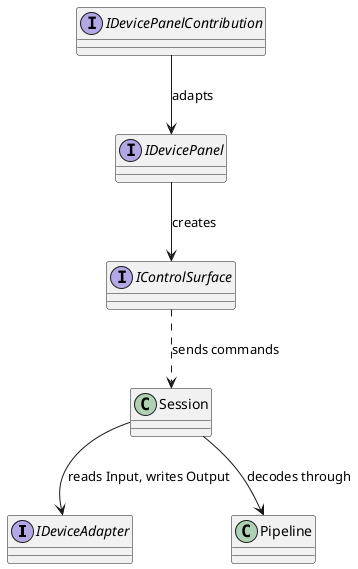

# DevTerm parity: API design

**Status:** Draft · **Date:** 2026-10-29 · **Related:** [Requirements](requirements.md) · [Architecture](architecture.md) · [Restructure plan](../../design/DevTermParity/restructure-plan.md) · [Testing strategy](testing-strategy.md)

## Contents

- [Contracts](#contracts)
- [Registration](#registration)
- [Configuration](#configuration)
- [Errors](#errors)

### List of Figures

- Figure 1 — Contract relationships

### List of Tables

- Table 1 — Contract homes

## Contracts

**Table 1 — Contract homes**

| Contract | Project | Namespace |
|----------|---------|-----------|
| `IDeviceAdapter`, `ConnectionState`, `ConnectionStateChangedEventArgs` | `OoBDev.System.Abstractions` | `OoBDev.System.IO` |
| `IDeviceConfigEditor`, `DeviceConfigTarget` | `OoBDev.System.Abstractions` | `OoBDev.System.IO.Devices` |
| `IControlSurface`, `ICommandPreview`, `IStructuredPresenter`, `IDevicePanel`, `IDeviceDecoder`, `DeviceSend`, `UiDefinition` | `OoBDev.System.Abstractions` / `OoBDev.UiDefinitions` | `OoBDev.UiDefinitions` |
| `IDevicePanelContribution` | `OoBDev.DevTerm.Core` | `OoBDev.DevTerm.Configuration` |

The adapter contract, in short:

```csharp
public interface IDeviceAdapter : IAsyncDisposable
{
    string Type { get; }
    string Path { get; }
    ConnectionState State { get; }
    event EventHandler<ConnectionStateChangedEventArgs> StateChanged;
    PipeReader Input { get; }
    PipeWriter Output { get; }
    Task OpenAsync(CancellationToken cancellationToken = default);
    Task CloseAsync(CancellationToken cancellationToken = default);
}
```



*Figure 1 — Contract relationships*

Stream-based callers use `AsStream(this IDeviceAdapter)` from `OoBDev.System.IO.Pipelines`; the stream adapters derive from `StreamDeviceAdapter`.

## Registration

`OoBDev.DevTerm.Core` registers with `TryAdd*` in its `ServiceCollectionExtensions`. `AddDevTermDevicePanels()` registers a `DevicePanelContribution` per `IDevicePanel` found in DI and a `DeviceDecoderPresenter` per `IDeviceDecoder`. The device bundle `OoBDev.DevTerm.Devices` adds the device libraries' panels so Core never references them. Each front end composes: Core, its transports, the bundle, then its shell services.

## Configuration

Connection settings are typed options bound in the composition root. A sample connection:

```json
{
  "DevTerm": {
    "Connections": [
      { "Name": "Bench DMM", "Transport": "tcp", "Host": "10.0.0.7", "Port": 5025, "Panel": "scpi" }
    ]
  }
}
```

The schema ids are `oobdev://devterm/schemas/<file>`; the generator is `SchemaGenerator.Generate()`.

## Errors

Adapters report failures as `ConnectionState.Faulted` through `StateChanged`; `OpenAsync` and `CloseAsync` throw only for programming errors and cancellation. Decoders never throw on bad bytes: they yield a decoded value with an error marker. Front ends show faults in the status area and keep the session list intact.
