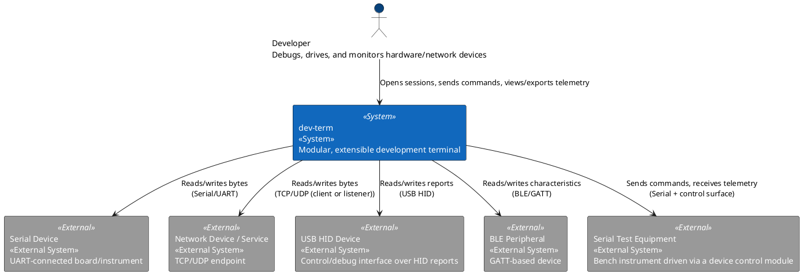
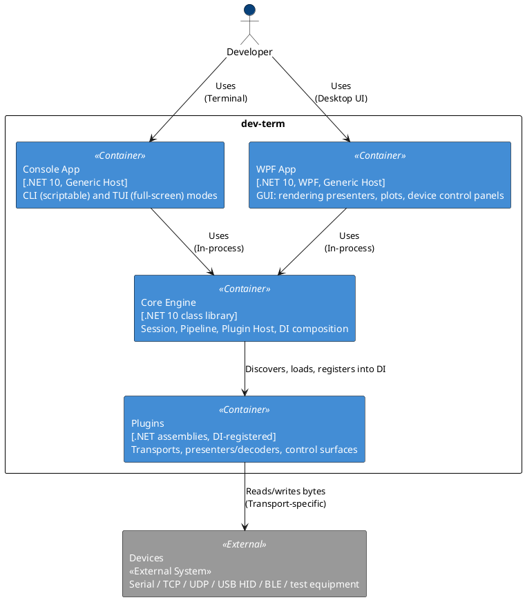
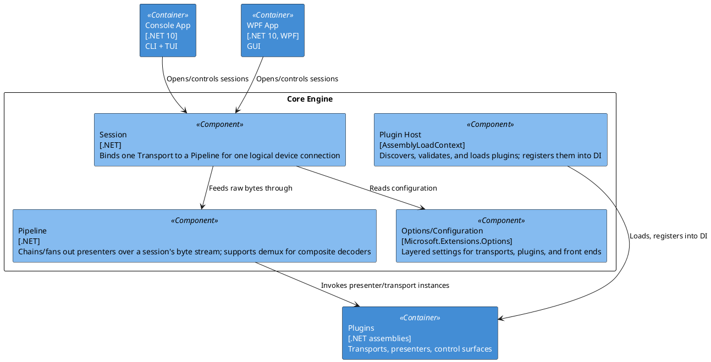

# Architecture Overview

## Purpose

Describes the high-level architecture of dev-term: the core abstractions, how data flows from a device to a screen (and back), and how transports/presenters/front ends stay independent of each other.

## Design principles

- Separate the three concerns cleanly: **transport** (getting bytes to/from a device), **interpretation** (turning bytes into something meaningful), and **presentation** (showing it to the user, in whichever front end they're using).
- Everything a device- or protocol-specific extension point (transports, presenters/decoders) is a plugin against a small, stable contract — the core never has device- or protocol-specific knowledge baked in.
- Core is UI-agnostic and transport-agnostic; it knows about `ITransport` and `IPresenter`, never about "the serial transport" or "the HPGL decoder" specifically.
- Async/streaming first — devices produce bytes at arbitrary times, not in request/response lockstep, and byte-level and message-level views must both stay live.
- Composition is standard .NET dependency injection, all the way down: the core, every plugin, and both front ends are wired together through `Microsoft.Extensions.DependencyInjection`/Generic Host, not through ad hoc `new`s or service locators. See [platform.md](platform.md).

## Core concepts

### Session

A `Session` binds one `ITransport` instance to a pipeline of presenters for a single logical connection to a device. Multiple sessions can be open concurrently (e.g., watching two serial ports, or a serial port and a TCP bridge, side by side).

**Errors and disconnects (2026-09-25).** A connection can end on its own: the read side fails (an unplugged cable, a reset socket, a presenter throwing while rendering), the device or peer closes it, or a send fails. In each case the session closes itself and raises `Session.Disconnected` once, with the failure or `null` for a clean hang-up. It raises it before a failed `SendAsync` rethrows, so the event is the single place a front end reports a lost connection. It isn't raised for a caller's own `CloseAsync`/`DisposeAsync`. `CloseAsync` is safe to call at any time and never throws for a transport-close failure, and `OpenAsync` reconnects the same session afterward. Open/close/fault are serialized, and a fault from an earlier connection is ignored once a newer one exists.

Every front end builds on that the same way:
- Input the parser can't encode is rejected before anything is sent (`DevTerm.Configuration.TypedInput`), leaving the connection alone.
- A device-side failure disconnects and is reported through `Disconnected` (`ConnectionErrorMessages.ForDisconnect`).
- The user resumes from there: File > Connect in the TUI/WPF, or simply the next typed line in the CLI.
- A failed *startup* connect opens the TUI/WPF disconnected instead of exiting.

**Observers (2026-09-25).** `Session.AddObserver(ISessionObserver)` is a passive tap on the raw
traffic and lifecycle. It sees each received chunk just before the pipeline renders it, each send
just before the transport write, and each open and close. It sits outside the pipeline, so attaching
one never changes what a presenter renders, and an observer that throws is ignored. The session
logger is built on it. See [session-logging.md](../../../design/SessionLogging/session-logging.md).

### Transport

`ITransport` — abstraction over a byte- or message-oriented, full-duplex (or receive-only) connection to a device: connection lifecycle (discover/open/close), device-specific configuration, and streaming bytes in and out. See [transports.md](../../../design/Transports/transports.md).

### Presenter

`IPresenter` — turns a raw byte stream into a viewable (and, where it makes sense, editable/sendable) representation. Presenters range from simple text/numeric-base views to stateful protocol decoders to renderers that produce graphics and export files. See [presenters.md](../../../design/Presenters/presenters.md).

### Pipeline

A session's pipeline is a chain of presenters/decoders that a raw byte stream flows through, fanning out to one or more simultaneous views — e.g., raw hex and a decoded protocol view of the same stream at once, or a byte-unframer (SLIP/COBS) feeding an inner decoder.

The pipeline isn't always a straight line: a **composite/channelized decoder** can demultiplex a single stream into several named channels (split by a header/discriminator byte, a time slot, or similar framing), each of which is then handed to its own sub-presenter — which might itself be a different text encoding, a different numeric base, or another nested decoder. See [presenters.md](../../../design/Presenters/presenters.md) for detail; this is the model for interlaced telemetry where different fields of the same frame carry differently-encoded data.

### Device control modules

Not every plugin is passive. A **device control module** composes a control surface (outbound commands/parameters that encode to bytes) with one or more presenters (typically a telemetry decoder and a rendering/plot presenter for the response) into one packaged plugin for driving and monitoring a specific piece of equipment — e.g., serial-based test equipment. It's built entirely out of the existing transport/presenter contracts rather than a separate pipeline mechanism. See [device-control-modules.md](../../../design/UiDefinitions/device-control-modules.md).

### Plugin host

Transports and presenters are discovered and loaded as plugins against versioned contracts, registering themselves into the shared DI container rather than being compiled into the core or the front ends. See [plugin-model.md](../../../design/Plugins/plugin-model.md).

### Front ends

Three deployable applications sharing the same core engine and DI composition: a console app (offering both CLI and TUI modes), a WPF app (GUI) and a loopback-only web host (`DevTerm.Web`). They share sessions, transports, and presenter plugins, differing only in how they render and how the user interacts. See [frontends.md](frontends.md) and [platform.md](platform.md).

## Architecture diagrams (C4)

Structural diagrams in these docs follow the [C4 model](https://c4model.com) using the standard [C4-PlantUML](https://github.com/plantuml-stdlib/C4-PlantUML) macros (`Person`, `System`, `Container`, `Component`, `Rel`, ...), included from the stdlib rather than drawn as plain boxes.

### System context

### Containers

### Core Engine components

## Non-goals (for now)

- Not a full protocol-analysis suite (e.g., not aiming to replace Wireshark for deep packet inspection) — the focus is device development/debugging workflows.
- Not initially targeting mobile platforms.

## Open questions

- ~~Plugin isolation mechanism: in-process vs. out-of-process~~ Both are built: in-process modules load into an `AssemblyLoadContext`, out-of-process presenters run as a child process (see [plugin-model.md](../../../design/Plugins/plugin-model.md)).
- ~~Whether presenters/decoders can also *originate* traffic~~ **Decided 2026-10-03: yes.** A presenter may generate data to feed back in as a simulation, or act as a virtual device of its own (it pairs with the loopback transport and the broker routing idea). Built 2026-10-03 as `IOriginatingPresenter`; see `Session.AddPresenter`.
- ~~Cross-session scripting/automation model for the CLI front end.~~ Decided 2026-10-13: attach to a named session (the profile-name pipe, see the cross-process control channel proposal), then use the ordinary REPL commands. Built 2026-10-14: `--attach <name> --cli true` (`AttachCliMode`).
