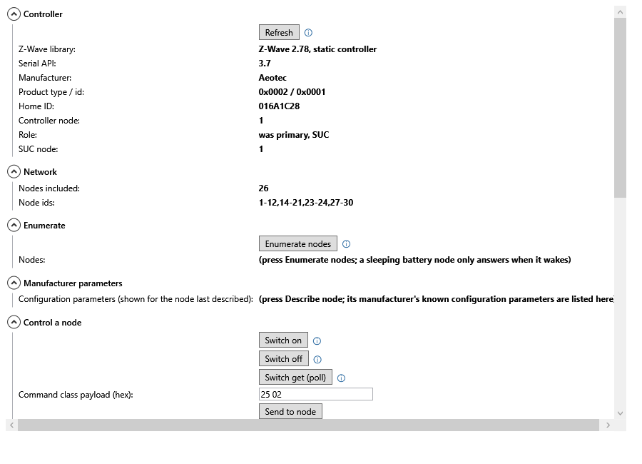

# Looking at a Z-Wave network through a Z-Stick

Plug in the controller (an Aeotec Z-Stick S2 appears as a virtual COM port; check with `--listports true`), then connect at 115200 8N1 with the `zwave` presenter so replies are decoded. Field-by-field reference: [`docs/specs/zwave-panel.md`](../specs/zwave-panel.md). The plugin is `src/DevTerm.Devices.ZWave`.

```
dotnet run --project src/DevTerm.Console -- --transport serial --port COM13 --baud 115200 --presenter zwave --parser zwave --cli true
```

Type a function id in hex and Enter; the `zwave` parser frames it and sends an ACK first. Real output from the bench ([report](../test/2026-10-26-15-43-09.md)):

```
15
[zwave] RES GetVersion: Z-Wave 2.78, static controller
20
[zwave] RES MemoryGetId: home ID 016A1C28, this controller is node 1
02
[zwave] RES SerialApiGetInitData: 26 nodes (1-12,14-21,23-24,27-30), API version 5, chip 3 v1
41 02
[zwave] RES GetNodeProtocolInfo: listening, routing, Routing Slave, Binary Switch (specific 0x01)
56
[zwave] RES GetSucNodeId: SUC is node 1
```

A typed line starting with `01` and longer than one byte is sent as a complete frame; anything else is `function [payload...]`, sent as a request. In the CLI nothing ACKs the stick's own callbacks, so a radio command (`13 ...`, SendData) to a node that does not answer repeats its callback; use the panel for that.

In the TUI or WPF choose **Device > Z-Wave controller...**. **Refresh** fills the Controller and Network sections; pick a node number, then **Node info** (cheap, answered by the stick) or **Basic Get** (radio traffic). Nothing in the panel changes a paired device.

## Set the baud rate to 115200 first

The Z-Stick talks at **115200 baud, 8N1**, but dev-term's serial default is 9600. At 9600 the stick never answers, so a panel opened on a default connection looks dead. In the Connection editor (or a saved profile) set **Baud** to `115200` and reconnect. If you forget, **Refresh** waits about 2.5 seconds and reports "The Z-Stick did not reply. It talks at 115200 baud, 8N1: set Baud to 115200 in the connection and reconnect."

## What the panel looks like

After **Refresh** against the real stick (frames captured on the bench; the screenshots are regenerated by `ControlPanelScreenshotTests`):



```text
┌┤dev-term - Z-Wave controller├────────────────────────────────────────────────┐
│[-] Controller                                                               ▲│
│                     ⟦ Refresh ⟧  (i)                                        █│
│  Z-Wave library:    Z-Wave 2.78, static controller                          █│
│  Serial API:        3.7                                                     █│
│  Manufacturer:      Aeotec                                                  █│
│  Product type / id: 0x0002 / 0x0001                                         █│
│  Home ID:           016A1C28                                                ░│
│  Controller node:   1                                                       ░│
│  Role:              was primary, SUC                                        ░│
│  SUC node:          1                                                       ░│
│                                                                             ░│
│[-] Network                                                                  ░│
│  Nodes included: 26                                                         ░│
│  Node ids:       1-12,14-21,23-24,27-30                                     ░│
│                                                                             ░│
│[-] Enumerate                                                                ░│
│                   ⟦ Enumerate nodes ⟧  (i)                                  ░│
│  Nodes:           (press Enumerate nodes; a sleeping battery node only answe░│
│                                                                             ░│
│[-] Manufacturer parameters                                                  ▼│
│◄█████████████████████████████████████░░░░░░░░░░░░░░░░░░░░░░░░░░░░░░░░░░░░░░► │
│                                                                              │
│                                                                              │
└──────────────────────────────────────────────────────────────────────────────┘
```

A ready-made connection profile, **Aeotec Z-Stick S2** (COM13, 115200 8N1, `zwave` presenter and parser), is saved under `~/.dev-term/profiles/`; pick it in Device Profiles, or run `--profile "Aeotec Z-Stick S2"`. Change `Port` if the stick enumerates elsewhere. The repo's `launchSettings.json` has the same as the **Z-Stick S2 COM13** launch profile.

## Listing, controlling and managing the network

These panel sections go beyond reading. Adding and removing a device have been run against the real stick (see below); Reset network, learn mode, Configuration set and switching a node have not, so try those on a bench network you can afford to change.

- **Enumerate nodes** reads the node list and asks every node about itself. The **Nodes** box is an aligned table, one row per node, with columns Node, Device, Product (manufacturer and product name), Version and Classes (a count).

  A sleeping battery node answers only when it wakes, so it may show only what the stick already knows. On the bench, node 2 is a GE 45603 plug-in appliance module (an outlet relay), which has no manufacturer configuration parameters.
- **Describe node** (in Query a node) asks one node for its command classes, versions, groups and manufacturer. The **Manufacturer parameters** section then lists that product's known configuration parameters, one per line (number, label, size, range, default, named values). A simple relay like the GE 45603 has none; a product with parameters (e.g. an Aeotec module) lists them, and **Configuration get / set** reads or writes one: type `81` to read parameter 81, or `81 1` to set it to 1 (a third number sets the size in bytes).
- **Control a node**: set **Node id**, then **Switch on / off / get**. For anything else type the command-class bytes in hex (e.g. `26 01 32`) and press **Send to node**. The **(i)** next to each button shows the exact bytes.
- **Add device** (verified on the real stick): press it, then put the device in inclusion mode (usually a button press on the device). **Last network event** and the terminal show `ready`, `node found`, `adding slave node N` and `include done node N`. Press **Stop adding** if nothing joins.
- **Remove device** works the same way for exclusion. **Stop removing** cancels.
- **Join another network (secondary)** puts the stick in learn mode so another network's controller can include it, making it a secondary controller there. It asks first; **Stop learn mode** cancels.
- **Reset network (new home ID)** asks first and **erases every pairing**: all devices must be re-included afterwards. Use it only when you mean to start over.
- **Heal node**, **Request node info**, **Is node failed?** and **Remove failed node** maintain the controller's node table; remove-failed only removes a node the controller already considers failed.
