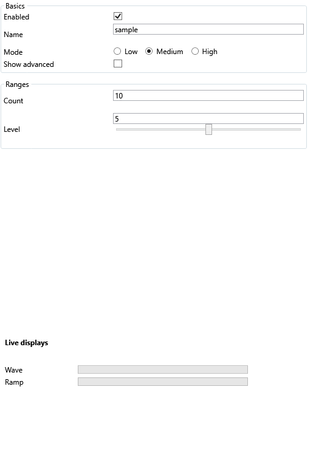
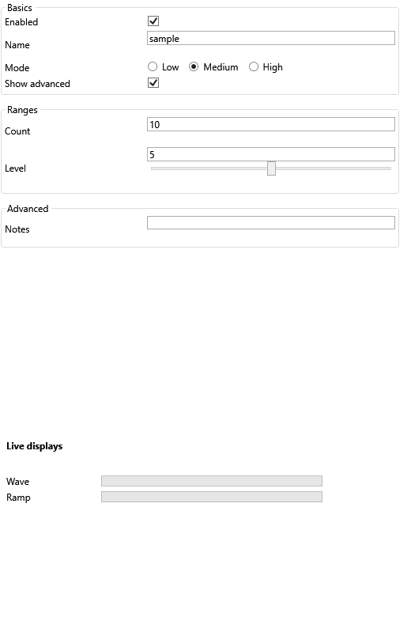
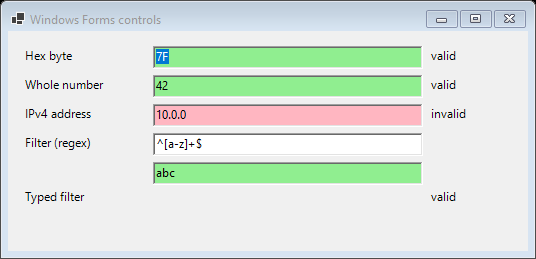
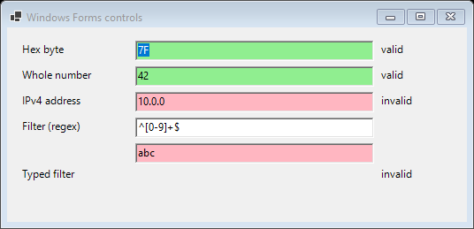
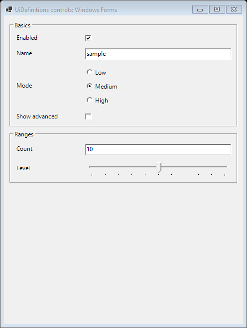
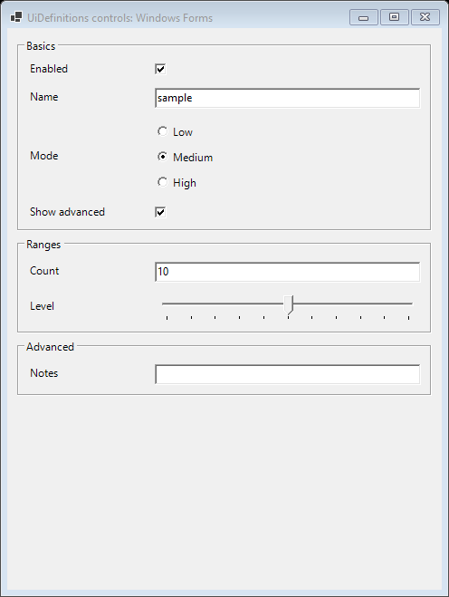
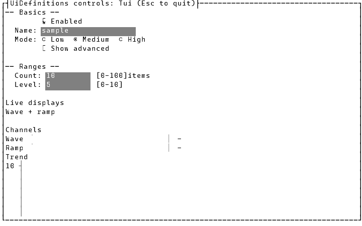
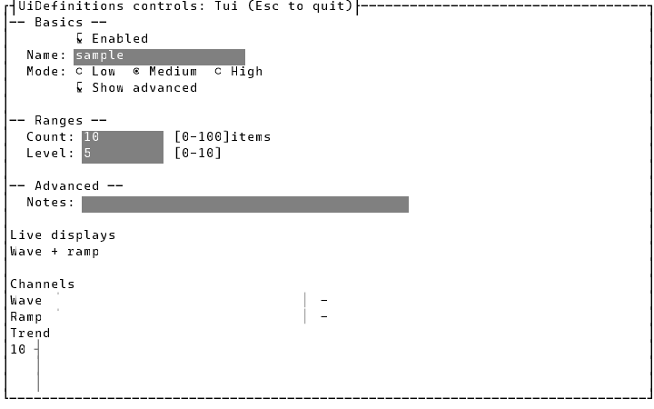
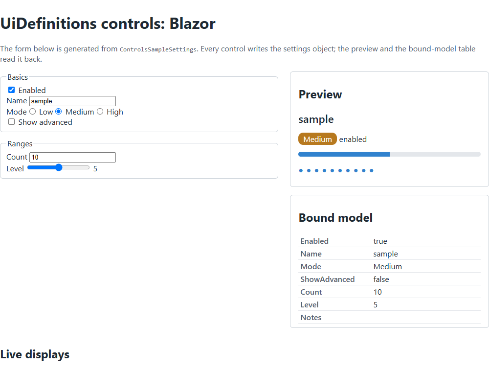
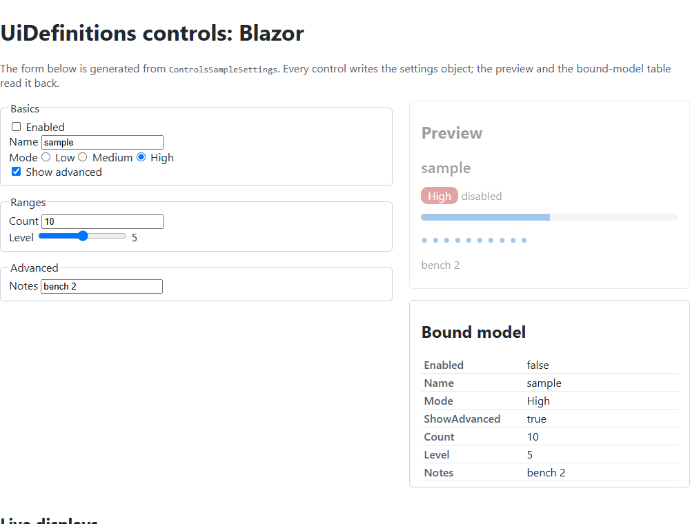

# Controls example guide

The control examples render one settings class (`ControlsSampleSettings`) through the `OoBDev.UiDefinitions` form renderers. Each framework has a journey test (category `DevLocal`) that drives the real controls and saves the screenshots below; the committed image changes only when the masked capture differs (`image-mask sync`). Design: [GeneratedGuides](../../../design/GeneratedGuides/README.md).

## Contents

- [WPF](#wpf)
- [WinForms](#winforms)
- [Tui](#tui)
- [Blazor](#blazor)
- [How the images are made](#how-the-images-are-made)

## WPF

The window starts with the Advanced group hidden. Ticking **Show advanced** reveals it.

*Figure 1 — WPF, initial state*

*Figure 2 — WPF after ticking Show advanced*

## WinForms

Typing in the filter box narrows the rows.

*Figure 3 — WinForms, initial state*

*Figure 4 — WinForms with a filter typed*

The settings dialog is the same class in a second window. Ticking Show advanced reveals the Notes row.

*Figure 5 — WinForms settings dialog, initial state*

*Figure 6 — WinForms settings dialog after ticking Show advanced*

## Tui

Focus **Show advanced** and press Space.

*Figure 7 — Tui, initial state*

*Figure 8 — Tui after pressing Space on Show advanced*

## Blazor

Every control writes the settings object; the preview card and the bound-model table read it back.

*Figure 9 — Blazor, initial state*

*Figure 10 — Blazor after choosing High, showing Advanced, typing a note and clearing Enabled*

## How the images are made

| Framework | Test | Capture |
|-----------|------|---------|
| WPF | `OoBDev.Examples.Controls.Wpf.Tests/ControlsJourneyTests.cs` | window rendered off-screen to a bitmap |
| WinForms | `OoBDev.Examples.Controls.WinForms.Tests/ControlsJourneyTests.cs` | `DrawToBitmap` of the form shown off-screen |
| Tui | `OoBDev.Examples.Controls.Tui.Tests/ControlsJourneyTests.cs` | headless screen buffer drawn cell by cell |
| Blazor | `OoBDev.Examples.Controls.Blazor.Tests/ControlsJourneyTests.cs` | the example runs as a process, Edge drives it through Playwright (inconclusive when Edge cannot launch) |

**Table 1 — Journey tests and capture methods**

Shared helpers are in `src/Examples/OoBDev.Examples.TestUtilities`. Run with `dotnet test src/Examples/<project> --filter TestCategory=DevLocal`.
