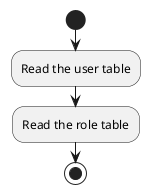
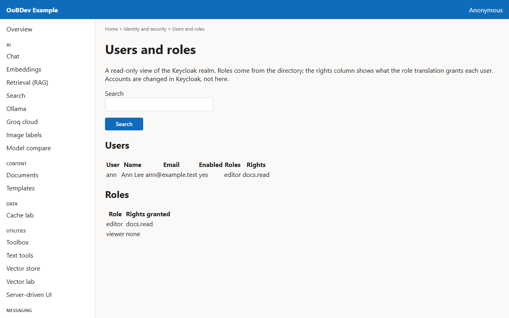

<!-- Generated by the Playwright journeys (src/Examples/OoBDev.Example.Web/e2e). Do not edit by hand: change the journey and rerun `npm run e2e`. This guide is rebuilt on every run. -->

# Browse users and roles

[User guides](README.md) | [Spec](../specs/browse-users-and-roles.md) | [Run book](../runbooks/browse-users-and-roles.md)

## Contents

- [Goal](#goal)
- [Why use it](#why-use-it)
- [Before you start](#before-you-start)
- [Journey at a glance](#journey-at-a-glance)
- [Steps](#steps)

## Goal

**Who:** An administrator checking who can do what.

See the realm users with their roles and the application rights those roles grant.

## Why use it

Answer "why can this person do that" without opening the Keycloak console; the screen is read-only.

## Before you start

- Sign-in is configured and the signed-in user holds the identity.read right.
- The Keycloak service account has the view-users and view-realm roles.

Related framework features: OoBDev.Keycloak (`KeycloakDirectoryReader`); OoBDev.AspNetCore.Abstractions (`IRoleRightMapper`).

## Journey at a glance

*Figure 1 — Browse users and roles: the steps in order*

## Steps

### 1. Read the user table

Each user shows their realm roles and the rights the role translation grants.

*Figure 2 — Read the user table*

### 2. Read the role table

The role table shows what each role grants, including roles that grant nothing.

*Figure 3 — Read the role table*
