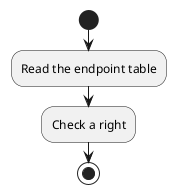
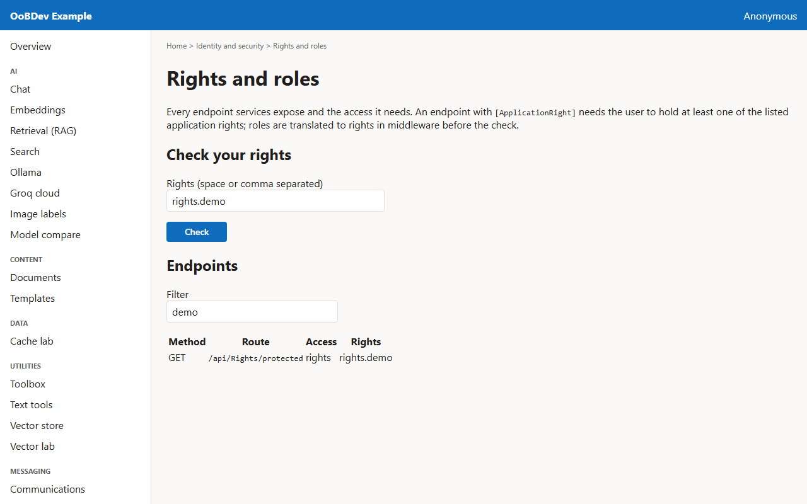
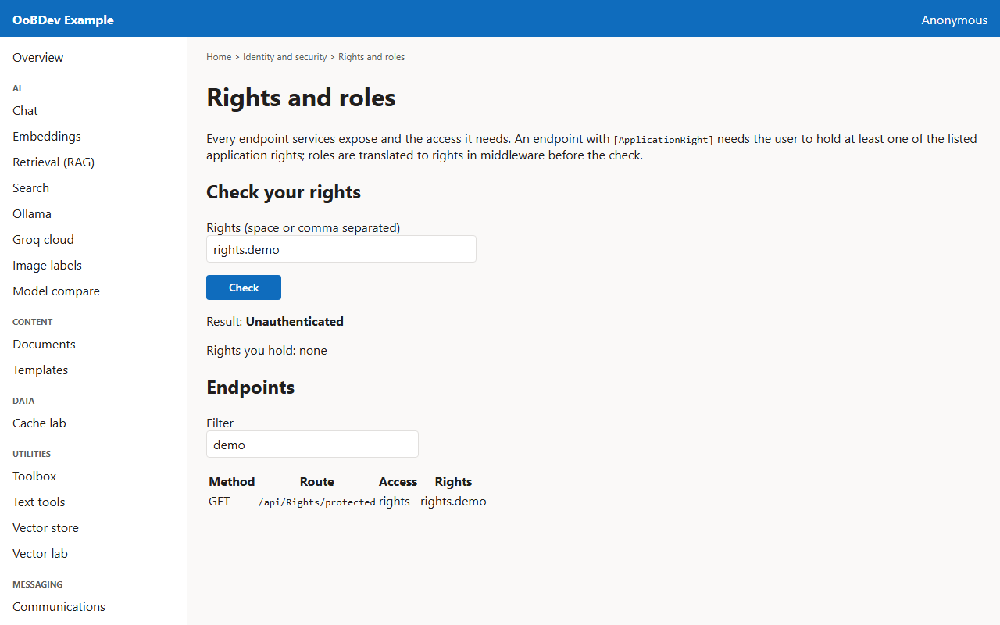

<!-- Generated by the Playwright journeys (src/Examples/OoBDev.Example.Web/e2e). Do not edit by hand: change the journey and rerun `npm run e2e`. This guide is rebuilt on every run. -->

# Check which rights an endpoint needs

[User guides](README.md) | [Spec](../specs/check-your-rights.md) | [Run book](../runbooks/check-your-rights.md)

## Contents

- [Goal](#goal)
- [Why use it](#why-use-it)
- [Before you start](#before-you-start)
- [Journey at a glance](#journey-at-a-glance)
- [Steps](#steps)

## Goal

**Who:** A developer working out why an API call is refused.

See the access each endpoint needs and check the current user against a right.

## Why use it

See the authorization model in one place: anonymous, authenticated or application rights, the same on every API surface.

## Before you start

- The example API is running.

Related framework features: OoBDev.AspNetCore.Abstractions (`[ApplicationRight]`, `IApplicationRightChecker`).

## Journey at a glance

*Figure 1 — Check which rights an endpoint needs: the steps in order*

## Steps

### 1. Read the endpoint table

Every endpoint is listed with its access. The filter narrows the list to a route or a right.

*Figure 2 — Read the endpoint table*

### 2. Check a right

Check asks the host whether the current user holds at least one of the listed rights.

*Figure 3 — Check a right*
