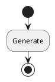
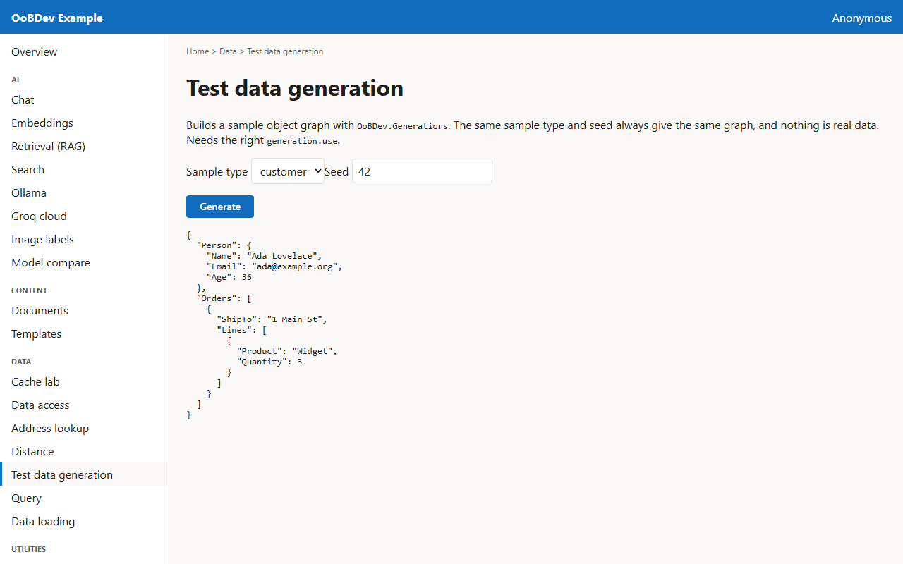

<!-- Generated by the Playwright journeys (src/Examples/OoBDev.Example.Web/e2e). Do not edit by hand: change the journey and rerun `npm run e2e`. This guide is rebuilt on every run. -->

# Generate test data

[User guides](README.md) | [Spec](../specs/generate-test-data.md) | [Run book](../runbooks/generate-test-data.md)

## Contents

- [Goal](#goal)
- [Why use it](#why-use-it)
- [Before you start](#before-you-start)
- [Journey at a glance](#journey-at-a-glance)
- [Steps](#steps)

## Goal

**Who:** A developer who needs repeatable sample data.

Build a sample object graph that is the same every time for the same seed.

## Why use it

Show seeded generation: the same type and seed give the same graph, so tests and demos are repeatable.

## Before you start

- The signed-in user holds the generation.use right (the admin role).

Related framework features: OoBDev.Generations (`Generator`).

## Journey at a glance

*Figure 1 — Generate test data: the steps in order*

## Steps

### 1. Generate

The customer sample and seed 42 are filled in; press Generate.

*Figure 2 — Generate*
