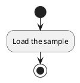
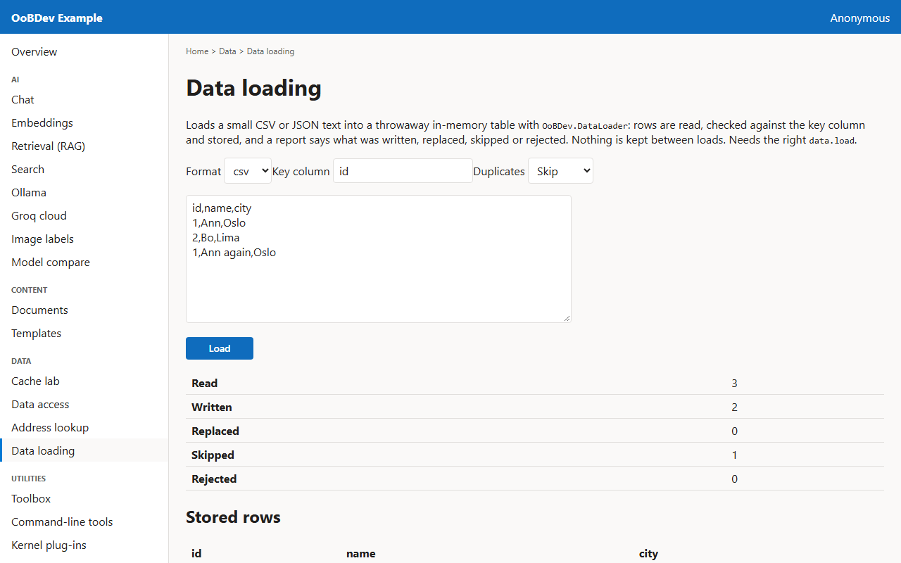

<!-- Generated by the Playwright journeys (src/Examples/OoBDev.Example.Web/e2e). Do not edit by hand: change the journey and rerun `npm run e2e`. This guide is rebuilt on every run. -->

# Load a file into a table

[User guides](README.md) | [Spec](../specs/load-a-file-into-a-table.md) | [Run book](../runbooks/load-a-file-into-a-table.md)

## Contents

- [Goal](#goal)
- [Why use it](#why-use-it)
- [Before you start](#before-you-start)
- [Journey at a glance](#journey-at-a-glance)
- [Steps](#steps)

## Goal

**Who:** A developer trying the data loader.

Load a small CSV into a throwaway table and read the report.

## Why use it

Show the read, key check and store steps with a report of what was written, skipped or rejected.

## Before you start

- The signed-in user holds the data.load right (the admin role).

Related framework features: OoBDev.DataLoader (`ILoader`, `CsvRowReader`, `InMemoryRowSink`).

## Journey at a glance

*Figure 1 — Load a file into a table: the steps in order*

## Steps

### 1. Load the sample

The sample CSV has a repeated id; press Load.

*Figure 2 — Load the sample*
