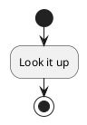
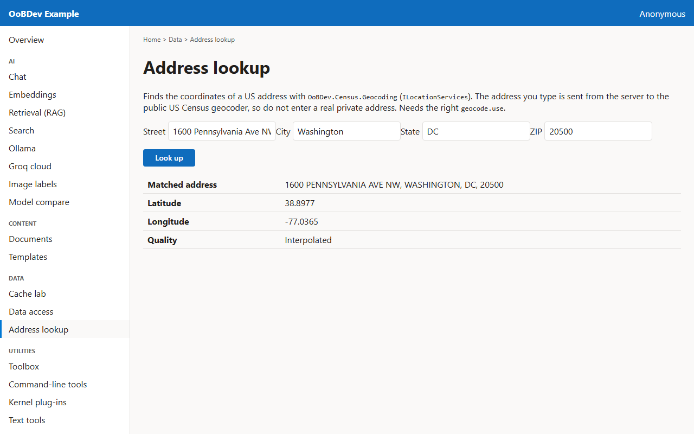

<!-- Generated by the Playwright journeys (src/Examples/OoBDev.Example.Web/e2e). Do not edit by hand: change the journey and rerun `npm run e2e`. This guide is rebuilt on every run. -->

# Look up an address

[User guides](README.md) | [Spec](../specs/look-up-an-address.md) | [Run book](../runbooks/look-up-an-address.md)

## Contents

- [Goal](#goal)
- [Why use it](#why-use-it)
- [Before you start](#before-you-start)
- [Journey at a glance](#journey-at-a-glance)
- [Steps](#steps)

## Goal

**Who:** A developer trying the spatial services.

Find the coordinates of a US address.

## Why use it

Show the location contract behind one provider; the same call works with any other provider registered for it.

## Before you start

- The API can reach the public US Census geocoder.
- The signed-in user holds the geocode.use right (the admin role).

Related framework features: OoBDev.SpatialServices (`ILocationServices`); OoBDev.Census.Geocoding (`CensusLocationServices`).

## Journey at a glance

*Figure 1 — Look up an address: the steps in order*

## Steps

### 1. Look it up

The sample White House address is filled in; press Look up.

*Figure 2 — Look it up*
