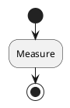
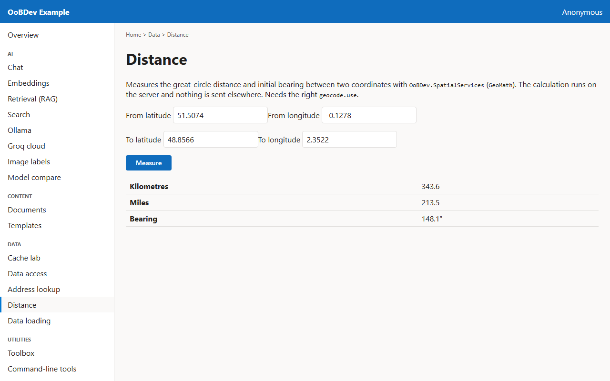

<!-- Generated by the Playwright journeys (src/Examples/OoBDev.Example.Web/e2e). Do not edit by hand: change the journey and rerun `npm run e2e`. This guide is rebuilt on every run. -->

# Measure a distance

[User guides](README.md) | [Spec](../specs/measure-a-distance.md) | [Run book](../runbooks/measure-a-distance.md)

## Contents

- [Goal](#goal)
- [Why use it](#why-use-it)
- [Before you start](#before-you-start)
- [Journey at a glance](#journey-at-a-glance)
- [Steps](#steps)

## Goal

**Who:** A developer trying the spatial services.

Find the distance and bearing between two coordinates.

## Why use it

Show the pure great-circle calculation that needs no external service.

## Before you start

- The signed-in user holds the geocode.use right (the admin role).

Related framework features: OoBDev.SpatialServices (`GeoMath`).

## Journey at a glance

*Figure 1 — Measure a distance: the steps in order*

## Steps

### 1. Measure

London and Paris are filled in; press Measure.

*Figure 2 — Measure*
