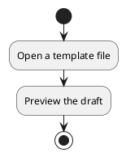
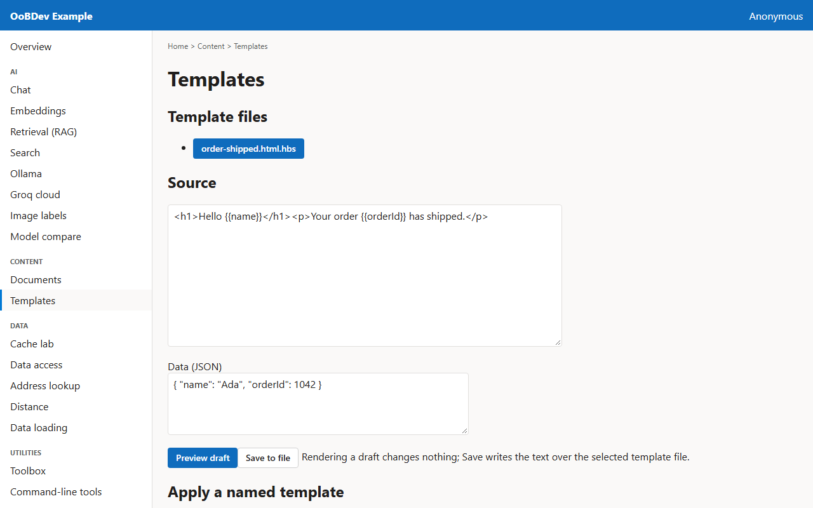
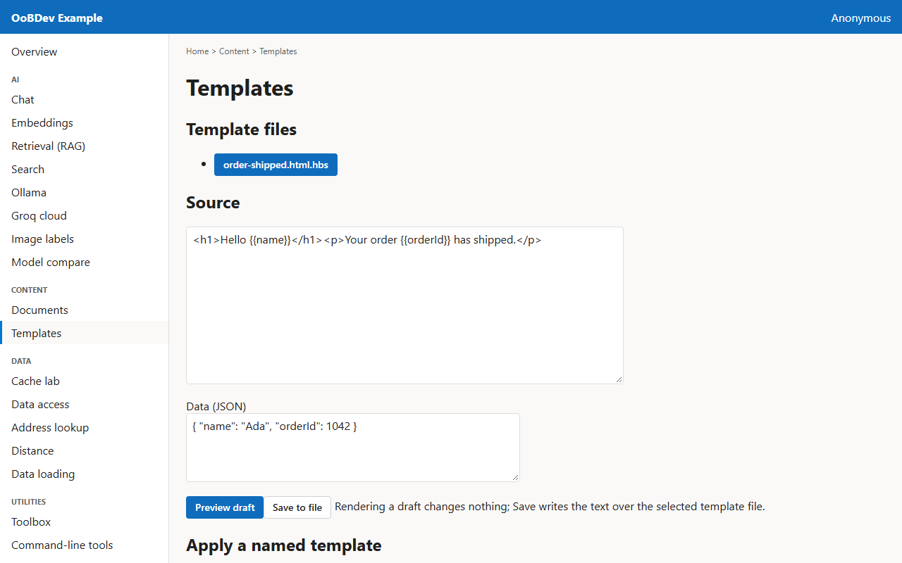

<!-- Generated by the Playwright journeys (src/Examples/OoBDev.Example.Web/e2e). Do not edit by hand: change the journey and rerun `npm run e2e`. This guide is rebuilt on every run. -->

# Open and preview a template

[User guides](README.md) | [Spec](../specs/preview-a-template.md) | [Run book](../runbooks/preview-a-template.md)

## Contents

- [Goal](#goal)
- [Why use it](#why-use-it)
- [Before you start](#before-you-start)
- [Journey at a glance](#journey-at-a-glance)
- [Steps](#steps)

## Goal

**Who:** A developer working with text templates.

Open a template file, change its text and see it rendered with sample data without saving anything.

## Why use it

Try a Handlebars template against JSON data and see the output at once, before wiring it into code.

## Before you start

- The example Templates folder holds the sample templates.

Related framework features: OoBDev.System (`ITemplateEngine`, `FileTemplateSource`); OoBDev.Handlebars.

## Journey at a glance

*Figure 1 — Open and preview a template: the steps in order*

## Steps

### 1. Open a template file

The list shows every template file; choosing one loads its text into the source box.

*Figure 2 — Open a template file*

### 2. Preview the draft

Preview renders the text in the box with the JSON data. Nothing is saved.

*Figure 3 — Preview the draft*
