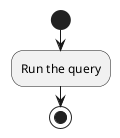
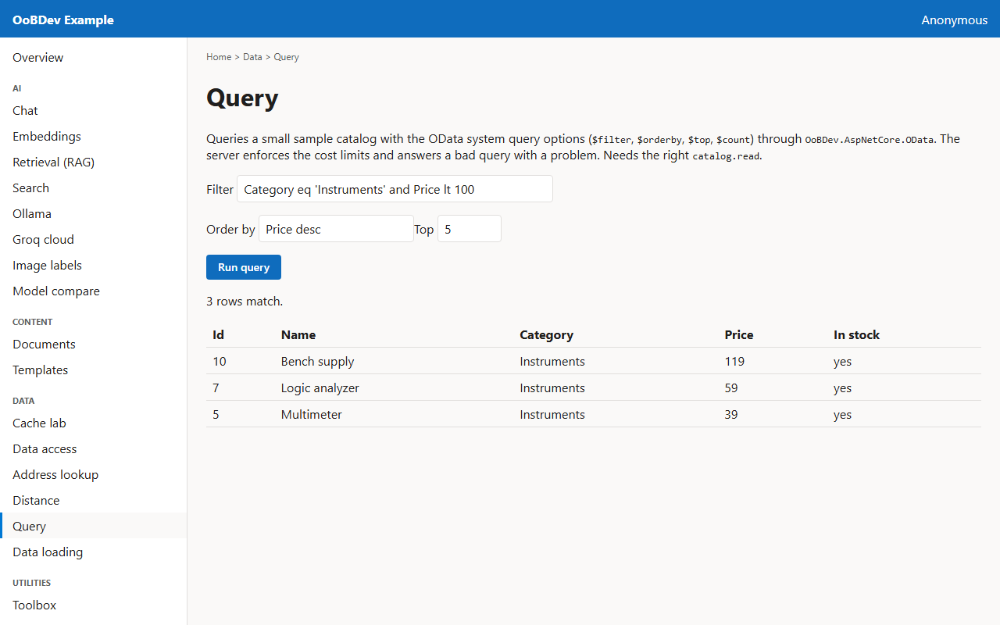

<!-- Generated by the Playwright journeys (src/Examples/OoBDev.Example.Web/e2e). Do not edit by hand: change the journey and rerun `npm run e2e`. This guide is rebuilt on every run. -->

# Query a catalog

[User guides](README.md) | [Spec](../specs/query-a-catalog.md) | [Run book](../runbooks/query-a-catalog.md)

## Contents

- [Goal](#goal)
- [Why use it](#why-use-it)
- [Before you start](#before-you-start)
- [Journey at a glance](#journey-at-a-glance)
- [Steps](#steps)

## Goal

**Who:** A developer trying the OData query surface.

Filter, sort and page the rows of a sample catalog with system query options.

## Why use it

Show that any IQueryable endpoint gets filtering, sorting and paging with cost limits and problem details errors.

## Before you start

- The signed-in user holds the catalog.read right (the admin role).

Related framework features: OoBDev.AspNetCore.OData (`[OoBDevEnableQuery]`, `$filter`, `$orderby`, `$top`, `$count`).

## Journey at a glance

*Figure 1 — Query a catalog: the steps in order*

## Steps

### 1. Run the query

The filter keeps the instruments under 100, sorted by price, highest first; press Run query.

*Figure 2 — Run the query*
