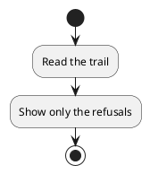
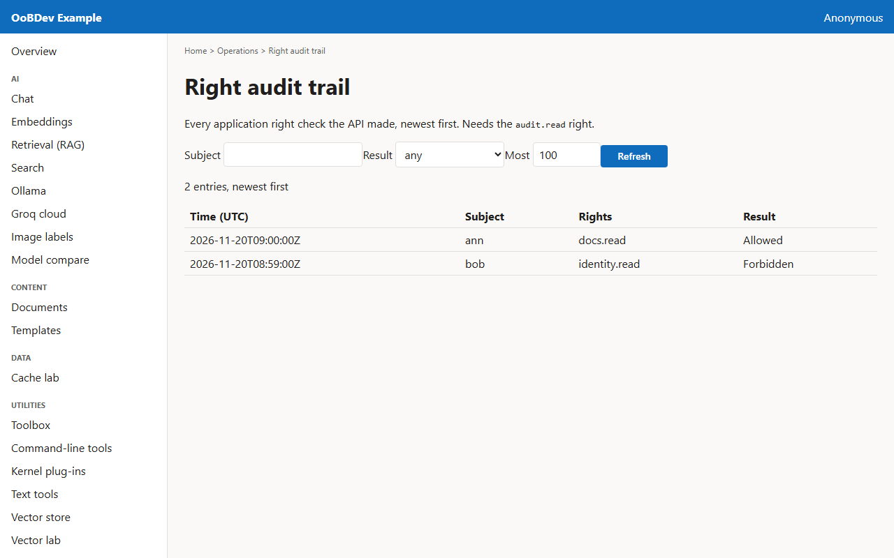
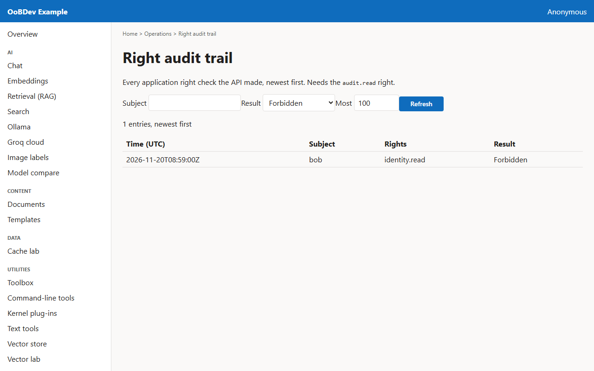

<!-- Generated by the Playwright journeys (src/Examples/OoBDev.Example.Web/e2e). Do not edit by hand: change the journey and rerun `npm run e2e`. This guide is rebuilt on every run. -->

# Review the right audit trail

[User guides](README.md) | [Spec](../specs/review-the-right-audit-trail.md) | [Run book](../runbooks/review-the-right-audit-trail.md)

## Contents

- [Goal](#goal)
- [Why use it](#why-use-it)
- [Before you start](#before-you-start)
- [Journey at a glance](#journey-at-a-glance)
- [Steps](#steps)

## Goal

**Who:** An operator looking into a refused call.

See which right checks the API allowed or refused, and narrow the list to the refusals.

## Why use it

Answer "who was refused, and for which right" from the durable trail, without reading logs.

## Before you start

- The example API runs with OoBDev:RightAudit:ConnectionString set.
- The signed-in user holds the audit.read right.

Related framework features: OoBDev.AspNetCore.Abstractions (`IApplicationRightChecker`); OoBDev.AspNetCore.EntityFrameworkCore (`TryAddEntityFrameworkRightAudit`).

## Journey at a glance

*Figure 1 — Review the right audit trail: the steps in order*

## Steps

### 1. Read the trail

Every right check is listed newest first with who asked, the rights and the result.

*Figure 2 — Read the trail*

### 2. Show only the refusals

Choose Forbidden as the result and refresh to narrow the list.

*Figure 3 — Show only the refusals*
