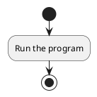
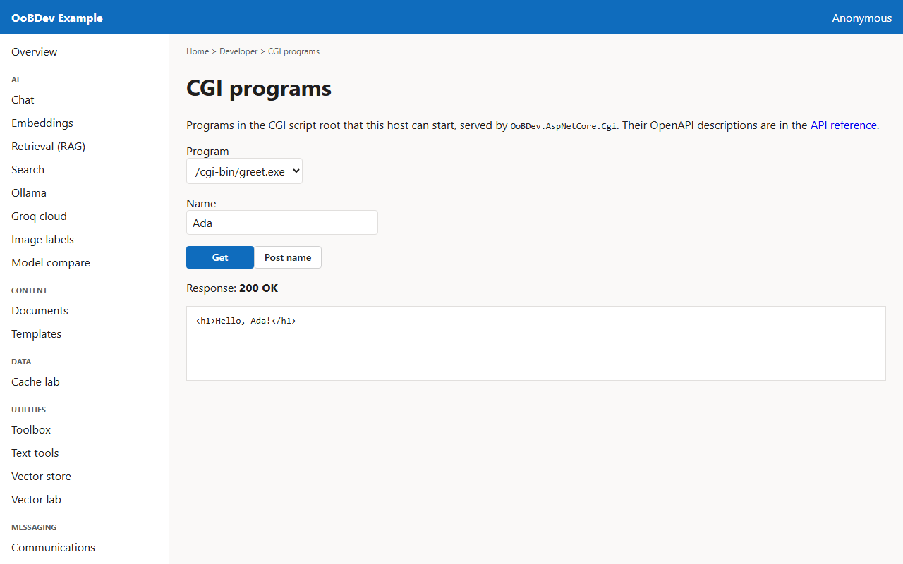

<!-- Generated by the Playwright journeys (src/Examples/OoBDev.Example.Web/e2e). Do not edit by hand: change the journey and rerun `npm run e2e`. This guide is rebuilt on every run. -->

# Run a CGI program

[User guides](README.md) | [Spec](../specs/run-a-cgi-program.md) | [Run book](../runbooks/run-a-cgi-program.md)

## Contents

- [Goal](#goal)
- [Why use it](#why-use-it)
- [Before you start](#before-you-start)
- [Journey at a glance](#journey-at-a-glance)
- [Steps](#steps)

## Goal

**Who:** A developer checking the CGI hosting.

Pick a program the host can start and see its answer.

## Why use it

See a CGI program answer through the middleware, with its status, without a command line.

## Before you start

- The example API is running and cgi-bin holds a program built for this system.

Related framework features: OoBDev.AspNetCore.Cgi; OoBDev.AspNetCore.Cgi.OpenApi.

## Journey at a glance

*Figure 1 — Run a CGI program: the steps in order*

## Steps

### 1. Run the program

The first program is selected. Get calls it with the name; the status and the page it returned are shown.

*Figure 2 — Run the program*
