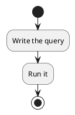
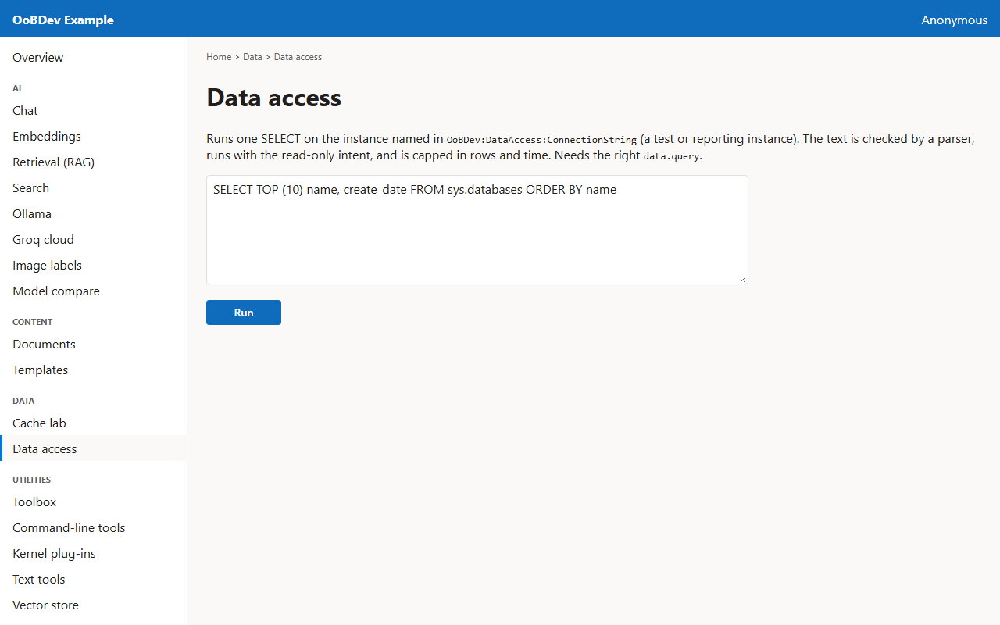
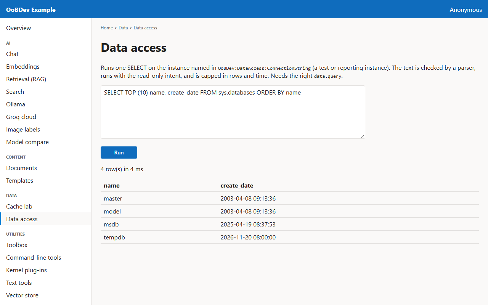

<!-- Generated by the Playwright journeys (src/Examples/OoBDev.Example.Web/e2e). Do not edit by hand: change the journey and rerun `npm run e2e`. This guide is rebuilt on every run. -->

# Run a read-only query

[User guides](README.md) | [Spec](../specs/run-a-read-only-query.md) | [Run book](../runbooks/run-a-read-only-query.md)

## Contents

- [Goal](#goal)
- [Why use it](#why-use-it)
- [Before you start](#before-you-start)
- [Journey at a glance](#journey-at-a-glance)
- [Steps](#steps)

## Goal

**Who:** A developer looking at rows in a test or reporting database.

Run one SELECT and read the rows, knowing nothing else can run.

## Why use it

Let a developer look at data without a path to change it: a parser allows one SELECT, the connection asks for the read-only intent, rows and time are capped, and the login permissions are the real guard.

## Before you start

- OoBDev:DataAccess:ConnectionString names a test or reporting instance, ideally a login that can only read.
- The signed-in user holds the data.query right (the admin role).

Related framework features: OoBDev.DacFx (`SelectOnlyGuard`); OoBDev.Example.WebApi (`ReadOnlyQueryRunner`).

## Journey at a glance

*Figure 1 — Run a read-only query: the steps in order*

## Steps

### 1. Write the query

The box holds one SELECT. Change it to what you want to see.

*Figure 2 — Write the query*

### 2. Run it

The rows appear in a table with the elapsed time; a note says when the cap cut the list short.

*Figure 3 — Run it*
