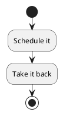
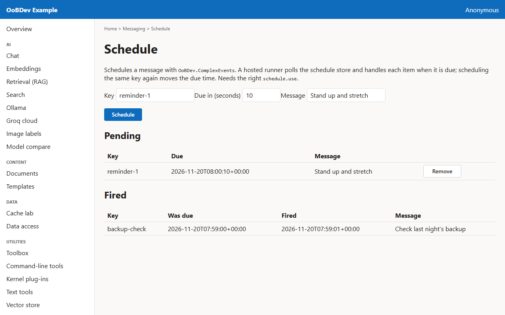
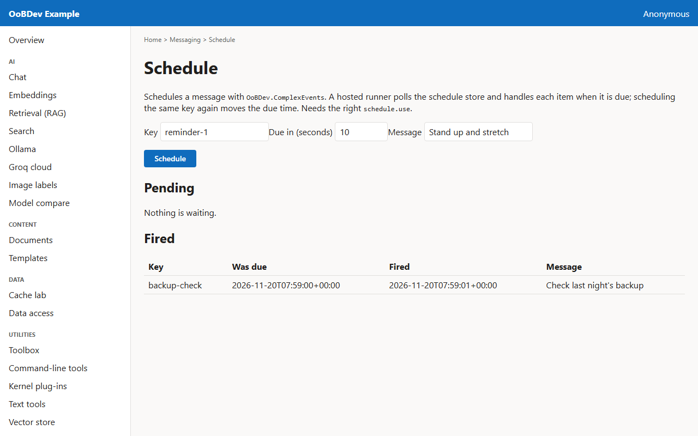

<!-- Generated by the Playwright journeys (src/Examples/OoBDev.Example.Web/e2e). Do not edit by hand: change the journey and rerun `npm run e2e`. This guide is rebuilt on every run. -->

# Schedule a message

[User guides](README.md) | [Spec](../specs/schedule-a-message.md) | [Run book](../runbooks/schedule-a-message.md)

## Contents

- [Goal](#goal)
- [Why use it](#why-use-it)
- [Before you start](#before-you-start)
- [Journey at a glance](#journey-at-a-glance)
- [Steps](#steps)

## Goal

**Who:** A developer trying the scheduling building block.

Schedule a message for later, see it wait, and take it back before it is due.

## Why use it

Show a due-time event store with a hosted runner: items are leased so two instances never run the same one, and registering the same key again moves the due time.

## Before you start

- The API runs with its hosted services on (not DISABLE_HOSTING=true).
- The signed-in user holds the schedule.use right (the admin role).

Related framework features: OoBDev.ComplexEvents (`IScheduleStore`, `ScheduleRunner`); OoBDev.ComplexEvents.Hosting (`ScheduleHost`).

## Journey at a glance

*Figure 1 — Schedule a message: the steps in order*

## Steps

### 1. Schedule it

Give the item a key, a delay and a message, then press Schedule.

*Figure 2 — Schedule it*

### 2. Take it back

Remove drops a pending item before it is due, so it never fires.

*Figure 3 — Take it back*
