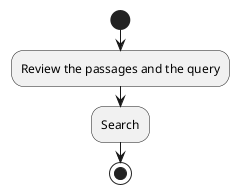
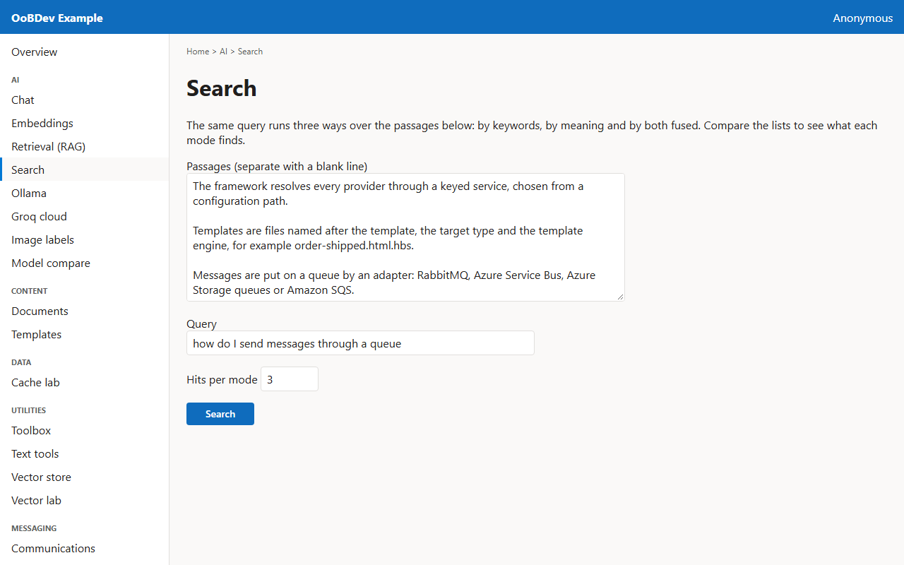
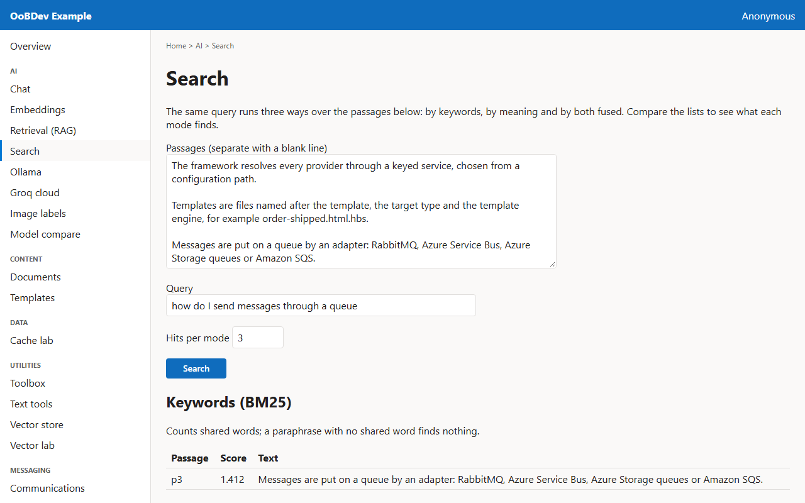

<!-- Generated by the Playwright journeys (src/Examples/OoBDev.Example.Web/e2e). Do not edit by hand: change the journey and rerun `npm run e2e`. This guide is rebuilt on every run. -->

# Search passages by keyword, meaning and both

[User guides](README.md) | [Spec](../specs/search-three-ways.md) | [Run book](../runbooks/search-three-ways.md)

## Contents

- [Goal](#goal)
- [Why use it](#why-use-it)
- [Before you start](#before-you-start)
- [Journey at a glance](#journey-at-a-glance)
- [Steps](#steps)

## Goal

**Who:** A developer choosing a search strategy.

Run one query three ways and see what each mode finds.

## Why use it

See why keyword search misses paraphrases, why embeddings rank everything, and how rank fusion combines them, with the scoring in plain view.

## Before you start

- The all-MiniLM embedder is available in the API.

Related framework features: OoBDev.Onnx.SentenceEmbeddings; OoBDev.AI.Abstractions (`IEmbeddingProvider`).

## Journey at a glance

*Figure 1 — Search passages by keyword, meaning and both: the steps in order*

## Steps

### 1. Review the passages and the query

Sample passages and a query are filled in. Separate your own passages with a blank line.

*Figure 2 — Review the passages and the query*

### 2. Search

The same query runs by keywords (BM25), by meaning (embeddings) and by reciprocal rank fusion of both.

*Figure 3 — Search*
