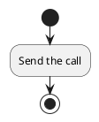
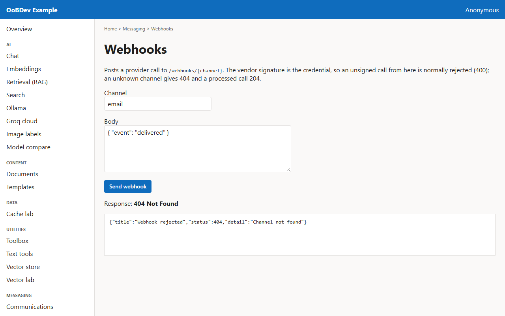

<!-- Generated by the Playwright journeys (src/Examples/OoBDev.Example.Web/e2e). Do not edit by hand: change the journey and rerun `npm run e2e`. This guide is rebuilt on every run. -->

# Send a webhook to a channel

[User guides](README.md) | [Spec](../specs/send-a-webhook.md) | [Run book](../runbooks/send-a-webhook.md)

## Contents

- [Goal](#goal)
- [Why use it](#why-use-it)
- [Before you start](#before-you-start)
- [Journey at a glance](#journey-at-a-glance)
- [Steps](#steps)

## Goal

**Who:** A developer testing inbound provider calls.

Post a provider call to a channel and see how the host answers.

## Why use it

See how the host answers a provider call: 204 when processed, 400 for a bad signature, 404 for an unknown channel.

## Before you start

- The example API is running.

Related framework features: OoBDev.Communications (`IReceiveService`).

## Journey at a glance

*Figure 1 — Send a webhook to a channel: the steps in order*

## Steps

### 1. Send the call

The channel and a sample body are filled in. The response status and problem details are shown.

*Figure 2 — Send the call*
