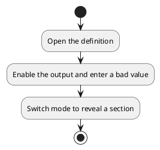
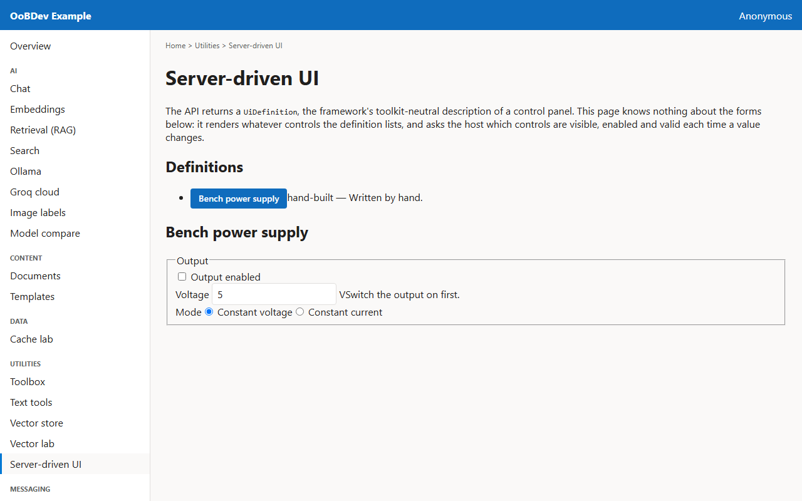
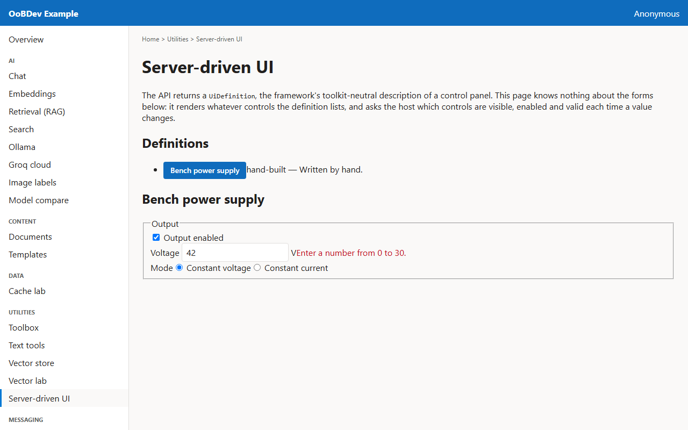
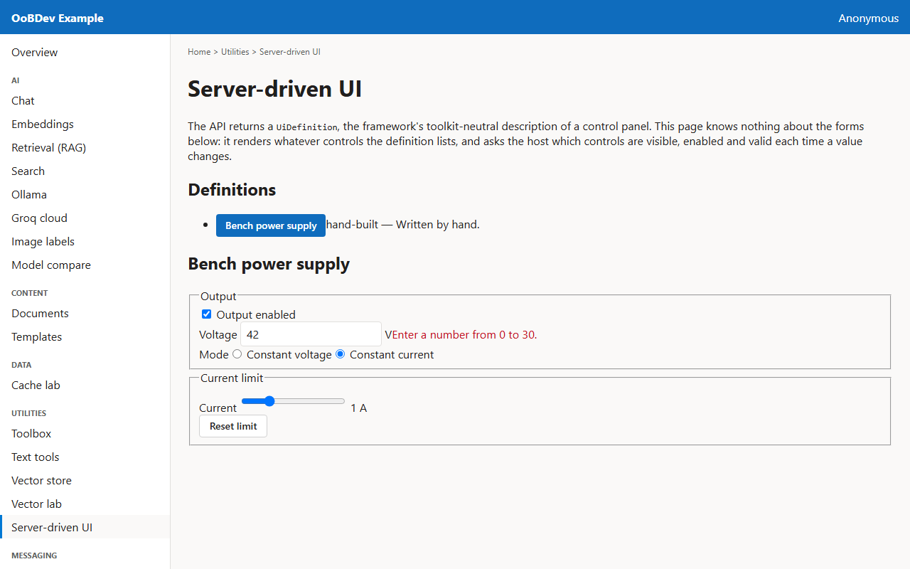

<!-- Generated by the Playwright journeys (src/Examples/OoBDev.Example.Web/e2e). Do not edit by hand: change the journey and rerun `npm run e2e`. This guide is rebuilt on every run. -->

# Render a panel from a server-supplied definition

[User guides](README.md) | [Spec](../specs/server-driven-ui.md) | [Run book](../runbooks/server-driven-ui.md)

## Contents

- [Goal](#goal)
- [Why use it](#why-use-it)
- [Before you start](#before-you-start)
- [Journey at a glance](#journey-at-a-glance)
- [Steps](#steps)

## Goal

**Who:** A developer who wants one UI contract for every front end.

Open a UI definition and watch the host decide which controls show, enable and validate.

## Why use it

See the framework UI contract rendered by a client that has no knowledge of the form.

## Before you start

- The example API is running.

Related framework features: OoBDev.UiDefinitions (`UiDefinition`, `ValueValidator`, `FormDefinitionGenerator`).

## Journey at a glance

*Figure 1 — Render a panel from a server-supplied definition: the steps in order*

## Steps

### 1. Open the definition

Pick the bench supply. The page fetches the definition and asks the host for each control state.

*Figure 2 — Open the definition*

### 2. Enable the output and enter a bad value

Switching the output on enables Voltage. A value above 30 is rejected by the host.

*Figure 3 — Enable the output and enter a bad value*

### 3. Switch mode to reveal a section

Choosing Constant current makes the Current limit section visible.

*Figure 4 — Switch mode to reveal a section*
