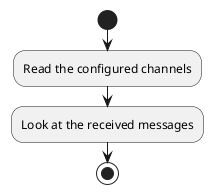
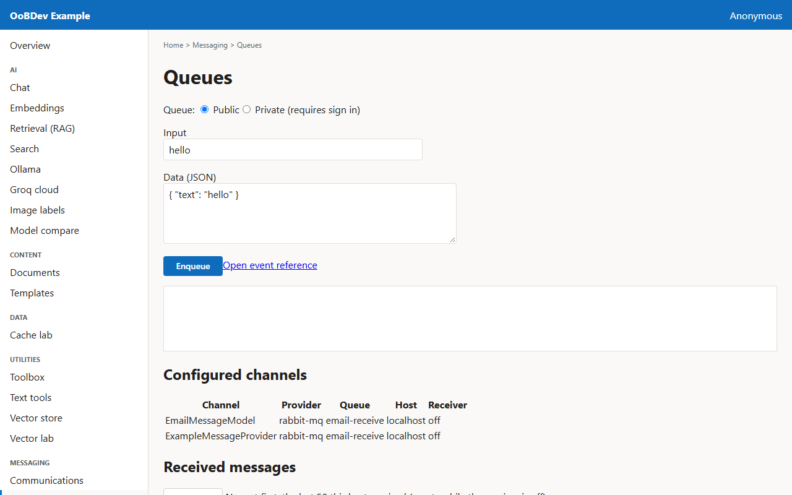
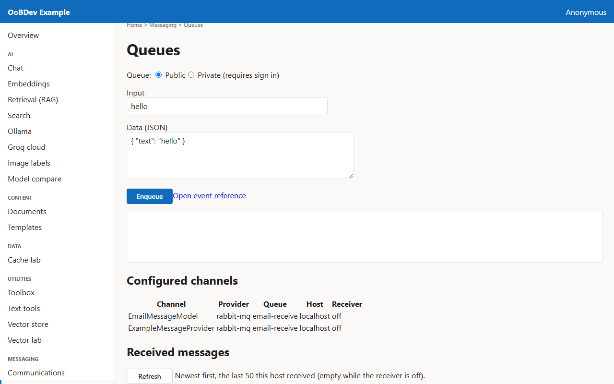

<!-- Generated by the Playwright journeys (src/Examples/OoBDev.Example.Web/e2e). Do not edit by hand: change the journey and rerun `npm run e2e`. This guide is rebuilt on every run. -->

# See the queue channels and received messages

[User guides](README.md) | [Spec](../specs/watch-the-queues.md) | [Run book](../runbooks/watch-the-queues.md)

## Contents

- [Goal](#goal)
- [Why use it](#why-use-it)
- [Before you start](#before-you-start)
- [Journey at a glance](#journey-at-a-glance)
- [Steps](#steps)

## Goal

**Who:** A developer checking the message queue wiring.

Confirm which provider and queue each channel uses and whether this host receives from it.

## Why use it

See the configured channels without opening configuration files, and watch what the handler receives.

## Before you start

- The example API is running.

Related framework features: OoBDev.MessageQueueing; OoBDev.RabbitMq, OoBDev.Microsoft.Azure.StorageAccount.

## Journey at a glance

*Figure 1 — See the queue channels and received messages: the steps in order*

## Steps

### 1. Read the configured channels

The table lists each channel with its provider, queue, host and whether the receiver is on. Connection strings are never shown.

*Figure 2 — Read the configured channels*

### 2. Look at the received messages

The list shows the last messages this host received, newest first. Refresh to update it.

*Figure 3 — Look at the received messages*
