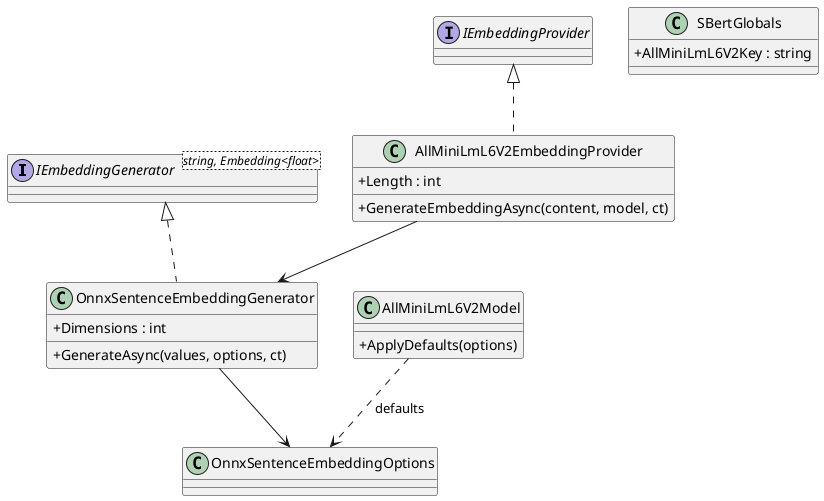

# AllMiniLmL6V2 — API Design

**Status:** Implemented · 2026-10-08 (reconciled with the code 2026-10-22) · Epic: AI · Related: [README](README.md), [architecture](architecture.md), [testing strategy](testing-strategy.md)

[← Architecture](architecture.md) · [↑ Index](README.md) · [Testing strategy →](testing-strategy.md)

## Contents

- [Generic runner](#generic-runner)
- [Model preset](#model-preset)
- [Registration](#registration)
- [Usage](#usage)
- [Class diagram](#class-diagram)

## Generic runner

Project `OoBDev.Onnx.SentenceEmbeddings`, namespace `OoBDev.Onnx.SentenceEmbeddings`.

**Table 1 — `OnnxSentenceEmbeddingOptions` (a non-sealed class; presets set defaults on it)**

| Option | Default | Meaning |
|--------|---------|---------|
| `ModelPath` | `model` | Folder with the model and vocabulary |
| `ModelFiles` | empty | `ModelFileSource` list downloaded into the folder when missing (sha-256 checked) |
| `ModelFileName`, `VocabFileName` | `model.onnx`, `vocab.txt` | Files inside the folder |
| `MaxSequenceLength`, `MaxBatchSize` | 256, 32 | Truncation and batch size |
| `MaxConcurrentInferences` | `Environment.ProcessorCount` | Concurrency gate |
| `IntraOpThreads` | 0 | 0 lets ONNX Runtime choose |
| `LowerCase` | true | Tokenizer casing |
| `ClsToken`, `SepToken`, `UnkToken`, `PadToken`, `MaskToken` | BERT tokens | Special tokens |
| `InputIdsName`, `AttentionMaskName`, `TokenTypeIdsName` | standard names | Session inputs; `TokenTypeIdsName` null for models without it (mpnet) |
| `Pooling` | `Mean` | `Mean` or `Cls` |
| `LayerNormalize` | false | Layer normalisation before the unit scaling |
| `Normalize` | true | Scale to unit length |
| `Prefix` | null | Text prepended to every value (for example `query: `) |
| `Dimensions`, `SupportsDimensionTruncation` | null, false | Truncate and re-normalise; only for Matryoshka-trained models |

`Validate()` checks the ranges and is called by the generator constructor.

```csharp
public sealed partial class OnnxSentenceEmbeddingGenerator : IEmbeddingGenerator<string, Embedding<float>>
{
    public OnnxSentenceEmbeddingGenerator(IOptions<OnnxSentenceEmbeddingOptions> options, ILogger<OnnxSentenceEmbeddingGenerator> logger);

    public int Dimensions { get; }   // from the model metadata, or Options.Dimensions

    public static Task<string> EnsureModelAsync(OnnxSentenceEmbeddingOptions options, ILogger logger, CancellationToken cancellationToken = default);

    public Task<GeneratedEmbeddings<Embedding<float>>> GenerateAsync(IEnumerable<string> values, EmbeddingGenerationOptions? options = null, CancellationToken cancellationToken = default);
    public object? GetService(Type serviceType, object? serviceKey = null);
    public void Dispose();
}
```

Behaviour:

- The constructor validates the options, downloads missing `ModelFiles`, loads the model and vocabulary and reads the output size.
- `GenerateAsync` tokenizes each value once, truncates to `MaxSequenceLength`, splits into batches of at most `MaxBatchSize`, pads each batch to its longest row, and runs the session under the concurrency gate.
- Pooling is a masked mean (or CLS) over the last hidden state followed by L2 normalisation, computed over spans.
- Empty or whitespace input returns an all-zero vector of length `Dimensions` without running the model. This differs from the fork, which returned an empty array.
- `GetService(typeof(EmbeddingGeneratorMetadata))` reports the generator name, the model file name and the dimensions; a keyed request returns null.
- No `TimeProvider` is injected (the design proposed one; nothing in the generator needs it).

## Model preset

Project `OoBDev.SBert.AllMiniLmL6V2`, namespace `OoBDev.SBert.AllMiniLmL6V2`.

```csharp
public static class SBertGlobals
{
    public const string AllMiniLmL6V2Key = "all-minilm-l6-v2";
    public const string DefaultSection = "AllMiniLmL6V2";
}

public static class AllMiniLmL6V2Model
{
    public const string Repository = "sentence-transformers/all-MiniLM-L6-v2";
    public const string Revision = "1110a243fdf4706b3f48f1d95db1a4f5529b4d41";
    public static string DefaultFolder { get; }
    public static void ApplyDefaults(OnnxSentenceEmbeddingOptions options);   // pinned files with sha-256, folder, names
}

public class AllMiniLmL6V2EmbeddingProvider : IEmbeddingProvider
{
    public AllMiniLmL6V2EmbeddingProvider(OnnxSentenceEmbeddingGenerator generator);
    public int Length { get; }   // 384, from the model; no blocking call
    public Task<ReadOnlyMemory<float>> GenerateEmbeddingAsync(string content, string? model, CancellationToken cancellationToken = default);
}
```

The preset has no options subclass: `ApplyDefaults` configures the shared options class, then configuration overrides it. `SBertGlobals` lives in the preset project.

## Registration

```csharp
public static IServiceCollection TryAddAllMiniLmL6V2Services(
    this IServiceCollection services, IConfiguration configuration, string allMiniLmL6V2OptionSection = SBertGlobals.DefaultSection);
```

Registers, in order: `Configure<OnnxSentenceEmbeddingOptions>` (defaults, then `configuration.Bind`), the generator as a singleton, `IEmbeddingGenerator<string, Embedding<float>>` as a singleton forwarding to it (also under the key `SBertGlobals.AllMiniLmL6V2Key`), `IEmbeddingProvider` as a transient that **replaces** any earlier default, and the keyed `IEmbeddingProvider` under `SBertGlobals.AllMiniLmL6V2Key`. The existing method name is kept so callers need no change.

**Planned** (not in the code; see `BACKLOG.md`): `AddValidatedOptions` instead of `Configure`, `EmbeddingGeneratorBuilder` wrapping (`UseOpenTelemetry`, `UseLogging`; the generator already emits its own span and metrics, so wrapping would double them and needs the full Microsoft.Extensions.AI package), and the legacy `ALLMINILM` key alias. The alias is not needed while the framework is unreleased.

## Usage

```csharp
var embeddings = await generator.GenerateAsync(
    ["first sentence", "second sentence"], cancellationToken: ct);
ReadOnlyMemory<float> vector = embeddings[0].Vector;   // length 384, unit norm
```

## Class diagram



*Figure 1 — Public types*

[← Architecture](architecture.md) · [↑ Index](README.md) · [Testing strategy →](testing-strategy.md)
