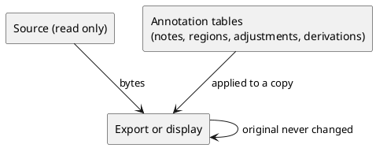

# Annotation layer (pattern)

Status: **pattern page written 2026-11-18** (documentation only; no abstractions in code until a second consumer appears). Source: the tables of the storage catalog (`C:\repo\_storage`, read-only reference; rules `imgx-2`, `imgx-3`, `imgx-4` in its image feature document). Parent design: [embedding client, pgvector store and annotation layer](../EmbeddingClientAndPgVector/README.md); request: [pgvector store and read-only annotation layer](../../features/request/2026-11-11-pgvector-store-and-read-only-annotation-layer.md).

## Contents

1. [Rule](#rule)
2. [Reference tables](#reference-tables)
3. [Behavior](#behavior)
4. [Applying it elsewhere](#applying-it-elsewhere)
5. [Not decided](#not-decided)

## Rule

The source file or record is never written. Everything a person adds or changes (a note, a marked region, an adjustment, a link to an original) is stored beside it and keyed by the content identity (the content id, in the catalog a numeric key for the hashed content). Edits take effect only on a derived copy at export or display time. Removing every annotation row returns the original view unchanged.

## Reference tables

**Table 1 — Catalog tables that carry the pattern**

| Table | Key | What it holds | Notes |
|-------|-----|---------------|-------|
| `annotations` | `annotation_id` | `content_id`, `kind` (up to 20 characters), `body` (up to 2000), `page`, `region` (JSON, fractions of the page), `created_at` | Many per content; index on (`content_id`, `page`); the read kind in the query engine exposes `annotationKind`, `body`, `page`, `path`, `created` |
| `image_adjustments` | `content_id` | brightness, contrast, saturation, rotation (integers), denoise flag, `updated_at` | One row per content; an all-zero adjustment clears the row; applied only to exported or shown copies (rule `imgx-2`) |
| `image_derivations` | `content_id` (the copy) | `original_content_id`, crop `x`, `y`, `w`, `h` as fractions of the original, `created_at` | One copy has one original; only the link is stored, files are never touched (rule `imgx-3`); index on the original |

All three reference the content table with a foreign key. Suggested boxes (rule `imgx-4`) are never stored: a detector may propose a region, and a row exists only after the owner confirms it as a crop or a derivation.

## Behavior

**Table 2 — Rules to keep when the pattern is reused**

| Rule | Why |
|------|-----|
| Key by content identity, not by path | The same bytes at two paths share their annotations; a move or rename loses nothing |
| Regions and crops are fractions (0 to 1), not pixels | They survive a resize or a thumbnail at another scale |
| One row per content for settings (adjustments), many rows for notes | Settings are replaced, notes accumulate |
| Applying is a pure function of (original, annotation rows) | Export and display are reproducible and testable without a database |
| Suggestions are separate from stored facts | A detector result is not an owner decision |
| Deleting the original's annotations never deletes a file | The layer has no write access to the source |

*Figure 1 — The source is read, the annotations are applied to a copy*

## Applying it elsewhere

- A new consumer adds its own annotation table keyed by the content or record identity, with fractions for any geometry, and reads it through the [metadata query engine](../MetadataQuery/README.md) as a kind.
- Applying adjustments belongs to the exporter or viewer of that media type (for images, [`OoBDev.Imaging.Analysis`](../ImageAnalysis/README.md) offers `AdjustBrightnessContrast` and `ToGrayscale` on an `RgbImage`).
- Rights follow the usual application rights; notes are per owner data and are never logged beyond ids and counts.

## Not decided

- Whether a shared annotation contract (`IAnnotationStore`) is worth a Framework project: wait for a second consumer, as the parent design says.
- Saved selections (named result sets) exist in the catalog but are not part of this page.
