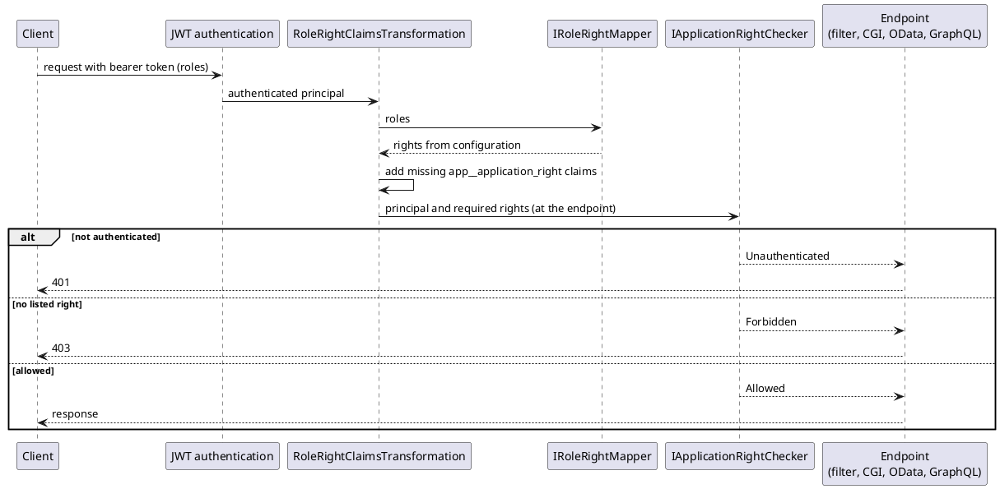

# Application Rights — Architecture

[← Requirements](requirements.md) · [↑ Overview](README.md) · [API design →](api-design.md)

**Status:** Draft · **Date:** 2026-10-22 · **Related:** [requirements](requirements.md)

## Contents

- [Layer placement](#layer-placement)
- [Request flow](#request-flow)
- [Configuration](#configuration)
- [Failure behavior](#failure-behavior)
- [Alternatives considered](#alternatives-considered)

### List of Figures

1. [Figure 1 — Request sequence](#figure-1)

### List of Tables

1. [Table 2 — Alternatives](#table-2)

## Layer placement

The contracts (`IRoleRightMapper`, `IApplicationRightChecker`, `RightCheckResult`) sit in `OoBDev.AspNetCore.Abstractions` next to `[ApplicationRight]`, so adapters and extensions such as the CGI middleware can depend on them without the MVC project. The default `ApplicationRightChecker` also sits in Abstractions, so the `[ApplicationRight]` filter falls back to it when none is registered. The mapper and transformation (`ConfigurationRoleRightMapper`, `RoleRightClaimsTransformation`) sit in `OoBDev.AspNetCore.Mvc` with the existing `UserAuthorizationHandler`.

## Request flow

<a id="figure-1"></a>



*Figure 1 — Request sequence*

## Configuration

```json
{
  "OoBDev": {
    "Authorization": {
      "RoleClaimTypes": [ "roles", "role" ],
      "Roles": {
        "order-clerk": [ "orders.read" ],
        "order-manager": [ "orders.read", "orders.approve" ]
      }
    }
  }
}
```

The `Roles` section is data, so it can change without a rebuild. Role claim types default to the standard role claim plus `roles` and `role`.

## Failure behavior

- A principal that is not authenticated is returned unchanged by the transformation and is `Unauthenticated` at the checker.
- A role missing from configuration adds nothing; the caller then fails the right check with `Forbidden`.
- The transformation never throws for a bad claim; an empty right name in configuration is rejected when the options are validated at start.
- A principal can pass through the transformation more than once (ASP.NET Core may call it repeatedly); a marker claim keeps it idempotent, and the rule is "add only rights not already present".

## Alternatives considered

<a id="table-2"></a>**Table 2 — Alternatives**

| Alternative | Why not |
|-------------|---------|
| ASP.NET Core policies per right | Fine for MVC, but OData, GraphQL and the CGI middleware need the same decision without policy plumbing; the checker is called from all of them, and policies can still be built on top of it |
| Rights in the token (STS exchange) | Grows the token and freezes rights until it expires; kept as an option that merges with mapped rights (REQ-005) |
| Role names checked in endpoints | Couples code to the identity provider's vocabulary |

[API design →](api-design.md)
