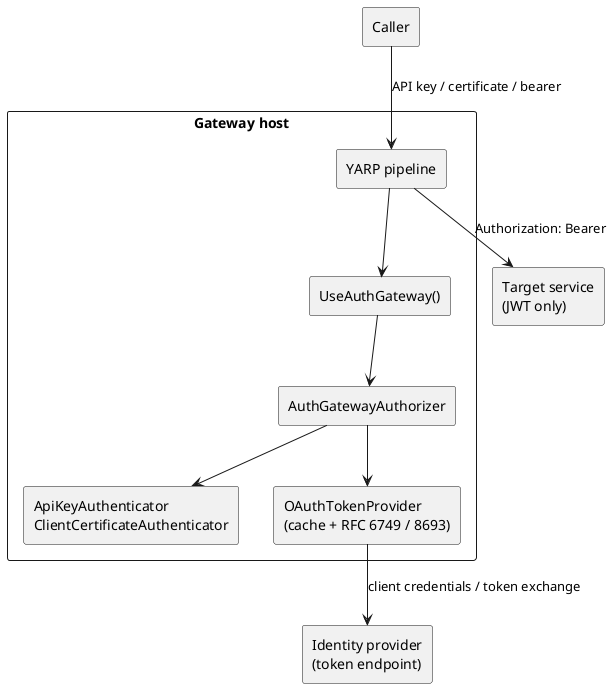

# Authentication translation gateway

**Status:** Library built 2026-11-23 (authorizer, API key, client certificate, client credentials, RFC 8693, cache; `UseAuthGateway()` not yet exercised against a running proxy) · **Request:** [authentication translation gateway](../../features/request/2026-11-10-auth-translation-gateway.md) · **Owner decision:** Q9 (2026-11-19): a YARP-based dotex library; inbound API key, then client certificate, then RFC 8693 token exchange.

A reverse proxy step that authenticates the inbound caller with one scheme and calls the target with a bearer token. Services keep understanding only JWT (rule `owner-decisions`); the gateway is the edge adapter that converts the other credentials.

## Contents

- [Requirements](#requirements)
- [Architecture](#architecture)
- [Configuration](#configuration)
- [Security](#security)
- [Testing](#testing)

## Requirements

| Id | Requirement |
|----|-------------|
| G1 | A route names its target in its YARP metadata (`AuthGatewayTarget`). A route with no target, or a target not configured, is refused with 403 (no open proxy). |
| G2 | Inbound schemes per target, tried in the listed order: `ApiKey` (a header, compared as a SHA-512 hash in constant time) and `ClientCertificate` (a thumbprint allow-list). A request with no accepted credential gets 401 before any outbound call. |
| G3 | Outbound is a bearer token: `ClientCredentials` (the gateway's own client) or `TokenExchange` (RFC 8693, the inbound bearer token is the `subject_token`, `audience` from the target). |
| G4 | Tokens are cached per target and caller until shortly before expiry (skew 30 s); concurrent requests for the same key fetch one token. |
| G5 | One audit log line per decision (target, scheme, caller id, outcome). Keys, secrets and tokens are never logged. |
| G6 | A token endpoint failure answers 502 as an RFC 9457 problem; refusals answer 401 or 403 as problems. |

## Architecture

*Figure 1 — Gateway components*

`AuthGatewayAuthorizer.AuthorizeAsync(HttpContext, targetName)` holds the logic and does not depend on YARP; `UseAuthGateway()` is the thin proxy pipeline step that reads the route metadata, calls it, replaces the `Authorization` header and stops the pipeline with a problem response on refusal. Replacing `Authorization` also removes the inbound API key header so it never reaches the target.

## Configuration

Section `OoBDev:AuthGateway`. Secrets (`ClientSecret`) come from the secret store or environment, never from the repository.

| Key | Meaning |
|-----|---------|
| `Targets:{name}:Inbound` | List: `ApiKey`, `ClientCertificate` |
| `Targets:{name}:Outbound:Grant` | `ClientCredentials` or `TokenExchange` |
| `Targets:{name}:Outbound:TokenEndpoint` | Token endpoint URL |
| `Targets:{name}:Outbound:ClientId` / `ClientSecret` | The gateway's client |
| `Targets:{name}:Outbound:Scope` / `Audience` | Optional |
| `ApiKeys` | List of `{ Id, Sha512, Subject }`; `Sha512` is the hex hash of the key |
| `ApiKeyHeader` | Default `X-Api-Key` |
| `ClientCertificates` | List of `{ Thumbprint, Subject }` |

## Security

High sensitivity: the gateway holds a client secret and mints credentials for callers. Targets are an explicit allow-list; TLS to both sides is the host's job; cache lifetimes end before the token expires; the cache key includes the caller subject so one caller never receives another's token. Client certificates need the host to request them (Kestrel `ClientCertificateMode`).

## Testing

Unit tests (11, built) with a fake token endpoint (`HttpMessageHandler`) and `FakeTimeProvider`: the five acceptance criteria of the request, the cache and the single fetch under concurrency, no secrets in log output, API key and certificate authenticators. Not built: a Simulate test of `UseAuthGateway()` with a real YARP pipeline and a stub target (no `Microsoft.AspNetCore.TestHost` in the repository package set yet); that step is a 20-line adapter over the tested authorizer.
