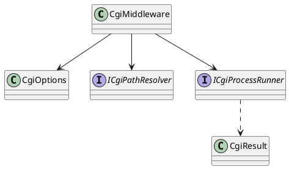

# CGI Middleware — API Design

[← Architecture](architecture.md) · [↑ Overview](README.md) · [Testing strategy →](testing-strategy.md)

**Status:** Draft (all signatures *Proposed*) · **Date:** 2026-10-22 · **Related:** [architecture](architecture.md)

## Contents

- [Registration](#registration)
- [Options](#options)
- [Types](#types)
- [Configuration sample](#configuration-sample)
- [Error model](#error-model)

### List of Figures

1. [Figure 3 — Types](#figure-3)

## Registration

```csharp
namespace OoBDev.AspNetCore.Cgi;

public static class ServiceCollectionExtensions
{
    /// <summary>Registers CGI options, the path resolver and the process runner with TryAdd.</summary>
    public static IServiceCollection TryAddCgiServices(this IServiceCollection services, IConfiguration configuration);
}

public static class ApplicationBuilderExtensions
{
    /// <summary>Runs CGI programs under <see cref="CgiOptions.Prefix"/>. Place authorization ahead of it.</summary>
    public static IApplicationBuilder UseCgi(this IApplicationBuilder app);
}
```

## Options

```csharp
public class CgiOptions
{
    public string Prefix { get; set; } = "/cgi-bin";
    [Required] public string ScriptRoot { get; set; } = default!;
    /// <summary>Extension (".py") to executable ("python3"); the script path is the first argument.</summary>
    public IDictionary<string, string> Handlers { get; set; } = new Dictionary<string, string>(StringComparer.OrdinalIgnoreCase);
    public TimeSpan Timeout { get; set; } = TimeSpan.FromSeconds(30);
    public long MaxRequestBodyBytes { get; set; } = 10 * 1024 * 1024;
    public long? MaxResponseBytes { get; set; }
    public int MaxConcurrentProcesses { get; set; } = Environment.ProcessorCount * 2;
    public int MaxStderrBytes { get; set; } = 64 * 1024;
    public bool AllowBatchFiles { get; set; }
}
```

## Types



<a id="figure-3"></a>*Figure 3 — Types*

`ICgiPathResolver` turns a request path into a script plus `PATH_INFO`, or a rejection. `ICgiProcessRunner` starts the child, feeds stdin, enforces timeout and kill, and returns a `CgiResult` (status, headers, body stream, exit code). Both are interfaces so tests can replace them.

## Configuration sample

```json
{
  "OoBDev": {
    "Cgi": {
      "Prefix": "/cgi-bin",
      "ScriptRoot": "C:/inetpub/cgi",
      "Handlers": { ".py": "python3", ".exe": "" },
      "Timeout": "00:00:30"
    }
  }
}
```

## Error model

The middleware writes RFC 9457 problem details for the 4xx and 5xx results it produces itself (403, 413, 502, 503, 504). Responses produced by the script (its own `Status`) pass through unchanged.

[← Architecture](architecture.md) · [↑ Overview](README.md) · [Testing strategy →](testing-strategy.md)
