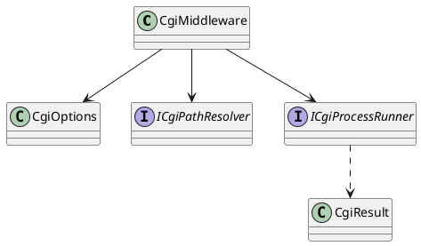

# CGI Middleware — API Design

[← Architecture](architecture.md) · [↑ Overview](README.md) · [Testing strategy →](testing-strategy.md)

**Status:** Implemented · **Date:** 2026-10-22 · **Related:** [architecture](architecture.md)

## Contents

- [Registration](#registration)
- [Options](#options)
- [Types](#types)
- [Configuration sample](#configuration-sample)
- [OpenAPI listing](#openapi-listing)
- [Error model](#error-model)

### List of Figures

1. [Figure 3 — Types](#figure-3)

## Registration

```csharp
namespace OoBDev.AspNetCore.Cgi;

public static class ServiceCollectionExtensions
{
    public const string DefaultSection = "OoBDev:Cgi";

    /// <summary>Registers validated CgiOptions, CgiOptionsValidator, the path resolver and the process runner with TryAdd.</summary>
    public static IServiceCollection TryAddCgiServices(this IServiceCollection services, IConfiguration configuration, string configurationSectionName = DefaultSection);

    /// <summary>Runs CGI programs under <see cref="CgiOptions.Prefix"/>. Authentication goes ahead of it; rights are checked inside from <see cref="CgiOptions.RequiredRights"/>.</summary>
    public static IApplicationBuilder UseCgi(this IApplicationBuilder app);
}
```

## Options

```csharp
public class CgiOptions
{
    public string Prefix { get; set; } = "/cgi-bin";
    [Required] public string ScriptRoot { get; set; } = default!;
    /// <summary>Extension (".py") to executable ("python3"); the script path is the first argument.</summary>
    public IDictionary<string, string> Handlers { get; set; } = new Dictionary<string, string>(StringComparer.OrdinalIgnoreCase);
    public TimeSpan Timeout { get; set; } = TimeSpan.FromSeconds(30);
    public long MaxRequestBodyBytes { get; set; } = 10 * 1024 * 1024;
    public long? MaxResponseBytes { get; set; }
    public int MaxConcurrentProcesses { get; set; } = Environment.ProcessorCount * 2;
    public int MaxStderrBytes { get; set; } = 64 * 1024;
    public bool AllowBatchFiles { get; set; }

    /// <summary>Host environment variables copied into the otherwise cleared child environment.</summary>
    public IList<string> InheritedEnvironmentVariables { get; set; } = ["PATH", "SystemRoot"];

    /// <summary>Lets unauthenticated users run scripts. Off by default.</summary>
    public bool AllowAnonymous { get; set; }

    /// <summary>The user needs at least one of these application rights when the list is not empty.</summary>
    public IList<string> RequiredRights { get; set; } = [];

    /// <summary>Extra rights per script file name; the user needs at least one of the listed rights.</summary>
    public IDictionary<string, IList<string>> ScriptRights { get; set; } = new Dictionary<string, IList<string>>(StringComparer.OrdinalIgnoreCase);
}
```

## Types



<a id="figure-3"></a>*Figure 3 — Types*

`ICgiPathResolver.Resolve(remainingPath)` turns a request path into a `CgiScript` (script name and path, `PATH_INFO`, executable) or throws `CgiException` (403, 404). `ICgiProcessRunner.StartAsync(CgiProcessRequest, CancellationToken)` starts the child, feeds stdin, enforces timeout, kill and the concurrency cap, reads the header block and returns a `CgiResult` (status, headers, body stream; disposing it releases the process slot). Both are interfaces so tests can replace them. Failures are `CgiException` subtypes that carry the status: `CgiBusyException` (503), `CgiBodyTooLargeException` (413), `CgiTimeoutException` (504), `CgiProtocolException` and `CgiResponseTooLargeException` (502), `CgiProcessFailedException` (500). `CgiOptionsValidator` fails startup for a missing or static-served script root.

## Configuration sample

```json
{
  "OoBDev": {
    "Cgi": {
      "Prefix": "/cgi-bin",
      "ScriptRoot": "C:/inetpub/cgi",
      "Handlers": { ".py": "python3", ".exe": "" },
      "Timeout": "00:00:30"
    }
  }
}
```

## OpenAPI listing

The opt-in project `OoBDev.AspNetCore.Cgi.OpenApi` lists CGI programs in the host's OpenAPI documents. `TryAddCgiOpenApi(configuration, "OoBDev:Cgi:OpenApi")` adds `CgiOpenApiDocumentTransformer` to the documents named in `CgiOpenApiOptions.Documents` (default `all`).

- A program is described by `{program}.openapi.json` in the script root: `greet.exe` and `greet.cgi` are both described by `greet.openapi.json`, so one description serves every platform's build. The program owns the file; the example program writes it with `greet -openapi` during its build.
- Paths in the description are relative to the program: `/` is the program itself and `/{id}` reaches it with `PATH_INFO`. The transformer publishes them under `{Prefix}/{program file}`, for example `/cgi-bin/greet.exe`.
- Operations without tags get the program name as their tag. Component schemas are merged; a path or schema already in the document wins and the clash is logged.
- A description without a program next to it (no listed handler matches), or one that is not valid OpenAPI, is skipped with a warning; it never fails the document.
- The listing does not change what the middleware allows: authorization, rights and handler checks still decide each request.

## Error model

The middleware writes RFC 9457 problem details for the 4xx and 5xx results it produces itself (401, 403, 404, 413, 500, 502, 503, 504). Responses produced by the script (its own `Status`) pass through unchanged.

[← Architecture](architecture.md) · [↑ Overview](README.md) · [Testing strategy →](testing-strategy.md)
