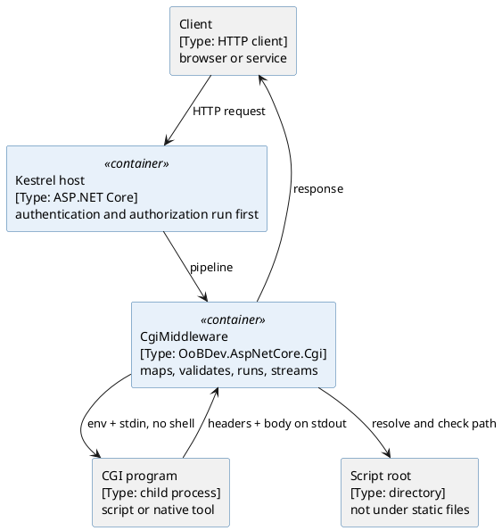
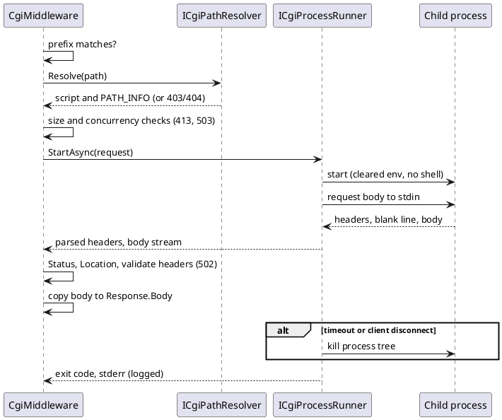

# CGI Middleware — Architecture

[← Requirements](requirements.md) · [↑ Overview](README.md) · [API design →](api-design.md)

**Status:** Implemented · **Date:** 2026-10-22 · **Related:** [requirements](requirements.md)

## Contents

- [Layer placement](#layer-placement)
- [Containers](#containers)
- [Request flow](#request-flow)
- [Meta-variables](#meta-variables)
- [Configuration](#configuration)
- [Failure behavior](#failure-behavior)
- [Alternatives considered](#alternatives-considered)

### List of Figures

1. [Figure 1 — Containers](#figure-1)
2. [Figure 2 — Request sequence](#figure-2)

### List of Tables

1. [Table 2 — Meta-variables](#table-2)
2. [Table 3 — Alternatives](#table-3)

## Layer placement

`OoBDev.AspNetCore.Cgi` is an optional enhancement that depends on the framework's ASP.NET Core layer and ships as its own package, so it sits in the Extensions layer. Applications that do not call `TryAddCgiServices` carry no CGI code path. A Framework placement was rejected because it would put process execution into a layer every application references.

## Containers

*Figure 1 — Containers*

## Request flow

*Figure 2 — Request sequence*

## Meta-variables

**Table 2 — Meta-variables**

| Variable | Source |
|----------|--------|
| `GATEWAY_INTERFACE` | `CGI/1.1` |
| `SERVER_SOFTWARE`, `SERVER_PROTOCOL`, `SERVER_NAME`, `SERVER_PORT` | Request and host |
| `REQUEST_METHOD`, `QUERY_STRING` | Request |
| `SCRIPT_NAME` | Prefix plus script segment |
| `PATH_INFO` | Remaining path |
| `PATH_TRANSLATED` | Script root plus `PATH_INFO`, only when it stays inside the root |
| `CONTENT_TYPE`, `CONTENT_LENGTH` | Request headers |
| `REMOTE_ADDR`, `REMOTE_USER` | Connection and authenticated principal name |
| `HTTPS` | `on` when the request is TLS |
| `REQUEST_SCHEME` | Request scheme |
| `HTTP_*` | Request headers, except `Proxy`, `Authorization`, `Content-Type` and `Content-Length` (the last two have their own variables) |

## Configuration

Section `OoBDev:Cgi` (validated options): `Prefix` (`/cgi-bin`), `ScriptRoot` (required), `Handlers` (extension to executable map), `Timeout` (30 s), `MaxRequestBodyBytes` (10 MB), `MaxResponseBytes`, `MaxConcurrentProcesses` (2 x CPU), `MaxStderrBytes`, `AllowBatchFiles` (false), `AllowAnonymous` (false), `RequiredRights`, `ScriptRights`, `InheritedEnvironmentVariables` (`PATH`, `SystemRoot`). See [API design](api-design.md).

## Failure behavior

| Condition | Result |
|-----------|--------|
| Not authenticated (and `AllowAnonymous` off) | 401 |
| Missing required right | 403 |
| Unknown extension, path or symlink outside the root | 403 (404 when nothing matches) |
| Body over the limit | 413 before start |
| No free process slot | 503 with `Retry-After` |
| Missing `Content-Type` or no blank line | 502 |
| Non-zero exit before output | 500 |
| Timeout | Kill the tree; 504 if nothing was sent, otherwise abort the response |

## Alternatives considered

**Table 3 — Alternatives**

| Option | Pro | Con | Decision |
|--------|-----|-----|----------|
| Middleware in-process, spawn per request | Simple, matches CGI | Process cost per request | Chosen |
| FastCGI or SCGI | Persistent workers | Larger protocol surface | Non-goal |
| Reverse proxy to a web server with CGI | No new code | Extra server to deploy | Rejected for the standalone case |
| Shell invocation | Convenient | Injection risk | Rejected (REQ-006) |

[← Requirements](requirements.md) · [↑ Overview](README.md) · [API design →](api-design.md)
