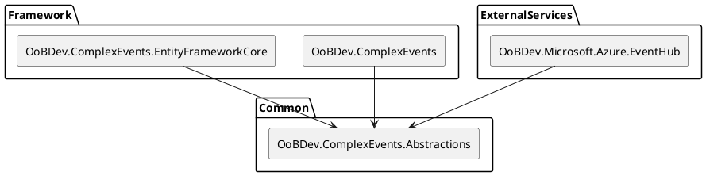

# Complex events and scheduling

Status: **proposed design, written 2026-11-19 on the assumed answer A of Q18; in-process core built 2026-11-19 (dispatcher, in-memory store, runner; 6 unit tests); EF Core schedule store built 2026-11-19 (`OoBDev.ComplexEvents.EntityFrameworkCore`, 5 Simulate tests on SQLite); hosted service built 2026-11-19 (`OoBDev.ComplexEvents.Hosting`, 3 unit tests); Event Hubs built 2026-11-23 (`IEventHubClient`, publisher, consumer, in-memory fake, `OoBDev.Microsoft.Azure.EventHub`; an Integration test runs against the stack emulator).** Request: [complex events, scheduling and Event Hubs](../../features/completed/2026-11-10-complex-events-and-scheduling.md). Epic 8 of [SharedFramework](../SharedFramework/README.md).

## Contents

1. [Scope](#scope)
2. [Requirements](#requirements)
3. [Architecture](#architecture)
4. [API sketch](#api-sketch)
5. [Scheduling rules](#scheduling-rules)
6. [Testing strategy](#testing-strategy)
7. [Open points](#open-points)

### List of Figures

1. Figure 1 — Components and layers

### List of Tables

1. Table 1 — Requirements
2. Table 2 — Test plan

## Scope

In: an attribute-declared event handler model, a scheduler with persisted state, and an Event Hubs provider behind an interface. Out: event sourcing (aggregates, streams and projections stay in [CqrsEventSourcing](../CqrsEventSourcing/README.md)); the SharedFramework `ComplexEvents.DatabaseExtensions` SQL project (no database project, assumed answer A of Q18); copying the owner's `event-sourcing` and `sync-mesh` material (needs the owner's say-so).

The handler model dispatches in-process events. It is not a second queue: durable delivery stays with `OoBDev.MessageQueueing`.

## Requirements

**Table 1 — Requirements**

| Id | Requirement | Acceptance |
|----|-------------|------------|
| CE-1 | A class marked `[ComplexEventHandler]` for an event type is found by a resolver and receives matching events | resolver returns the handler; a non-matching event is not dispatched |
| CE-2 | Several handlers per event run in declared order; one failing handler does not stop the others, its error is reported together | all run; an aggregate failure lists each error |
| CE-3 | A schedule registers an event for a due time (`ScheduleAt`) and runs it once | runs at or after the due time, then is released |
| CE-4 | A restart does not run a released schedule again, and two instances never run the same item | lease with an expiry; completion is recorded in the same transaction as the release |
| CE-5 | Schedule state is persisted through EF Core (SQLite, SQL Server, PostgreSQL) | same tests pass on each provider |
| CE-6 | An Event Hubs provider publishes and consumes through `IEventHubClient`, with a fake for tests | no live Azure in Unit or Simulate; live tests are `LiveIntegration` |
| CE-7 | Connection strings and options come from validated options (`AddValidatedOptions<T>()`) | invalid options fail at start |

*Table 1 lists what must hold; CE-4 is the one that needs a lease and an idempotent handler.*

## Architecture



*Figure 1 — Components and layers*

Layers follow the [coding standards](../../../.claude/rules/coding-standards.md): contracts in Abstractions, the resolver, dispatcher and in-memory scheduler in `OoBDev.ComplexEvents` (host-free), the EF store in its own Framework project (EF Core Relational only, like `OoBDev.System.Text.Templating.EntityFrameworkCore`), and the Event Hubs adapter in ExternalServices referencing Abstractions only. Registration is `TryAddComplexEvents()` and `TryAddEntityFrameworkSchedules()` in each project's `ServiceCollectionExtensions`.

## API sketch

```csharp
public interface IComplexEventHandler<in TEvent> { Task HandleAsync(TEvent @event, CancellationToken cancellationToken); }

[AttributeUsage(AttributeTargets.Class, AllowMultiple = true)]
public sealed class ComplexEventHandlerAttribute(Type eventType) : Attribute { public int Order { get; init; } }

public interface IComplexEventDispatcher { Task DispatchAsync<TEvent>(TEvent @event, CancellationToken cancellationToken); }

public interface IScheduleStore
{
    Task<ScheduleItem> RegisterAsync(string key, DateTimeOffset dueAt, string eventType, ReadOnlyMemory<byte> payload, CancellationToken cancellationToken);
    Task<IReadOnlyList<ScheduleItem>> LeaseDueAsync(DateTimeOffset now, int max, TimeSpan lease, CancellationToken cancellationToken);
    Task CompleteAsync(Guid id, CancellationToken cancellationToken);
    Task<bool> ReleaseAsync(string key, CancellationToken cancellationToken);
}
```

The scheduler is a hosted service that leases due items, dispatches them and completes them. It reads `TimeProvider`, never the system clock. A recurring schedule is a handler that registers its next item.

## Scheduling rules

- `RegisterAsync` with an existing key updates the due time (re-registration, not a duplicate).
- A lease that expires without `CompleteAsync` makes the item due again, so handlers must be idempotent; the dispatcher passes the item id as the idempotency key.
- A handler failure leaves the lease to expire and counts an attempt; after the configured maximum the item moves to a failed state and is logged, not retried silently.

## Testing strategy

**Table 2 — Test plan**

| Area | Tier | What |
|------|------|------|
| Resolver and dispatcher | Unit | order, multiple handlers, aggregate failure, no match |
| Scheduler with a fake `TimeProvider` | Unit | runs once at the due time; re-registration; failure attempts |
| EF store | Simulate | SQLite in memory: lease exclusivity with two stores, expiry, completion |
| EF store on SQL Server and PostgreSQL | Integration | `oobd-test-sqlserver` and the PostgreSQL service, same cases |
| Event Hubs adapter | Unit with a fake `IEventHubClient`; Azure emulator Integration (built 2026-11-23); live as `LiveIntegration` | publish and consume |

*Table 2 maps each area to its tier; coverage target 80% or more for the Framework projects.*

## Open points

- The test stack has an Event Hubs emulator (`oobd-test-eventhubs`, with Azurite, since 2026-11-23); one Integration test publishes and reads an event. Checkpointing is not built.
- Built 2026-11-23: `ScheduleAtAttribute`, `IRecurrence` with the built-in `CronRecurrence`, `CatchUpPolicy` and `RecurringSchedule`; RRule stays an `IRecurrence` implementation for a consumer, and since 2026-11-23 `RecurringScheduler` (optional in `ScheduleHost`) records each run in an `ILastRunStore` (in-memory and EF stores built) and registers the next occurrence.
- Dead letter (built 2026-11-23): `IScheduleFailureHandler` is told about every failed attempt by `ScheduleRunner` (and `ScheduleHost`, which takes an optional registered handler); a consumer publishes to its queue when `item.Attempts` reaches the store limit. A throwing handler is swallowed.
- From the wish list (Event Scheduler lines, merged 2026-11-19): default schedule rules declared by attribute on the event generator and overridable by configuration; a recorded last run time so a restarted scheduler can catch up missed items (a per-schedule catch-up policy: run all, run latest, skip); recurrence by cron (NCrontab is a third-party package, so a small built-in cron parser or `TimeProvider` timers are compared first) with other calculators (RRule) behind an `IRecurrence` interface.
