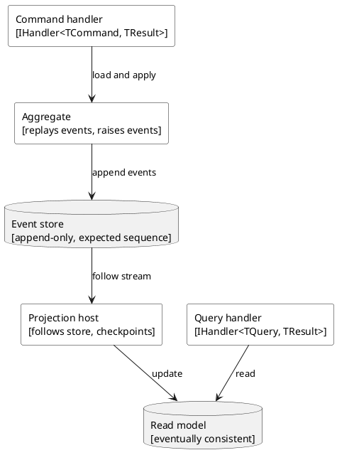

# CQRS and Event Sourcing — Architecture

[← Requirements](requirements.md) · [↑ Overview](README.md) · [API design →](api-design.md)

**Status:** Draft · **Date:** 2026-11-11

## Contents

- [Write and read sides](#write-and-read-sides)
- [Sources](#sources)
- [Relation to Complex Events](#relation-to-complex-events)

### List of Figures

1. [Figure 1 — Write and read sides](#figure-1)

### List of Tables

1. [Table 2 — Sources and what they teach](#table-2)
2. [Table 3 — Relation to Complex Events](#table-3)

## Write and read sides

A command handler loads an aggregate by replaying its stream from the event store, the aggregate raises events, and the store appends them with an expected sequence. A projection host follows the store, applies each event to a read model, and saves a checkpoint. Queries read the read model only.

*Figure 1 — Write and read sides*

## Sources

**Table 2 — Sources and what they teach**

| Source (read-only, `C:\repo\learning`) | Teaches | Used for |
|------|---------|----------|
| `fohjin-cqrs` | Pattern explanations from first principles, aggregate, repository, unit of work, compensating transaction | The teaching baseline; linked, not copied |
| `event-sourcing` | Append-only store, schema registry, follow API, projections, upcasting, hash-chained tamper evidence, optimistic concurrency | The infrastructure target and the optional extensions |
| `sync-mesh` | Hybrid logical clock; event lineage as descriptive provenance | Ordering across skewed clocks (R8) |

## Relation to Complex Events

The SharedFramework epic "Complex Events" (event sourcing, CQRS, scheduling, persistence, EventHub) is a proposal from the earlier consolidation. This design takes over its event-sourcing and CQRS parts and leaves the rest where they belong.

**Table 3 — Relation to Complex Events**

| Complex Events feature | Decision |
|------------------------|----------|
| Event sourcing abstractions and core | Replaced by this design's contracts |
| Event persistence (EF Core provider) | A store provider behind the same contract, built when a consumer appears |
| Event scheduling (cron attribute) | Separate scheduling feature, not part of event sourcing |
| Azure EventHub provider | A transport adapter in the cloud integrations, not in the core |

[API design →](api-design.md)
