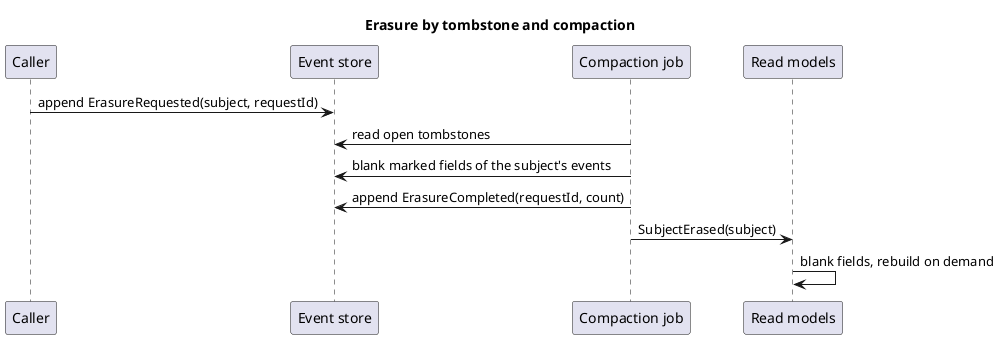

# CQRS and Event Sourcing — Erasure

[← Overview](README.md) · [Requirements](requirements.md) · [Architecture](architecture.md) · [API design](api-design.md)

**Status:** Core built 2026-11-16 (build steps 1, 2, the compaction job and the projection notification; see [Build order](#build-order)) · **Date:** 2026-11-16. Decided by the owner on 2026-11-16: erase personal data by rewriting history (a tombstone event and a compaction job that blanks the personal fields). This replaces the earlier line "crypto-shredding is the supported route; no redaction events" in the [overview](README.md#decisions).

## Contents

- [Need](#need)
- [Design](#design)
- [What erasure breaks](#what-erasure-breaks)
- [Verification](#verification)
- [Build order](#build-order)

## Need

A data subject may ask that their personal data be removed (GDPR Article 17). An append-only event store keeps every payload for ever, so a request cannot be met by deleting a row. The rule must work for the event store, for projections built from it and for any copy that left the system.

## Design

1. **Mark personal fields.** An event type declares which payload properties are personal data and which subject they belong to (an attribute on the event contract, `[PersonalData(SubjectKey)]`, read by the schema registry). A payload without the mark is never touched.
2. **Request.** An `ErasureRequested` tombstone event is appended to the subject's own stream, carrying the subject id and the request id, never the personal values. The stream records that erasure was asked for and when.
3. **Compaction job.** A hosted job reads open tombstones, finds every event whose marked fields belong to the subject, and replaces those fields with a fixed placeholder (`null` for nullable fields, a documented constant for others) in a single transaction per stream. The event keeps its id, sequence, type and timestamp, so ordering and counts survive. It then appends `ErasureCompleted` with the number of events changed.
4. **Projections.** The projection rebuild reads the blanked events, so a rebuild removes the personal data from read models. Live read models receive a `SubjectErased` notification and blank the same fields at once.
5. **Idempotent.** Running the job twice changes nothing the second time; a tombstone without a completion is retried.

*Figure 1 — Erasure by tombstone and compaction*

## What erasure breaks

The owner accepted these effects with the decision:

- **Hash chains.** Events are optionally hash-chained for tamper evidence (requirement R9). Blanking a payload changes its hash and breaks every later link. The compaction job therefore re-seals the chain from the first changed event and records the re-seal in `ErasureCompleted`; a chain verified before the request no longer matches a copy taken before it.
- **External copies.** Backups, exports, CloudEvents already sent to other systems, message-queue retention and logs keep the old values. Erasure covers the store and the read models only; each other copy needs its own retention rule or request to its holder, and the request record lists the known copies.
- **Immutability.** The store is no longer strictly append-only. The compaction job is the only code allowed to update a payload, behind its own right, and every update is logged with the request id.
- **Replay differences.** A replay after erasure sees placeholders, so an aggregate that needs a personal value to apply an event must tolerate the placeholder.

## Verification

When built, tests prove: marked fields are blanked and unmarked fields are not; other subjects' events are untouched; a second run changes nothing; a rebuild of a projection contains no personal value; the hash chain verifies after the re-seal; an unmarked event type is refused by the schema registry when it carries a subject id. See [testing strategy](testing-strategy.md).

## Build order

1. Built: `[PersonalData(subjectProperty, fields...)]` on the event class; `EventTypeRegistry.Register` refuses a mark that names a missing property and builds the placeholder per field (`null` for a nullable field, `[erased]` for text, `0`/`false` for numbers and booleans).
2. Built: `ErasureRequested` and `ErasureCompleted` events, and `IEventPayloadRewriter` (implemented by `InMemoryEventStore` and `EfEventStore`; one transaction per stream; id, sequence, type and timestamp unchanged). It is a separate interface so ordinary code cannot reach it.
3. Built: `ErasureService.CompactAsync` (idempotent; a request without `ErasureCompleted` is retried). **Not built:** the hash-chain re-seal, because the stores do not chain events yet (R9 open); the compaction runs from a host job or command, not a hosted service yet.
4. Built: `ISubjectErasureHandler` is called per completed request so live read models blank at once; a rebuild reads the blanked events (tested through the store). **Not built:** a projection-runner rebuild test per read model.
5. Built: the registry refuses an event class with a public `SubjectId` property that has neither `[PersonalData]` nor `[NoPersonalData]` (the opt-out for classes that only reference the subject, such as the erasure events). **Not built:** an entry point behind its own right and its screen spec.
