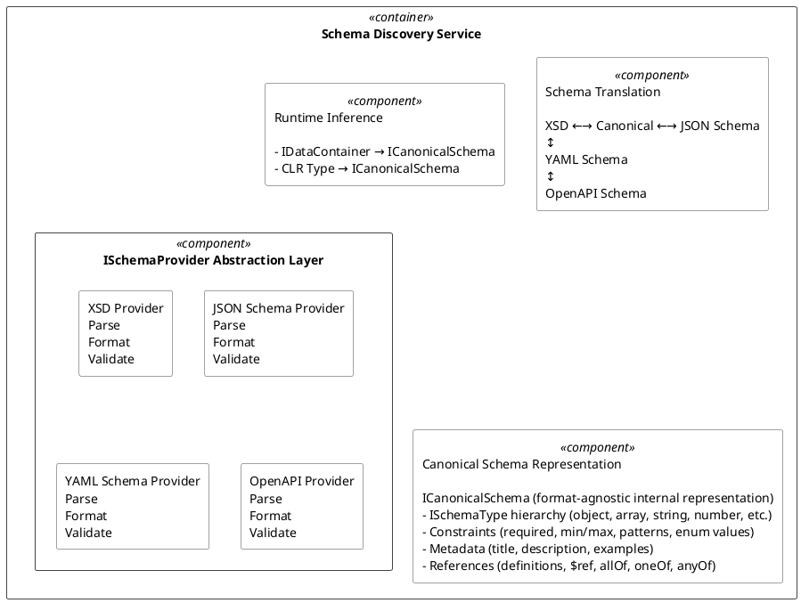
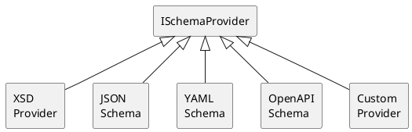
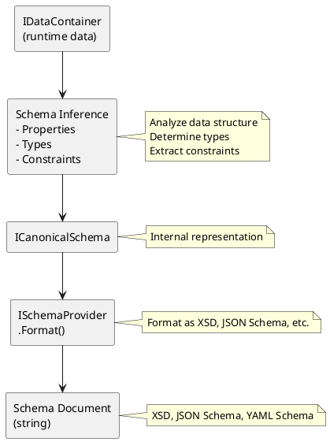
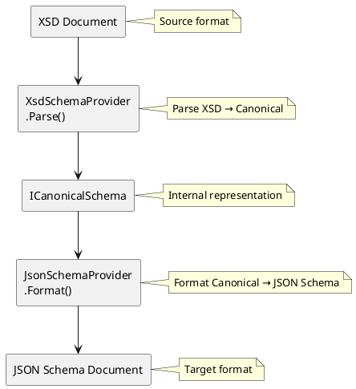
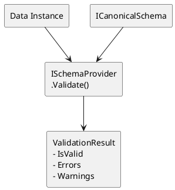

# Schema Discovery & Translation - Architecture

**Epic:** 11 - Data Enhancement Pipeline
**Feature:** Schema Discovery & Translation
**Priority:** HIGH (Foundation)
**Complexity:** MEDIUM-HIGH

---

## Overview

Schema discovery and translation system that allows runtime introspection of data models and bidirectional conversion between schema formats (XSD, JSON Schema, YAML Schema, OpenAPI). Uses canonical internal representation similar to path translation architecture.

---

## Architectural Goals

1. **Format Agnostic**: XSD, JSON Schema, YAML Schema are providers, not the core system
2. **Runtime Introspection**: Discover schema from live data containers
3. **Bidirectional Translation**: Convert between any two schema formats
4. **Validation Integration**: Validate data against discovered/translated schemas
5. **Metadata Preservation**: Retain titles, descriptions, constraints across translations

---

## System Architecture



*Figure 1 — Schema Discovery Service architecture*

---

## Core Components

### 1. ISchemaProvider (Schema Format Abstraction)

Similar to IPathNavigator, this provides format-specific parsing and formatting.

```csharp
/// <summary>
/// Schema provider abstraction.
/// Implementations: XsdSchemaProvider, JsonSchemaProvider, YamlSchemaProvider, OpenApiSchemaProvider
/// </summary>
public interface ISchemaProvider
{
    /// <summary>
    /// Schema format identifier (e.g., "xsd", "jsonschema", "yamlschema", "openapi").
    /// </summary>
    string SchemaFormat { get; }

    /// <summary>
    /// Parses schema document into canonical representation.
    /// </summary>
    ICanonicalSchema Parse(string schemaContent);

    /// <summary>
    /// Formats canonical schema back to this format.
    /// </summary>
    string Format(ICanonicalSchema schema);

    /// <summary>
    /// Validates data against canonical schema.
    /// </summary>
    ValidationResult Validate(object data, ICanonicalSchema schema);

    /// <summary>
    /// Checks if content is parseable by this provider.
    /// </summary>
    bool CanParse(string content);
}
```

---

### 2. ICanonicalSchema (Format-Agnostic Schema)

Central internal representation that all schema formats translate through.

```csharp
/// <summary>
/// Canonical internal schema representation (format-agnostic).
/// </summary>
public interface ICanonicalSchema
{
    /// <summary>
    /// Schema title/name (optional).
    /// </summary>
    string? Title { get; }

    /// <summary>
    /// Schema description (optional).
    /// </summary>
    string? Description { get; }

    /// <summary>
    /// Root type definition.
    /// </summary>
    ISchemaType RootType { get; }

    /// <summary>
    /// Named type definitions (for $ref, complexType, etc.).
    /// </summary>
    IReadOnlyDictionary<string, ISchemaType> Definitions { get; }

    /// <summary>
    /// Additional metadata (version, id, etc.).
    /// </summary>
    IReadOnlyDictionary<string, object> Metadata { get; }

    /// <summary>
    /// Resolves a type reference (handles $ref, type names).
    /// </summary>
    ISchemaType? ResolveReference(string reference);
}
```

---

### 3. ISchemaType Hierarchy

Represents different schema types (object, array, string, number, boolean, etc.).

```csharp
/// <summary>
/// Base schema type interface.
/// </summary>
public interface ISchemaType
{
    /// <summary>
    /// Type category (object, array, string, number, boolean, null, reference).
    /// </summary>
    SchemaTypeKind Kind { get; }

    /// <summary>
    /// Type title (optional).
    /// </summary>
    string? Title { get; }

    /// <summary>
    /// Type description (optional).
    /// </summary>
    string? Description { get; }

    /// <summary>
    /// Is this type nullable?
    /// </summary>
    bool IsNullable { get; }

    /// <summary>
    /// Additional metadata.
    /// </summary>
    IReadOnlyDictionary<string, object> Metadata { get; }
}

public enum SchemaTypeKind
{
    Object,
    Array,
    String,
    Number,
    Integer,
    Boolean,
    Null,
    Reference,
    OneOf,
    AllOf,
    AnyOf
}

/// <summary>
/// Object schema type.
/// </summary>
public interface IObjectSchemaType : ISchemaType
{
    /// <summary>
    /// Property definitions.
    /// </summary>
    IReadOnlyDictionary<string, ISchemaType> Properties { get; }

    /// <summary>
    /// Required property names.
    /// </summary>
    IReadOnlyList<string> Required { get; }

    /// <summary>
    /// Additional properties allowed?
    /// </summary>
    bool AdditionalPropertiesAllowed { get; }

    /// <summary>
    /// Schema for additional properties (if allowed).
    /// </summary>
    ISchemaType? AdditionalPropertiesSchema { get; }
}

/// <summary>
/// Array schema type.
/// </summary>
public interface IArraySchemaType : ISchemaType
{
    /// <summary>
    /// Item schema.
    /// </summary>
    ISchemaType ItemsSchema { get; }

    /// <summary>
    /// Minimum items.
    /// </summary>
    int? MinItems { get; }

    /// <summary>
    /// Maximum items.
    /// </summary>
    int? MaxItems { get; }

    /// <summary>
    /// Unique items required?
    /// </summary>
    bool UniqueItems { get; }
}

/// <summary>
/// String schema type.
/// </summary>
public interface IStringSchemaType : ISchemaType
{
    /// <summary>
    /// Minimum length.
    /// </summary>
    int? MinLength { get; }

    /// <summary>
    /// Maximum length.
    /// </summary>
    int? MaxLength { get; }

    /// <summary>
    /// Regular expression pattern.
    /// </summary>
    string? Pattern { get; }

    /// <summary>
    /// Format hint (date-time, email, uri, etc.).
    /// </summary>
    string? Format { get; }

    /// <summary>
    /// Allowed enum values.
    /// </summary>
    IReadOnlyList<string>? EnumValues { get; }
}

/// <summary>
/// Number schema type.
/// </summary>
public interface INumberSchemaType : ISchemaType
{
    /// <summary>
    /// Minimum value (inclusive).
    /// </summary>
    decimal? Minimum { get; }

    /// <summary>
    /// Maximum value (inclusive).
    /// </summary>
    decimal? Maximum { get; }

    /// <summary>
    /// Exclusive minimum?
    /// </summary>
    bool ExclusiveMinimum { get; }

    /// <summary>
    /// Exclusive maximum?
    /// </summary>
    bool ExclusiveMaximum { get; }

    /// <summary>
    /// Multiple of (for validation).
    /// </summary>
    decimal? MultipleOf { get; }
}

/// <summary>
/// Reference schema type (for $ref, type references).
/// </summary>
public interface IReferenceSchemaType : ISchemaType
{
    /// <summary>
    /// Reference path ($ref, type name, etc.).
    /// </summary>
    string Reference { get; }
}
```

---

### 4. ISchemaDiscoveryService (Orchestrator)

Coordinates schema discovery, translation, and inference.

```csharp
/// <summary>
/// Schema discovery and translation service.
/// </summary>
public interface ISchemaDiscoveryService
{
    /// <summary>
    /// Registers schema provider.
    /// </summary>
    void RegisterProvider(ISchemaProvider provider);

    /// <summary>
    /// Gets schema for data container.
    /// </summary>
    Task<ICanonicalSchema> GetSchemaAsync(IDataContainer container);

    /// <summary>
    /// Gets schema for specific path in container.
    /// </summary>
    Task<ICanonicalSchema> GetSchemaAsync(IDataContainer container, string path);

    /// <summary>
    /// Infers schema from runtime data.
    /// </summary>
    ICanonicalSchema InferSchema(object data);

    /// <summary>
    /// Translates schema between formats.
    /// </summary>
    string TranslateSchema(string schemaContent, string sourceFormat, string targetFormat);

    /// <summary>
    /// Gets schema in specific format.
    /// </summary>
    Task<string> GetSchemaAsAsync(IDataContainer container, string format);

    /// <summary>
    /// Validates data against schema.
    /// </summary>
    ValidationResult ValidateAgainstSchema(object data, ICanonicalSchema schema);

    /// <summary>
    /// Gets provider by format.
    /// </summary>
    ISchemaProvider? GetProvider(string format);
}
```

---

## Design Patterns

### 1. Provider Pattern (Schema Formats)

Similar to IPathNavigator, each schema format is a provider.



*Figure 2 — ISchemaProvider implementations*

### 2. Value Object Pattern (Canonical Schema)

ICanonicalSchema is immutable and format-agnostic.

### 3. Strategy Pattern (Schema Validation)

Different providers implement validation differently, but all validate against canonical schema.

### 4. Composite Pattern (Schema Types)

ISchemaType hierarchy allows complex nested schemas.

### 5. Visitor Pattern (Schema Traversal)

Traverse schema tree for analysis, documentation generation, etc.

---

## Data Flow

### Schema Discovery Flow



*Figure 3 — Schema inference flow*

### Schema Translation Flow



*Figure 4 — Schema translation flow (XSD to JSON Schema)*

### Runtime Validation Flow



*Figure 5 — Schema validation flow*

---

## Schema Inference Algorithm

### Inference from CLR Types

```csharp
public class SchemaInferenceEngine
{
    public ICanonicalSchema InferFromType(Type type)
    {
        var rootType = InferSchemaType(type);
        var definitions = new Dictionary<string, ISchemaType>();

        // Collect referenced types
        CollectDefinitions(type, definitions);

        return new CanonicalSchema
        {
            Title = type.Name,
            Description = GetTypeDescription(type),
            RootType = rootType,
            Definitions = definitions
        };
    }

    private ISchemaType InferSchemaType(Type type)
    {
        // Handle nullable
        var underlyingType = Nullable.GetUnderlyingType(type);
        var isNullable = underlyingType != null;
        type = underlyingType ?? type;

        // Primitive types
        if (type == typeof(string))
            return new StringSchemaType { IsNullable = isNullable };
        if (type == typeof(int) || type == typeof(long))
            return new IntegerSchemaType { IsNullable = isNullable };
        if (type == typeof(decimal) || type == typeof(double) || type == typeof(float))
            return new NumberSchemaType { IsNullable = isNullable };
        if (type == typeof(bool))
            return new BooleanSchemaType { IsNullable = isNullable };

        // Collections
        if (type.IsArray || typeof(IEnumerable).IsAssignableFrom(type))
        {
            var itemType = GetCollectionItemType(type);
            return new ArraySchemaType
            {
                ItemsSchema = InferSchemaType(itemType),
                IsNullable = isNullable
            };
        }

        // Complex objects
        var properties = new Dictionary<string, ISchemaType>();
        var required = new List<string>();

        foreach (var prop in type.GetProperties(BindingFlags.Public | BindingFlags.Instance))
        {
            properties[prop.Name] = InferSchemaType(prop.PropertyType);

            // Required if not nullable and not optional
            if (!IsNullableProperty(prop))
                required.Add(prop.Name);
        }

        return new ObjectSchemaType
        {
            Properties = properties,
            Required = required,
            IsNullable = isNullable
        };
    }
}
```

### Inference from Data Instances

```csharp
public ICanonicalSchema InferFromData(object data)
{
    if (data == null)
        return new CanonicalSchema { RootType = new NullSchemaType() };

    var type = data.GetType();

    // Use reflection-based inference as baseline
    var baseSchema = InferFromType(type);

    // Enhance with runtime data analysis
    EnhanceWithDataAnalysis(baseSchema, data);

    return baseSchema;
}

private void EnhanceWithDataAnalysis(ICanonicalSchema schema, object data)
{
    // Example: For strings, detect format hints
    if (schema.RootType is IStringSchemaType stringType && data is string str)
    {
        if (IsEmail(str))
            ((StringSchemaType)stringType).Format = "email";
        else if (IsUri(str))
            ((StringSchemaType)stringType).Format = "uri";
        else if (IsDateTime(str))
            ((StringSchemaType)stringType).Format = "date-time";

        ((StringSchemaType)stringType).MinLength = str.Length;
        ((StringSchemaType)stringType).MaxLength = str.Length;
    }

    // Example: For numbers, detect ranges
    if (schema.RootType is INumberSchemaType numberType && data is decimal number)
    {
        ((NumberSchemaType)numberType).Minimum = number;
        ((NumberSchemaType)numberType).Maximum = number;
    }

    // Recursively analyze nested objects/arrays
    if (schema.RootType is IObjectSchemaType objectType && data is object obj)
    {
        foreach (var prop in objectType.Properties)
        {
            var propValue = GetPropertyValue(obj, prop.Key);
            if (propValue != null)
            {
                var propSchema = new CanonicalSchema { RootType = prop.Value };
                EnhanceWithDataAnalysis(propSchema, propValue);
            }
        }
    }
}
```

---

## Integration with DataContainer

### Schema Discovery from Container

```csharp
public class DataContainerSchemaDiscoverer
{
    public async Task<ICanonicalSchema> DiscoverSchemaAsync(IDataContainer container)
    {
        var rootNode = container.Navigate("/");
        var rootValue = await rootNode.GetValueAsync();

        if (rootValue == null)
        {
            // No data - infer from provider metadata
            return InferFromProviderMetadata(container);
        }

        // Infer from actual data
        return _inferenceEngine.InferFromData(rootValue);
    }

    public async Task<ICanonicalSchema> DiscoverSchemaAtPathAsync(
        IDataContainer container,
        string path)
    {
        var node = container.Navigate(path);
        var value = await node.GetValueAsync();

        return _inferenceEngine.InferFromData(value);
    }
}
```

### Provider Metadata Enhancement

```csharp
public interface IDataProvider
{
    // Existing members...

    /// <summary>
    /// Optional schema metadata from provider.
    /// </summary>
    ICanonicalSchema? SchemaMetadata { get; }
}

// Database provider example
public class DatabaseDataProvider : IDataProvider
{
    public ICanonicalSchema? SchemaMetadata => InferFromDatabaseSchema();

    private ICanonicalSchema InferFromDatabaseSchema()
    {
        // Query database schema
        var columns = GetTableColumns();

        var properties = new Dictionary<string, ISchemaType>();
        var required = new List<string>();

        foreach (var column in columns)
        {
            properties[column.Name] = MapDatabaseTypeToSchemaType(column);
            if (!column.IsNullable)
                required.Add(column.Name);
        }

        return new CanonicalSchema
        {
            Title = _tableName,
            RootType = new ObjectSchemaType
            {
                Properties = properties,
                Required = required
            }
        };
    }
}
```

---

## Error Handling

### Schema Parse Errors

```csharp
public class SchemaParseException : Exception
{
    public string SchemaFormat { get; }
    public int? LineNumber { get; }
    public int? ColumnNumber { get; }

    public SchemaParseException(
        string message,
        string format,
        int? line = null,
        int? column = null)
        : base(message)
    {
        SchemaFormat = format;
        LineNumber = line;
        ColumnNumber = column;
    }
}
```

### Schema Validation Errors

```csharp
public class ValidationResult
{
    public bool IsValid => Errors.Count == 0;
    public IList<ValidationError> Errors { get; } = new List<ValidationError>();
    public IList<ValidationWarning> Warnings { get; } = new List<ValidationWarning>();
}

public class ValidationError
{
    public string Path { get; set; } = "";
    public string Message { get; set; } = "";
    public string ErrorCode { get; set; } = "";
    public object? Value { get; set; }
    public ISchemaType? ExpectedType { get; set; }
}
```

---

## Performance Considerations

### Schema Caching

```csharp
public class CachingSchemaDiscoveryService : ISchemaDiscoveryService
{
    private readonly ConcurrentDictionary<string, ICanonicalSchema> _schemaCache = new();

    public async Task<ICanonicalSchema> GetSchemaAsync(IDataContainer container)
    {
        var cacheKey = ComputeCacheKey(container);

        return _schemaCache.GetOrAdd(cacheKey, _ =>
        {
            return _inner.GetSchemaAsync(container).GetAwaiter().GetResult();
        });
    }
}
```

### Lazy Schema Inference

```csharp
public class LazyCanonicalSchema : ICanonicalSchema
{
    private ISchemaType? _rootType;
    private readonly Lazy<ISchemaType> _lazyRootType;

    public ISchemaType RootType => _rootType ??= _lazyRootType.Value;

    // Defer expensive schema analysis until accessed
}
```

---

## Thread Safety

- **ICanonicalSchema**: Immutable after construction
- **ISchemaProvider**: Stateless, thread-safe
- **SchemaDiscoveryService**: Uses concurrent collections for provider registry
- **Schema cache**: ConcurrentDictionary for thread-safe caching

---

## Related Documents

- [Requirements](requirements.md)
- [API Design](api-design.md)
- [Testing Strategy](testing-strategy.md)
- [Core Container Architecture](../CoreContainer/architecture.md)
- [Path Translation Architecture](../PathTranslation/architecture.md)
