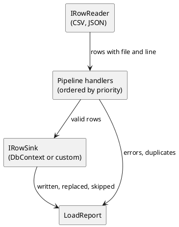

# Data loader (ETL)

Status: **file handlers built 2026-11-23 (`TextFileHandler`, `DocumentUploadHandler`, `SourceFileResolver`, 6 unit tests); proposed design, written 2026-11-19 on the assumed answer A of Q18 (library only, no CLI, stands alone until the MasterData design needs it); core built 2026-11-19 (`OoBDev.DataLoader`: pipeline, CSV and JSON readers, in-memory sink, 8 unit tests, `TryAddDataLoader`); the EF Core sink is built 2026-11-19 (`OoBDev.DataLoader.EntityFrameworkCore`, JSON-column table, 3 Simulate tests on SQLite); batching built 2026-11-23 (`IBatchRowSink`, `LoadOptions.BatchSize`, one save per batch in the EF sink).** Request: [data loader](../../features/request/2026-11-10-data-loader-etl.md). Epic 5 of [SharedFramework](../SharedFramework/README.md); related: [MasterData](../MasterData/README.md).

## Contents

1. [Behavior](#behavior)
2. [Architecture](#architecture)
3. [API sketch](#api-sketch)
4. [Rules](#rules)
5. [Testing strategy](#testing-strategy)
6. [Open points](#open-points)

### List of Figures

1. Figure 1 — Pipeline

### List of Tables

1. Table 1 — Test plan

## Behavior

A load reads rows from a file (CSV, JSON), runs them through an ordered pipeline of handlers (validate, map, look up, write) and reports the outcome per row. Duplicates follow a configured policy: skip, replace or fail. An invalid row is reported with file and line; the load continues or stops by option. A bad row never throws; the load returns a report.

## Architecture



*Figure 1 — Pipeline*

`OoBDev.DataLoader` (Framework, host-free) holds the pipeline, readers over the existing CSV and JSON utilities, and an in-memory sink. An EF Core sink is a separate project (`OoBDev.DataLoader.EntityFrameworkCore`, EF Core Relational only). No CLI project (assumed answer A of Q18); a host calls `ILoader.LoadAsync`.

## API sketch

```csharp
public interface IRowReader { IAsyncEnumerable<SourceRow> ReadAsync(Stream source, CancellationToken cancellationToken); }
public interface IPipelineHandler { int Priority { get; } ValueTask<RowOutcome> HandleAsync(RowContext row, CancellationToken cancellationToken); }
public interface IRowSink { ValueTask<WriteResult> WriteAsync(RowContext row, DuplicatePolicy policy, CancellationToken cancellationToken); }
public interface ILoader { Task<LoadReport> LoadAsync(Stream source, string format, LoadOptions options, CancellationToken cancellationToken); }
public enum DuplicatePolicy { Skip, Replace, Fail }
```

## Rules

- Handlers run in ascending `Priority`; a handler that rejects a row ends its pipeline.
- Lookup by alternative key is a handler, not a sink feature: `LookupHandler` takes an `ILookupSource` (`DictionaryLookupSource` for a fixed table, `DelegateLookupSource` for a host query by property or query) and writes the found value into a target column; a required lookup rejects an empty or unknown key.
- The sink writes in batches, one transaction per batch; a failed batch is reported and the next continues unless `StopOnError` is set.

## Testing strategy

**Table 1 — Test plan**

| Case | Tier | Check |
|------|------|-------|
| CSV and JSON with a duplicate row | Unit | skip, replace and fail each applied and reported |
| invalid row | Unit | reported with file and line; rest loaded or stopped by option |
| handler order | Unit | ascending priority |
| EF sink | Simulate (SQLite) | rows written, replaced, skipped |
| EF sink on SQL Server | Integration (`oobd-test-sqlserver`) | same cases |

*Table 1 maps each case to its tier; the Framework target is 80% or more coverage.*

## Open points

Whether MasterData (Epic 5) absorbs the loader once its design is built. The SharedFramework source also had a database deployment template, which the [desired-state tooling](../DesiredStateDatabase/README.md) now covers.
