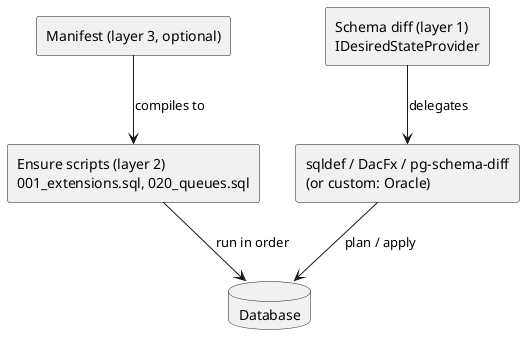

# Desired-State Database Tooling — Architecture

[← Requirements](requirements.md) · [↑ Overview](README.md) · [API design →](api-design.md)

**Status:** Draft · **Date:** 2026-10-29

## Contents

- [Layers](#layers)
- [Phases](#phases)
- [Rollback](#rollback-proposed-2026-11-19)
- [Alternatives considered](#alternatives-considered)

### List of Figures

1. [Figure 1 — Layers](#figure-1)

### List of Tables

1. [Table 2 — Phases](#table-2)
2. [Table 3 — Alternatives](#table-3)

## Layers

*Figure 1 — Layers*

## Phases

**Table 2 — Phases**

| Phase | Content | Needs |
|-------|---------|-------|
| 0 | Bake-off per the notes' test plan; decision recorded | Tool binaries, Postgres/SQL Server/SQLite containers, licence check |
| 1 | Provider interface and gates (`PlanAnalyzer`, `ApplyOptions`); SQL Server through `mssqldef` (DacFx stays the dacpac route). Built 2026-11-23 | Phase 0 result |
| 2 | Postgres and SQLite adapters wrapping sqldef (built 2026-11-23, Q34 A) | Phase 0 result |
| 3 | Ensure-script runner (built 2026-11-23: `EnsureScriptRunner`, `*.once.sql` with recorded hashes) | none |
| 4 | Manifest compiler (built 2026-11-23: `FeatureManifest`, `ManifestCompiler`; portable `queue_*` and `stream_*` tables, extensions on Postgres only); Oracle as repeatable scripts (provider built 2026-11-23, Q35 A; the Oracle executor is not) | none |

## Rollback (proposed 2026-11-19)

The scripts are the source of truth, so the model is **roll forward to a previous desired state**, not reverse scripts:

1. Rolling back means re-publishing the scripts of an earlier commit; the same diff engine computes the changes back, under the same data-loss guard (REQ-003), so a rollback that would drop a column holding data is refused without the explicit flag.
2. Before `ApplyAsync` changes a database the provider writes the change script it is about to run (the dry-run output) to the deployment record, with the source commit; that script is the audit of what ran and the starting point for a manual revert.
3. Data is not restored by the tool. A destructive change needs a backup taken by the operator before the flag is set (`docs/how-tos/production-operations-practices.md`); the apply result states whether the plan contained data-loss steps so a pipeline can require the backup.
4. No automatic transaction-wide undo: engines differ (SQL Server DDL is transactional, MySQL is not). Where the engine supports it the apply runs in one transaction and a failure leaves the database unchanged; otherwise a failure reports the step reached.

Open for the bake-off: whether the chosen tool can emit the reverse plan directly (a nice-to-have, not required).

## Alternatives considered

**Table 3 — Alternatives**

| Alternative | Why not (yet) |
|-------------|---------------|
| Write a custom diff engine first | Costly per engine; the bake-off may show a tool already does it |
| Imperative migrations (EF, DbUp) | The request is scripts as the source of truth |
| Fold into `OoBDev.DacFx` | DacFx is SQL Server only; the provider interface sits above it |

[API design →](api-design.md)
