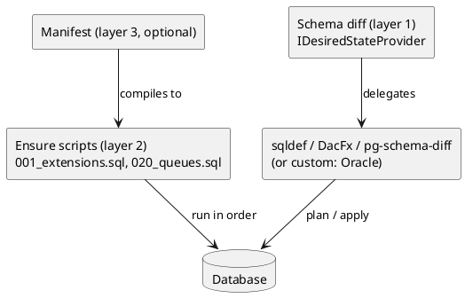

# Desired-State Database Tooling — Architecture

[← Requirements](requirements.md) · [↑ Overview](README.md) · [API design →](api-design.md)

**Status:** Draft · **Date:** 2026-10-29

## Contents

- [Layers](#layers)
- [Phases](#phases)
- [Alternatives considered](#alternatives-considered)

### List of Figures

1. [Figure 1 — Layers](#figure-1)

### List of Tables

1. [Table 2 — Phases](#table-2)
2. [Table 3 — Alternatives](#table-3)

## Layers

*Figure 1 — Layers*

## Phases

**Table 2 — Phases**

| Phase | Content | Needs |
|-------|---------|-------|
| 0 | Bake-off per the notes' test plan; decision recorded | Tool binaries, Postgres/SQL Server/SQLite containers, licence check |
| 1 | Provider interface and SQL Server adapter over `OoBDev.DacFx` | Phase 0 result |
| 2 | Postgres and SQLite adapters (wrap the winner) | Phase 0 result |
| 3 | Ensure-script runner | none |
| 4 | Manifest compiler; Oracle | Owner answer (Q5) |

## Alternatives considered

**Table 3 — Alternatives**

| Alternative | Why not (yet) |
|-------------|---------------|
| Write a custom diff engine first | Costly per engine; the bake-off may show a tool already does it |
| Imperative migrations (EF, DbUp) | The request is scripts as the source of truth |
| Fold into `OoBDev.DacFx` | DacFx is SQL Server only; the provider interface sits above it |

[API design →](api-design.md)
