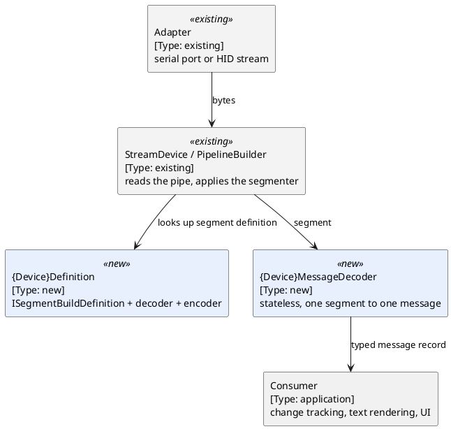

# Device Decoding — Architecture

[← Requirements](requirements.md) · [↑ Overview](README.md) · [API design →](api-design.md)

**Status:** Draft · **Date:** 2026-10-28

## Contents

- [Layers](#layers)
- [Data flow](#data-flow)
- [Package layout](#package-layout)
- [Template device](#template-device)
- [State outside the decoder](#state-outside-the-decoder)

### List of Figures

1. Figure 1 — Receive path for one device

### List of Tables

1. Table 1 — Where each dev-term concern lands

## Layers

A device package implements `IDeviceDefinitionReceiver<TMessage>` and `IDeviceDefinitionTransmitter<TMessage>` from `OoBDev.System.Abstractions` and nothing else. Bytes arrive through the existing adapters (`OoBDev.System.IO.Ports`, `.UsbHids`, `.Pipelines`); the package never opens a port. Framing, decoding, encoding and checksums are the four pieces a device supplies.

## Data flow



*Figure 1 — Receive path for one device*

Transmit is the reverse: a message record goes through `IMessageEncoder<T>` to bytes, which `StreamDevice` writes to the adapter.

## Package layout

Per device, for example `OoBDev.Quarta.RadexOne`:

```
OoBDev.Quarta.RadexOne/
  Messages/            record types and the message decoder and encoder
  Segmenters/          only when the built-in segmenters do not fit
  QuartaGlobals.cs     provider key "radex-one"
  RadexOneOptions.cs   validated options (serial settings, timeouts)
  ServiceCollectionExtensions.cs
  README.Quarta.RadexOne.md
  docs/                device .ksy and known-configuration.md moved from dev-term
```

The tests project is `OoBDev.Quarta.RadexOne.Tests`.

Device packages are specialized and separately packaged, so they sit in the Extensions layer (`src/Extensions/`) and reference `OoBDev.System.Abstractions` only. Their test projects sit beside them and reference `OoBDev.Devices.TestUtilities` (`src/Framework/`, beside `OoBDev.TestUtilities`). Stub projects for all eight devices and the helper project exist since 2026-10-28; they build and hold the provider key only.

## Template device

The first device built end to end is DE-5000: a 17-byte packet on a stream, verified on real hardware, with no command side. It exercises the segmenter, a checksum-free or simple-checksum decode, the registration and the readme without the open questions that Busylight (state) and K8055 (HID report id) raise. What it teaches is written back into [api-design.md](api-design.md) before the other devices follow.

## State outside the decoder

dev-term's decoders buffer partial frames and raise change events (K8055 publishes only values that changed). Under R3 that state moves out of the decoder.

**Table 1 — Where each dev-term concern lands**

| dev-term concern | Lands in |
|------------------|----------|
| Buffering partial frames, resynchronising on a prefix | The segmenter (`ISegmenter`); a prefix-resynchronising segmenter is added only if the built-in ones cannot express a device |
| Decoding bytes to values | `IMessageDecoder<T>` returning a record |
| Rendering a line of text (`"RADEX-ONE: CPM=..."`) | A formatter on the record, not part of decoding |
| Change tracking (`ValuesChanged`) | A small consumer type per device that compares successive records |
| Building command frames from UI state (Busylight colour, track, volume) | A message record carrying the whole state, encoded by `IMessageEncoder<T>`; the state holder belongs to the consumer |
| Reply correlation (SCPI, Radex One packet numbers) | A consumer type, designed with SCPI in phase 4 |
