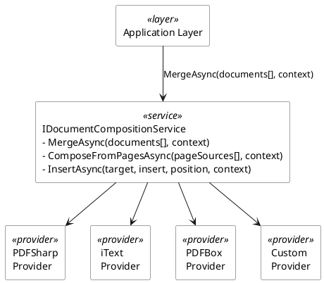

# Document Composition Service - Architecture

**Epic:** 6 - Document Services
**Feature:** Document Composition Service
**Last Updated:** 2026-01-23

---

## Architectural Overview

The Document Composition Service implements a **Provider Pattern** with **Context-Based Merging** for combining multiple documents into a single output with bookmark preservation, metadata consolidation, and intelligent page ordering.



*Figure 1 — Composition service and providers*

---

## Core Components

### 1. DocumentCompositionService

**Implementation Pattern:**
```csharp
public class DocumentCompositionService : IDocumentCompositionService
{
    public async Task<CompositionResult> MergeAsync(
        IEnumerable<byte[]> documents,
        string format,
        CompositionContext? context = null)
    {
        context ??= new CompositionContext();
        var provider = await SelectProviderAsync(format, context);

        var result = await provider.MergeAsync(documents, format, context);

        if (context.GenerateToC)
        {
            result.ComposedDocument = await GenerateTableOfContentsAsync(
                result.ComposedDocument!, context);
        }

        return result;
    }
}
```

---

## Design Patterns

1. **Provider Pattern** - Multiple composition engines
2. **Strategy Pattern** - Different merge strategies
3. **Builder Pattern** - Complex document composition

---

## Related Documents

- [Requirements](requirements.md)
- [API Design](api-design.md)
- [Testing Strategy](testing-strategy.md)
- [Epic 6 Overview](../README.md)
