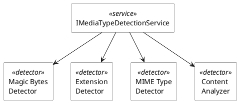

# Media Type Detection - Architecture

**Epic:** 6 - Document Services
**Feature:** Media Type Detection
**Last Updated:** 2026-01-23

---

## Architectural Overview

The Media Type Detection Service uses **multiple detection strategies** with a **signature database** for accurate format identification.



*Figure 1 — Media type detection service and detectors*

---

## Core Components

### 1. MediaTypeDetectionService

```csharp
public class MediaTypeDetectionService : IMediaTypeDetectionService
{
    private readonly FormatSignatureDatabase _signatureDb;

    public async Task<DetectionResult> DetectAsync(byte[] content, DetectionContext? context = null)
    {
        // 1. Try magic bytes
        var result = await DetectByMagicBytesAsync(content);
        if (result.Confidence > 0.9)
            return result;

        // 2. Try content analysis
        result = await AnalyzeContentAsync(content);
        return result;
    }
}
```

---

## Design Patterns

1. **Strategy Pattern** - Multiple detection strategies
2. **Factory Pattern** - Detector creation
3. **Repository Pattern** - Signature database

---

## Related Documents

- [Requirements](requirements.md)
- [API Design](api-design.md)
- [Testing Strategy](testing-strategy.md)
- [Epic 6 Overview](../README.md)
