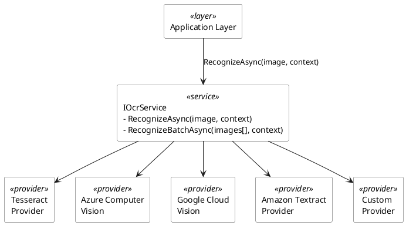

# OCR Service - Architecture

**Epic:** 6 - Document Services
**Feature:** OCR Service
**Last Updated:** 2026-01-23

---

## Architectural Overview

The OCR Service implements a **Provider Pattern** with **Multi-Engine Support** for text extraction from images using Tesseract, cloud-based OCR services, and custom engines.



*Figure 1 — OCR service and providers*

---

## Core Components

### 1. OcrService

```csharp
public class OcrService : IOcrService
{
    private readonly IOcrProviderFactory _providerFactory;
    private readonly IImagePreprocessor _preprocessor;

    public async Task<OcrResult> RecognizeAsync(byte[] imageContent, OcrContext? context = null)
    {
        context ??= new OcrContext();

        // 1. Preprocess image
        if (context.Preprocessing != OcrPreprocessing.None)
        {
            imageContent = await _preprocessor.PreprocessAsync(imageContent, context.Preprocessing);
        }

        // 2. Select provider
        var provider = await SelectProviderAsync(context);

        // 3. Perform OCR
        var result = await provider.RecognizeAsync(imageContent, context);

        return result;
    }
}
```

---

## Design Patterns

1. **Provider Pattern** - Multiple OCR engines
2. **Strategy Pattern** - Different preprocessing strategies
3. **Factory Pattern** - Provider creation

---

## Related Documents

- [Requirements](requirements.md)
- [API Design](api-design.md)
- [Testing Strategy](testing-strategy.md)
- [Epic 6 Overview](../README.md)
