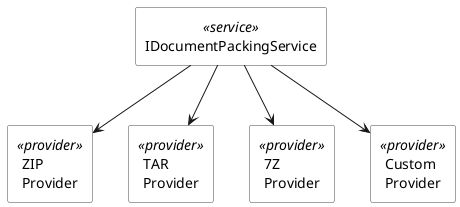

# Document Packing Service - Architecture

**Epic:** 6 - Document Services
**Feature:** Document Packing Service
**Last Updated:** 2026-01-23

---

## Architectural Overview



*Figure 1 — Packing service and providers*

---

## Core Components

```csharp
public class DocumentPackingService : IDocumentPackingService
{
    public async Task<PackingResult> PackAsync(
        IEnumerable<PackingItem> items,
        string archiveFormat,
        PackingContext? context = null)
    {
        var provider = await SelectProviderAsync(archiveFormat);
        return await provider.PackAsync(items, context ?? new PackingContext());
    }
}
```

---

## Related Documents

- [Requirements](requirements.md)
- [API Design](api-design.md)
- [Testing Strategy](testing-strategy.md)
- [Epic 6 Overview](../README.md)
