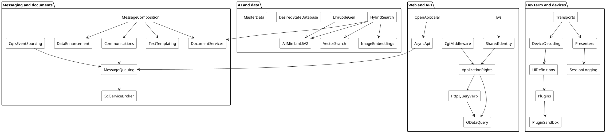

# Feature landscape of the design set

**Status:** Draft review · **Date:** 2026-11-11 · **Request:** owner, 2026-11-11 ("review all designs in `docs/design`")

For every feature in [docs/design](../README.md): which features are expected to work together, how far it is built, known issues, the web standards and RFCs it touches, the patterns and practices it follows, and the features it is missing. The goal is a map that shows where the designs fit together and where they have gaps, not a replacement for the feature documents.

**How the status was found.** Each design's own status line was compared with the projects that exist under `src` (by project name, plus a read of the readme and status files for the unclear ones). Nothing was built or run for this review, so "built" means "a project exists", not "verified". Where the design status and the code disagree it is listed under known issues as drift. Standards are the ones that apply to the topic, not a claim that the code implements them completely.

## Contents

1. [How the features relate](#how-the-features-relate)
2. [Status at a glance](#status-at-a-glance)
3. [Area documents](#area-documents)
4. [Cross-cutting findings](#cross-cutting-findings)
5. [Suggested follow-up](#suggested-follow-up)

**List of figures**

1. [Figure 1 — Features that work together](#figure-1)

**List of tables**

1. [Table 1 — Status at a glance](#table-1)
2. [Table 2 — Area documents](#table-2)
3. [Table 3 — Design status that disagrees with the code](#table-3)

## How the features relate

*Figure 1 — Features that work together*

An arrow means "is expected to be used by or to feed" the target, taken from the related-links lines of the designs. Features without arrows (for example Theming or ConnectionProfiles) are leaf designs of the DevTerm application and are covered in the [DevTerm and devices](devterm-and-devices.md) document.

## Status at a glance

**Table 1 — Status at a glance**

| Area | Features | Built | Partly built | Design only |
|------|----------|-------|--------------|-------------|
| [Web and API](web-and-api.md) | ApplicationRights, AsyncApi, CgiMiddleware, HttpQueryVerb, Jws, ODataQuery, OpenApiScalar, SharedIdentity | AsyncApi, OpenApiScalar, Jws, CgiMiddleware (first cut) | ApplicationRights, HttpQueryVerb, ODataQuery, SharedIdentity | none |
| [Messaging and documents](messaging-and-documents.md) | Communications, CqrsEventSourcing, DataEnhancement, DocumentServices, MasterData, MessageComposition, MessageQueuing, SharedCaching, SharedFramework, SqlServiceBroker, TextTemplating, TemplateTools | MessageQueuing, SqlServiceBroker | Communications, DocumentServices, SharedCaching, TextTemplating, TemplateTools | CqrsEventSourcing, DataEnhancement, MasterData, MessageComposition |
| [AI and data](ai-and-data.md) | AllMiniLmL6V2, ContractParser, DesiredStateDatabase, HybridSearch, ImageEmbeddings, LlmCodeGen, VectorSearch, GeneratedGuides | AllMiniLmL6V2, ImageEmbeddings, LlmCodeGen, VectorSearch | HybridSearch, DesiredStateDatabase, GeneratedGuides | ContractParser |
| [DevTerm and devices](devterm-and-devices.md) | ConnectionProfiles, DeviceDecoding, DevTermParity, MultiSessionUi, NetworkDevices, PluginSandbox, Plugins, Presenters, ProjectState, ScpiInstruments, Ser2NetWin, SessionChannel, SessionLogging, StreamTools, Theming, Transports, UiDefinitions, WebFrontend, WindowsForms, ZWave, example-ui | Ser2NetWin, DeviceDecoding (per device packages) | most of the DevTerm leaf designs, Transports, UiDefinitions, WindowsForms | PluginSandbox (spike only) |

*Counts are from the design status lines and the project names under `src`; see the area documents for the evidence per feature.*

## Area documents

**Table 2 — Area documents**

| Document | Covers |
|----------|--------|
| [web-and-api.md](web-and-api.md) | Rights, queries, API description, CGI, JWS and identity |
| [messaging-and-documents.md](messaging-and-documents.md) | Queues, communications, templating, documents, caching, events |
| [ai-and-data.md](ai-and-data.md) | Embeddings, search, LLM tooling, databases, guides |
| [devterm-and-devices.md](devterm-and-devices.md) | Transports, decoders, UI definitions, plugins and the DevTerm leaf designs |

## Cross-cutting findings

**Table 3 — Design status that disagrees with the code**

| Feature | Design says | Code shows |
|---------|-------------|------------|
| ApplicationRights | Draft | `RoleRightOptions` in `OoBDev.AspNetCore.Mvc` and the example API's rights catalog and controller exist |
| ODataQuery, HttpQueryVerb | Draft | `OoBDev.AspNetCore.OData` with limits and a query-body middleware exists |
| Communications | Design phase, "replaces a 16 LOC stub" | `OoBDev.Communications` plus Abstractions, Hosting and MessageQueueing projects with tests |
| TextTemplating | Design phase | Handlebars adapter and `OoBDev.System.Text.Templating.Xslt` exist |
| SharedCaching | Design phase | `OoBDev.Caching` and Abstractions exist; whether the attribute-based, AOP and background-task designs are covered is not stated |
| SharedIdentity | Design phase | `OoBDev.Identity`, Abstractions and `OoBDev.Identity.Jws` exist |
| Jws | Accepted | `OoBDev.Identity.Jws` exists |
| DocumentServices | Design phase | `OoBDev.Documents` plus Abstractions, ExternalTools, Guides and Hpgl exist |

Other patterns across the set:

- **Status lines are stale in the older designs.** Epic designs written in January 2026 (SharedFramework, Communications, DataEnhancement, TextTemplating, MasterData, ContractParser) still say "Design phase" while parts exist. A reconcile pass (skill `reconcile-designs-and-code`) per feature would close the drift.
- **Three designs have no status line at all:** ConnectionProfiles, MultiSessionUi and the other moved DevTerm leaf folders. Their state lives in the [DevTerm parity status](../DevTermParity/status.md).
- **The same four standards recur** across the web designs: HTTP semantics (RFC 9110), problem details (RFC 9457), JWT (RFC 7519) and OpenAPI. They are best kept in one place, which the [web and API](web-and-api.md) document does.
- **Observability and operations are missing from most designs.** Few of the feature designs say what is logged, which metrics exist or how a failure is recognised; the telemetry design (OpenTelemetry) is covered in the patterns-discovery set but not linked from the feature designs.

## Suggested follow-up

1. Reconcile the eight drifted designs in Table 3 and update their status lines (backlog item, one change each).
2. Give the moved DevTerm leaf folders a status line that points to the parity status.
3. Pick the missing features in each area document that the owner wants and move them to `BACKLOG.md`; none are added there by this review.
