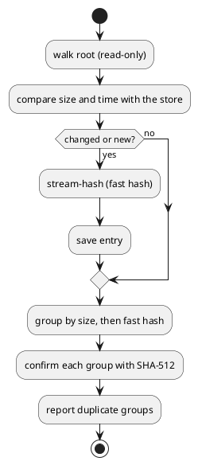

# File inventory and duplicate detection

Status: **proposed design, written 2026-11-19 on the assumed answer A of Q20 (library plus a tool in `src/Tools`; a fast non-cryptographic hash first and SHA-512 to confirm; shared interfaces only); library built 2026-11-19 (`OoBDev.IO.Inventory`, 4 unit tests); the `src/Tools` CLI built 2026-11-19 (`OoBDev.FileInventory.Cli`, 3 unit tests); the perceptual image phase is not built.** Request: [file inventory and deduplication](../../features/request/2026-11-10-file-inventory-and-deduplication.md).

## Contents

1. [Behavior](#behavior)
2. [Architecture](#architecture)
3. [API sketch](#api-sketch)
4. [Rules](#rules)
5. [Testing strategy](#testing-strategy)
6. [Open points](#open-points)

### List of Figures

1. Figure 1 — Scan flow

### List of Tables

1. Table 1 — Test plan

## Behavior

A scan walks a root read-only and records path, size, times and a content hash. A second scan re-hashes only files whose size or modified time changed. Exact duplicates are grouped by size, then by a fast hash, then confirmed with SHA-512; nothing is ever deleted or moved. Near-duplicate images (a perceptual hash, optionally the existing [image embeddings](../ImageEmbeddings/README.md) with a threshold) are a second phase. Results go through an interface so the NAS catalog can write to Postgres and the photo library to its own store.

## Architecture



*Figure 1 — Scan flow*

`OoBDev.IO.Inventory` (Framework, host-free) holds `FileScanner`, `DuplicateFinder` and `IInventoryStore` with an in-memory implementation. A store adapter per consumer lives with that consumer. A small `OoBDev.FileInventory.Cli` in `src/Tools` runs a scan and prints groups. Hashing streams the file (no whole-file reads).

## API sketch

```csharp
public sealed record InventoryEntry(string Path, long Length, DateTimeOffset Modified, string FastHash, string? Sha512);

public interface IInventoryStore
{
    ValueTask<InventoryEntry?> FindAsync(string path, CancellationToken cancellationToken);
    ValueTask SaveAsync(InventoryEntry entry, CancellationToken cancellationToken);
    IAsyncEnumerable<InventoryEntry> ListAsync(CancellationToken cancellationToken);
}

public sealed class FileScanner(IInventoryStore store, TimeProvider time)
{
    public Task<ScanReport> ScanAsync(string root, CancellationToken cancellationToken);
}

public sealed class DuplicateFinder
{
    public IAsyncEnumerable<DuplicateGroup> FindAsync(IInventoryStore store, CancellationToken cancellationToken);
}
```

## Rules

- A read-only root still scans; an unreadable file is reported and skipped.
- Symbolic links are not followed by default (loop safety); an option follows them.
- A group is exact only after the SHA-512 confirmation, so a fast-hash collision never reports a false duplicate.

## Testing strategy

**Table 1 — Test plan**

| Case | Tier | Check |
|------|------|-------|
| two identical files in two folders | Unit (folder from `ITempFileFactory`) | one group; both files untouched |
| second scan, tree unchanged | Unit | zero files re-hashed |
| fast-hash collision | Unit (fake hasher) | not grouped after SHA-512 |
| read-only root | Unit | scan completes |
| image and resized copy | Unit with fixtures | grouped; unrelated images not (phase two) |

*Table 1 maps each case to its tier; the Framework target is 80% or more coverage.*

## Open points

Which fast hash: `System.IO.Hashing` XxHash3 is the proposal (a platform package). Whether the NAS catalog adopts the shared interfaces or keeps its scanner (Q20 says shared interfaces only).
