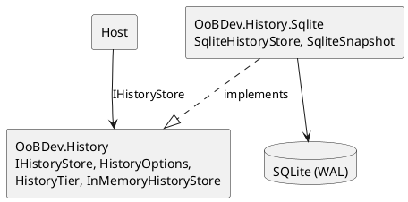

# History store

**Status:** Built 2026-11-23 (in-memory and SQLite providers, SQLite snapshot) · **Date:** 2026-11-23 · **Request:** [event, document and history stores](../../features/completed/2026-11-10-event-document-history-stores.md)

A time-series store with tiered rollups, for small hosts that keep state on a device (the `ctrl-home` proposal, telemetry research). The event store (`IEventStore`), the document store (`IEntityStore`) and the durable queue (`OoBDev.MessageQueueing.EntityFrameworkCore`) already exist with in-memory and SQLite providers; the history store is the part that did not. Owner Q10: a separate package family beside EventSourcing, no second embedded provider yet.

## Contents

- [Requirements](#requirements)
- [Architecture](#architecture)
- [API](#api)
- [Snapshot and backup](#snapshot-and-backup)
- [Testing](#testing)

## Requirements

**Table 1 — Requirements**

| Id | Requirement |
| --- | --- |
| H1 | Append a numeric point to a named series with a timestamp. |
| H2 | Read raw points of a series in a time range, oldest first. |
| H3 | Keep configured rollup tiers (for example 1 minute, 1 hour, 1 day buckets) holding count, minimum, maximum, sum and last value, updated as points arrive. |
| H4 | Read the buckets of a tier in a time range. |
| H5 | Prune raw points and buckets older than the retention of their tier, so storage stays bounded. |
| H6 | The same behaviour from the in-memory and the SQLite provider, proved by one shared test suite. |
| H7 | A consistent snapshot of the SQLite database while the host runs (`VACUUM INTO`), and a check that a snapshot opens and is intact. |

## Architecture

*Figure 1 — Packages*

- Rollups are incremental: an append updates the bucket of every tier it falls in (an upsert), so no rollup job is needed and the result does not depend on when a job ran. A late point (older than a bucket's last point) updates count, minimum, maximum and sum but not the last value.
- Buckets start at the timestamp rounded down to the bucket length from the Unix epoch, in UTC.
- `PruneAsync(now)` deletes by retention: raw points past `RawRetention`, and each tier's buckets past its `Retention`. Hosts call it from a scheduled job.
- Time comes from `TimeProvider` only where `now` is needed; points carry their own timestamps.
- Defaults: raw 1 day; tiers 1 minute for 7 days, 1 hour for 90 days, 1 day for 5 years.

## API

**Table 2 — Types**

| Type | Role |
| --- | --- |
| `IHistoryStore` | `AppendAsync(series, point)`, `ReadRawAsync(series, from, to)`, `ReadBucketsAsync(series, tier, from, to)`, `PruneAsync(now)`. |
| `HistoryPoint` | Timestamp and value. |
| `HistoryBucket` | Bucket start, count, minimum, maximum, sum, last value; `Average`. |
| `HistoryTier` | Name, bucket length, retention. |
| `HistoryOptions` | Raw retention and the tiers. |

Range reads are inclusive of `from` and exclusive of `to`.

## Snapshot and backup

`SqliteSnapshot.CreateAsync(connection, destinationPath)` runs `VACUUM INTO`, which copies a consistent state of the database while writers continue, and `SqliteSnapshot.VerifyAsync(path)` runs `PRAGMA integrity_check`. The helper works on any SQLite database, including the event store and the queue; sealed event segments are not built (no consumer needs them yet).

## Testing

`HistoryStoreContract` is an abstract set of `Unit` tests run by `InMemoryHistoryStoreTests` and by `SqliteHistoryStoreTests` (a temporary file database), so both providers pass the same suite. Snapshot tests copy a populated database, verify it and read the same points back.
