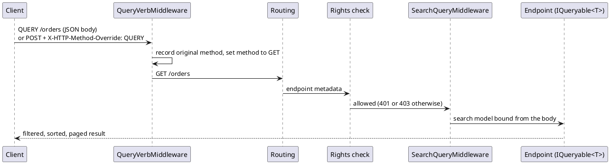

# HTTP QUERY Verb — Architecture

[← Requirements](requirements.md) · [↑ Overview](README.md) · [API design →](api-design.md)

**Status:** Draft · **Date:** 2026-10-22

## Contents

- [Request flow](#request-flow)
- [Why before routing](#why-before-routing)
- [Alternatives considered](#alternatives-considered)

### List of Figures

1. [Figure 1 — Request flow](#figure-1)

### List of Tables

1. [Table 2 — Alternatives](#table-2)

## Request flow

*Figure 1 — Request flow*

## Why before routing

Endpoint routing matches the HTTP method against `[HttpGet]` metadata before any later middleware runs, so the method must change first. Authorization then sees an ordinary `GET` endpoint and applies its rights, which is the point: no second authorization path.

## Alternatives considered

**Table 2 — Alternatives**

| Alternative | Why not |
|-------------|---------|
| A custom `[HttpQuery]` attribute on every action | Every endpoint changes and can drift from its `GET` twin |
| Only `POST` search endpoints | `POST` is not safe or idempotent; caches and retries cannot tell a query from a change |
| Add `QUERY` to `[AcceptVerbs]` on endpoints | Same per-endpoint cost; this middleware needs none |

[API design →](api-design.md)
