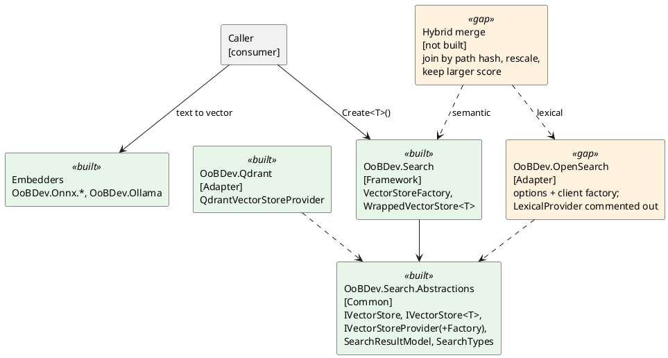

# Hybrid Search — Architecture

[← Requirements](requirements.md) · [↑ Overview](README.md) · [API design →](api-design.md)

**Status:** Draft (from the code as it stands) · **Date:** 2026-11-10

## Contents

- [Components](#components)
- [Where things live](#where-things-live)
- [Provider selection](#provider-selection)
- [Gaps](#gaps)

### List of Figures

1. [Figure 1 — Containers and what is built](#figure-1)

### List of Tables

1. [Table 1 — Projects](#table-1)

## Components

*Figure 1 — Containers and what is built*

Consumers get an `IVectorStore<T>` from DI or from `IVectorStoreFactory`. The factory finds the provider; `WrappedVectorStore<T>` only forwards calls, so the type parameter selects the collection and nothing else. Embeddings are produced by the consumer (or the queue reader host in `OoBDev.Data.Vectors.Hosting`) and passed in; the store never embeds text itself.

## Where things live

**Table 1 — Projects**

| Project | Layer | Holds |
|---------|-------|-------|
| `OoBDev.Search.Abstractions` | Common | `IVectorStore`, `IVectorStore<T>`, `IVectorStoreProvider`, `IVectorStoreProviderFactory`, `IVectorStoreFactory`, `[VectorStore]`, `SearchResultModel`, `SearchTypes` |
| `OoBDev.Search` | Framework | `VectorStoreFactory`, `WrappedVectorStore<T>`, `TryAddSearchServices()` |
| `OoBDev.Qdrant` | ExternalServices | `QdrantVectorStoreProvider`, its factory, options, gRPC client factory, point struct factory |
| `OoBDev.Microsoft.Azure.AISearch` | ExternalServices | `AzureAISearchVectorStoreProvider`, its factory and options; stores `Id`, `Payload` (JSON) and `Vector` (HNSW) in an Azure AI Search index (LiveIntegration test) |
| `OoBDev.OpenSearch` | ExternalServices | `OpenSearchOptions`, `OpenSearchClientFactory`; `LexicalProvider` is a commented-out class |
| `OoBDev.Onnx.SentenceEmbeddings`, `OoBDev.Onnx.ImageEmbeddings`, `OoBDev.Ollama` | ExternalServices | Embedders feeding the store |

## Provider selection

`VectorStoreFactory.Create(collectionName)` resolves in this order: a keyed `IVectorStoreProvider` registered under the collection name; the first non-null result of the registered `IVectorStoreProviderFactory` instances; the default `IVectorStoreProvider`. It then sets `CollectionName` on the provider. `Create<T>()` derives the name from `[VectorStore(CollectionName)]`, then `[Table(Name)]`, then `typeof(T).Name`.

Registration is `services.TryAddSearchServices()` (transient factory and open-generic `IVectorStore<>`); the Qdrant adapter adds its own provider and options.

## Gaps

- The lexical side has no query or index code; the OpenSearch adapter is configuration only, so R5 and R6 of the [requirements](requirements.md#table-1) are open.
- `SearchResultModel` does not carry `SearchTypes`, so a merged result cannot say which provider found it.
- The merge algorithm exists only as comments ([api-design](api-design.md#planned-hybrid-contract) keeps it).
