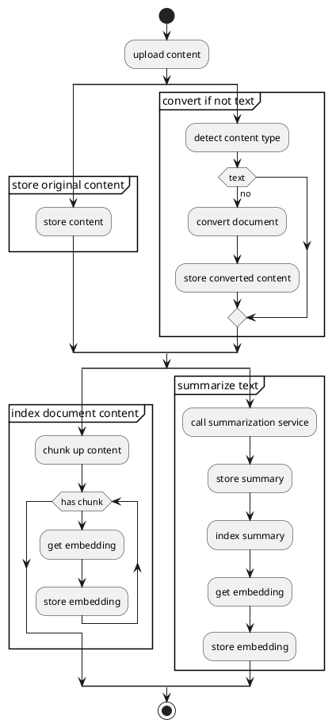
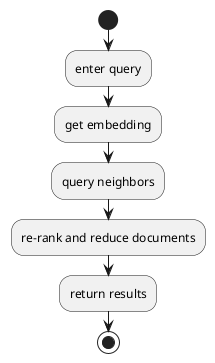
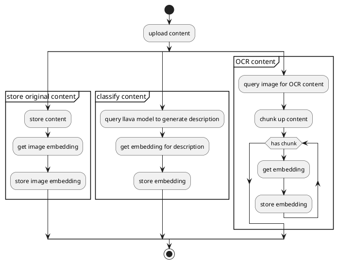

> Status: moved from `docs/Framework/search-design.md` (2026-11-10); part of the [HybridSearch](README.md) design.

## Diagrams

### Upload Document

The branches inside a `split` run in parallel; `split` is used instead of `fork` because the PlantUML server crashes (`height=0.0`) on forks that contain groups.

## Search content

### Upload Graphic

## Notes

- [LLaVa](https://huggingface.co/docs/transformers/main/model_doc/llava) (Large Language and Vision assistant)
- [LLaMA](https://huggingface.co/docs/transformers/main/en/model_doc/llama)
- [Sentence Transformers](https://www.sbert.net/)
- [Image Similarity](https://huggingface.co/blog/image-similarity)
- [Sentence Similarity](https://huggingface.co/tasks/sentence-similarity)
- [Audio Classification](https://huggingface.co/tasks/audio-classification)
- [Hybrid Search](https://qdrant.tech/articles/hybrid-search/)