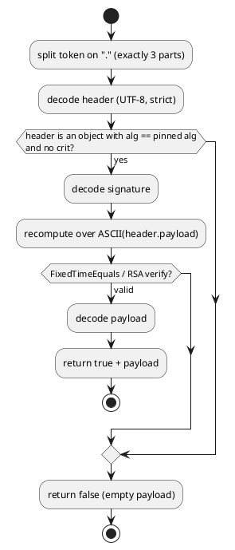

# JWS Reference Implementation — Architecture

[← Requirements](requirements.md) · [↑ Overview](README.md) · [API design →](api-design.md)

**Status:** Accepted · **Date:** 2026-10-29

## Contents

- [Placement and flow](#placement-and-flow)
- [Alternatives considered](#alternatives-considered)

### List of Figures

1. [Figure 1 — Verification flow](#figure-1)

### List of Tables

1. [Table 2 — Alternatives](#table-2)

## Placement and flow

`src/Framework/OoBDev.Identity.Jws` has no package or project references: base64url comes from `System.Buffers.Text.Base64Url`, HMAC and RSA from `System.Security.Cryptography`, header parsing from `System.Text.Json`. It stands beside `OoBDev.Identity` instead of inside it because it has no use for the user-management types. The tests project references `System.IdentityModel.Tokens.Jwt` only as the independent oracle.

*Figure 1 — Verification flow*

## Alternatives considered

**Table 2 — Alternatives**

| Alternative | Why not |
|-------------|---------|
| Wrap `System.IdentityModel.Tokens.Jwt` | The request is to see the steps; the library stays as the test oracle |
| A `Verify(token, key)` that reads `alg` from the token | Algorithm confusion; the caller pins the algorithm by choosing the method |
| Throw on a bad token | Callers branch on the result and a throw invites a swallowed exception; `Try` methods return `false` |

[API design →](api-design.md)
