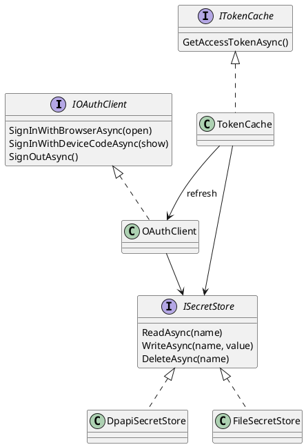

# OAuth client (desktop sign-in and refresh tokens)

Status: library built 2026-11-20 (abstractions, `OoBDev.Security.OAuthClient`, 16 Unit tests); the class is `PublicOAuthClient` because the analyzer forbids a type named like its namespace. `DpapiSecretStore` built in `Extensions/OoBDev.Security.OAuthClient.Windows` (2 tests). Open: Keycloak Integration tests. Owner answer 2026-11-17 (Q2): a host-free Framework library, with a Windows DPAPI secret store as a leaf in Extensions; layout confirmed 2026-11-19.

## Contents

- [Problem](#problem)
- [Requirements](#requirements)
- [Design](#design)
- [Testing strategy](#testing-strategy)
- [Not in the first slice](#not-in-the-first-slice)

List of figures: Figure 1 (interfaces and stores). List of tables: Table 1 (requirements).

## Problem

DevTerm and the other desktop clients acquire no token today, so refresh handling has nothing to attach to. Services understand only JWT bearer tokens and Keycloak is the identity provider (`.claude/rules/owner-decisions.md`), so a client needs the OAuth 2.0 public-client flow: sign in once, keep the refresh token safe, refresh the access token before it expires.

## Requirements

**Table 1 — Requirements**

| Id | Requirement |
|----|-------------|
| OC-1 | Authorization code with PKCE (S256) on a loopback redirect (`127.0.0.1`, an ephemeral port, RFC 8252). |
| OC-2 | Device authorization grant (RFC 8628) for clients with no browser (the Tui). |
| OC-3 | `ITokenCache` hands out a valid access token: it returns the cached one, refreshes it when it expires within a skew window, or reports that sign-in is needed. Concurrent callers share one refresh. |
| OC-4 | The refresh token lives only in an `ISecretStore`; no password is ever handled or stored. |
| OC-5 | Discovery from the issuer (`/.well-known/openid-configuration`), so a client needs the issuer and client id only. |
| OC-6 | The library never launches a browser: the caller passes an `Action<Uri>`, so the library stays host-free and testable. |
| OC-7 | Sign-out clears the secret store and, when the provider offers it, calls the revocation endpoint. |

## Design

*Figure 1 — The client signs in and writes the refresh token to the secret store; the cache reads it back to refresh.*

- Options (`OAuthClientOptions`: `Issuer`, `ClientId`, `Scopes`, `Skew`, `LoopbackTimeout`) are bound with `AddValidatedOptions<T>()`.
- HTTP uses `HttpClient` from `IHttpClientFactory`; the clock is `TimeProvider`.
- `ISecretStore` implementations: `FileSecretStore` (owner-only file; the portable default and the test double) in the library, `DpapiSecretStore` (`ProtectedData`, current user) in the Windows extension.
- A `DelegatingHandler` (`BearerTokenHandler`) adds the token from `ITokenCache` to outgoing requests and retries once after a 401 refresh, so a client gets the header without extra code.
- Errors: `OAuthException` carries the provider's `error` and `error_description`; `invalid_grant` on refresh clears the stored token and the next call reports that sign-in is needed.

## Testing strategy

- Unit: PKCE verifier and challenge against the RFC 7636 vectors; discovery parsing; token endpoint calls with a fake `HttpMessageHandler` (code exchange, refresh, device polling with `authorization_pending` and `slow_down`); cache skew, concurrent refresh sharing one call, `invalid_grant` clearing; the loopback listener accepting a state-checked redirect and rejecting a wrong state.
- Integration (`[IntegrationTestMethod("oobd-test-keycloak")]`): the real flows against the Keycloak container of the test stack (code flow driven with `HttpClient` through the login form, device flow approved by posting the login form of the verification page; both with PKCE, built and run 2026-11-20).
- DPAPI store: Windows-only Unit tests (round trip and delete).
- Coverage target 80% or more for the Framework library.

## Not in the first slice

- Client credentials and token exchange (RFC 8693) for services: separate, config-gated, not a desktop concern.
- macOS Keychain and Linux Secret Service stores (the file store is the fallback).
- Wiring into DevTerm and the other clients; each is its own item after the library exists.
