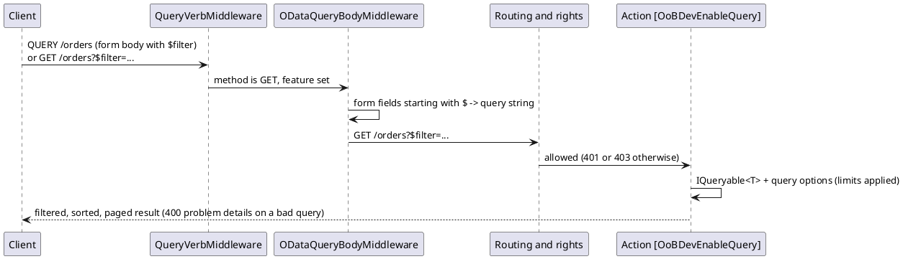

# OData Query — Architecture

[← Requirements](requirements.md) · [↑ Overview](README.md) · [API design →](api-design.md)

**Status:** Draft · **Date:** 2026-10-29

## Contents

- [Request flow](#request-flow)
- [Limits](#limits)
- [Alternatives considered](#alternatives-considered)

### List of Figures

1. [Figure 1 — Request flow](#figure-1)

### List of Tables

1. [Table 2 — Alternatives](#table-2)

## Request flow

*Figure 1 — Request flow*

## Limits

`EnableQueryAttribute` validates through `ODataValidationSettings`; `OoBDevEnableQueryAttribute` fills `MaxTop`, `MaxNodeCount`, `MaxExpansionDepth`, `AllowedQueryOptions` and `AllowedFunctions` from `ODataQueryLimits`. An attribute cannot take constructor injection, so it reads the limits from the request services when it runs.

## Alternatives considered

**Table 2 — Alternatives**

| Option | Verdict |
|--------|---------|
| `Microsoft.AspNetCore.OData` `[EnableQuery]` on existing actions | **Chosen.** First party, validation settings, works on any `IQueryable<T>`. |
| Full OData routing with an EDM model | Rejected for now: a second routing surface and a model to keep in step; not needed for query options. |
| Hand-written `$filter` parser | Rejected: owning a query language parser is a security risk. |
| GraphQL (HotChocolate) | Later, on demand (owner, 2026-10-22). |

[API design →](api-design.md)
