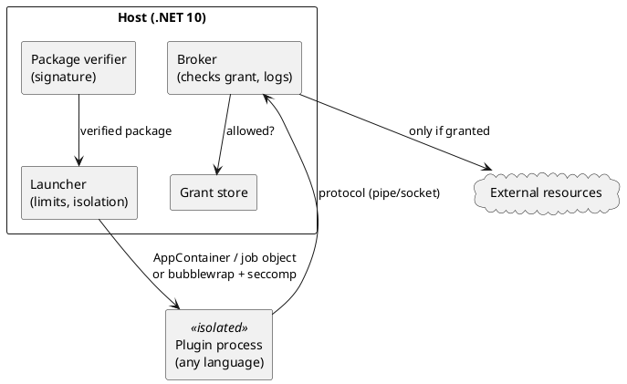

# Sandboxed Plugin Host — Architecture

[← Requirements](requirements.md) · [↑ Overview](README.md) · [API design →](api-design.md)

**Status:** Draft · **Date:** 2026-10-29

## Contents

- [Components](#components)
- [Phases](#phases)

### List of Figures

1. [Figure 1 — Host, broker and plugin](#figure-1)

### List of Tables

1. [Table 2 — Phases](#table-2)

## Components

*Figure 1 — Host, broker and plugin*

The plugin has no direct network, file or environment access; the only channel it holds is the broker connection. Isolation is per platform: Windows AppContainer plus job object; Linux bubblewrap plus seccomp, with a small shim that sets up the sandbox before exec.

## Phases

**Table 2 — Phases**

| Phase | Content | Needs |
|-------|---------|-------|
| 0 | [Threat model and PoC review](threat-model.md) (written 2026-10-29, awaiting sign-off) | Q6 not needed |
| 1 | [Protocol and manifest schema](protocol-and-manifest.md) (versioned; design written 2026-10-29; generated JSON Schema waits for the C# types) | Phase 0 |
| 2 | Windows launcher and broker with limits | Windows host |
| 3 | Linux shim and launcher | Linux host or container |
| 4 | Signed packages; SDK for one language | Phase 1 |
