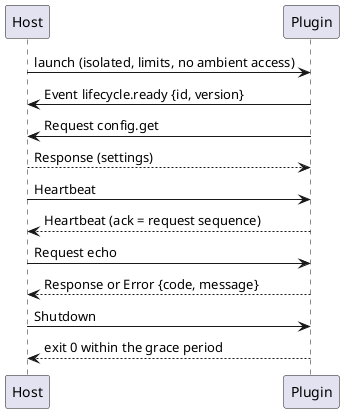

# Sandboxed Plugin Host — Protocol and manifest schema

[← Threat model](threat-model.md) · [↑ Overview](README.md)

**Status:** Signed off by the owner 2026-11-20 · **Date:** 2026-10-29

Phase 1 design (REQ-009, REQ-002, REQ-006). The frame format described here is built and tested in the spike (`src/Spikes/OoBDev.Spike.PluginSandbox`, `FrameChannel`). It fixes what is on the wire and in the manifest so a plugin in any language can be written from this page. It is based on the proof-of-concept wire profile (`PROFILE.md` in `examples/plugin-sandbox-poc`), which carried five languages and the real host's 36 conformance checks unchanged, and it adds versioning, grants and a manifest schema. Decisions here are reversible until a launcher ships.

## Contents

- [Framing and encoding](#framing-and-encoding)
- [Frame layout](#frame-layout)
- [Message flow](#message-flow)
- [Plugin rules](#plugin-rules)
- [Versioning](#versioning)
- [Request context](#request-context)
- [Manifest](#manifest)
- [Open points](#open-points)

### List of Figures

1. [Figure 3 — Start, request and shutdown](#figure-3)

### List of Tables

1. [Table 7 — Frame header and trailer layout](#table-7)
2. [Table 8 — Host violations and reactions](#table-8)
3. [Table 9 — Manifest fields](#table-9)

## Framing and encoding

The protocol is a packed binary structure (owner, 2026-11-10). Every integer is little-endian and fields sit at fixed offsets with no padding. Only the application payload may be text: a UTF-8 JSON string, declared by the `format` byte. The transport never looks inside a payload except to check that it matches the declared format.

One frame per message on the plugin's stdin (host to plugin) and stdout (plugin to host). Stdout carries frames only; logs go to stderr; end of input means the host is gone and the plugin exits. The maximum payload is 1 048 576 bytes and the maximum topic is 256 bytes.

Earlier drafts framed a JSON envelope behind a 4-byte length. The envelope fields (type, correlation, topic, deadline, hop count) are now header fields, so a receiver rejects a malformed frame from fixed offsets before any parser sees it, and a fixed header is cheap to write in any language. Bulk binary data still does not go in frames: the broker hands the plugin a granted file or pipe instead (REQ-004). Language neutrality (REQ-009) comes from this page; there is no IDL compiler to ship. A manifest JSON Schema is still generated (see Open points).

## Frame layout

<a id="table-7"></a>**Table 7 — Frame header and trailer layout**

| Offset | Size | Field | Rule |
|-------:|-----:|-------|------|
| 0 | 1 | `version` | Protocol major of the sender; the receiver refuses any other value |
| 1 | 1 | `flags` | `Crc32` = 1, `Hmac` = 2, `CounterSign` = 4; other bits must be zero. A session fixes the required flags at launch, so a frame without them is a downgrade and is refused |
| 2 | 1 | `type` | 1 `Request`, 2 `Response`, 3 `Event`, 4 `Heartbeat`, 5 `Shutdown`, 6 `Error`; any other value is rejected |
| 3 | 1 | `format` | Payload encoding: 0 binary, 1 JSON (UTF-8, must parse, not empty), 2 text (strict UTF-8) |
| 4 | 4 | `payloadLength` | 0 to 1 048 576 |
| 8 | 8 | `sequence` | Per direction, starts at 1, rises by exactly 1; a replay or a gap is a violation. This replaces the old `requestId` |
| 16 | 8 | `ack` | Sequence of the request being answered, or 0. This replaces the old `correlationId`. Non-zero needs `Hmac` and `CounterSign` and must name a request this side sent and has not yet had answered |
| 24 | 2 | `topicLength` | 0 to 256 |
| 26 | 1 | `hops` | Relay counter; the host drops a message over the limit |
| 27 | 1 | reserved | Must be zero |
| 28 | 4 | `ttlMs` | Request deadline in milliseconds; 0 for none |
| 32 | `topicLength` | topic | UTF-8, dotted lower case |
| next | `payloadLength` | payload | Topic specific; hostile in both directions |
| next | 4 | CRC-32 | Only with `Crc32`; over every byte before it. Catches accidental corruption, not tampering |
| next | 32 | HMAC-SHA256 | Only with `Hmac`; over every byte before the CRC, keyed with a random per-launch key the host passes to the plugin in its environment. A `CounterSign` reply also folds in the answered request's HMAC, so a reply cannot be moved to another request |

`source` and `target` from the old envelope are not on the wire: the host knows the source from the channel, and logical targets belong to the broker design (phase 2). A `ResourceRequest` and `ResourceGrant` pair is added with the broker and is not in version 1.

Topics a plugin may send are those its manifest lists under `publish`, plus `lifecycle.ready` and `config.get`. All other `lifecycle.*` topics are host only. A frame is read in order: header, version, flags, reserved byte, type and format, length limits, body, CRC, HMAC and ack, sequence, then topic and payload validity.

<a id="table-8"></a>**Table 8 — Host violations and reactions**

| Violation | Reaction |
|-----------|----------|
| Wrong version, unknown flag bits, non-zero reserved byte, unknown type or format | Disconnect and kill |
| Required flags missing (downgrade), or `CounterSign` without `Hmac` | Disconnect and kill |
| Payload or topic length over the cap, or an empty JSON payload | Disconnect and kill |
| CRC-32 or HMAC mismatch | Disconnect and kill |
| Sequence replayed or skipped | Disconnect and kill |
| `ack` naming no outstanding request, or `ack` without `Hmac` | Disconnect and kill |
| Topic or payload not valid for its declared format | Disconnect and kill |
| Rate over `msgPerSec` | Drop the excess and count it; kill when sustained |
| Topic outside the manifest | Refuse, log, count; kill after repeated attempts |
| Heartbeat unanswered, or three consecutive request timeouts | Declare hung and kill; restart policy applies |
| Unexpected exit, including exit 0 without a `Shutdown` | Treat as a crash; at five crashes in the window stop launching and report `Failed` |

## Message flow

<a id="figure-3"></a>



*Figure 3 — Start, request and shutdown*

## Plugin rules

1. Send `lifecycle.ready` with `{id, version}` after startup, within the ready timeout (10 s by default).
2. Answer a heartbeat from the same loop that handles requests. A side thread that only heartbeats hides a stuck plugin, so request time to live also counts.
3. Answer every `Request` with a `Response` or an `Error` whose payload is `{code, message}`; unknown topics get code `unknown-topic`.
4. On `Shutdown`, finish and exit 0 within the grace period; be killable at any instant, because the host owns committed state.
5. Ask for configuration with `config.get`; never read it from disk. Keep answering heartbeats and `Shutdown` while waiting.
6. Use stdout for frames only and read nothing but stdin.

## Versioning

The protocol version is `major.minor`. The manifest names the version the plugin was built for and every frame carries the major in its `version` byte. The host refuses a plugin whose major it does not support, with a reason in the log, before launch. Within a major, minor versions only add optional fields, new topics and new error codes; a receiver ignores what it does not know. A removed or changed meaning needs a new major, and the host may support two majors at once while plugins migrate. Conformance (the proof of concept's 36 checks, ported) is the contract test: a platform is listed in a manifest only after the plugin passes it there.

## Request context

A plugin that acts for a user needs to know who the user is, but it is untrusted, so it receives an immutable, minimised *assertion* from the host and never the user's credentials (REQ-012; auth rules in `owner-decisions`: services understand JWT, the host validates it).

1. **Built by the host from a validated token.** The host validates the bearer token itself and builds the context: `id`, `sub`, `tenant`, `claims` (only the claim types the manifest asks for under `context.claims`; everything else is dropped), `rights` (application rights, not raw roles), `aud` (the plugin id), `iat`, `exp` (short, never longer than the request's `ttlMs`) and `traceId`. The plugin never sees the access token, refresh token or any password.
2. **Immutable and tamper evident.** The context is serialised as canonical JSON (RFC 8785) and the `id` is its SHA-256. It travels in the `Request` payload as `{ "context": {...}, "body": {...} }`, or once per session as an `Event` on topic `context.set` that later requests refer to by `id`. The frame HMAC protects it in transit; the `id` lets any later check detect a changed copy. The plugin may read it and may not change it: it has no way to mint a context that the host will accept.
3. **The plugin presents only the id, never the data.** When the plugin asks the broker to do something (read a file, call a host, reach another plugin), it sends the context `id`. The broker looks up the context it stored for that request and checks the grant and the user's rights against it, so a plugin that edits its copy gains nothing. A request arriving with an unknown, expired or other-plugin `id` is refused and logged.
4. **Scoped to the request.** A context is valid for one request (or one session event with an `exp`) and for one plugin (`aud`). It is not kept after the request finishes unless the manifest declares `context.retain` and the user approved it.
5. **Acting for the user downstream.** If a call needs the user's identity at another service, the broker makes it, using an RFC 8693 token exchange (optional, config-gated) for a narrow audience, or the plugin receives a short-lived delegated token whose `aud` is only that service. The user's own token is never forwarded.
6. **Minimisation and privacy.** A plugin gets only the claims it declared and the user approved at install; personal data in claims (email, name) is a declared claim like any other and appears in the grant record.

A plugin can still copy what it was given and leak it through any channel it is granted, so declared claims are the limit of the disclosure. The context is for the plugin's logic, not a trust boundary for the host.

## Manifest

The manifest is JSON inside the signed package. The signature covers the manifest bytes and the manifest carries a SHA-256 for every file (REQ-006). `entry.dev` from the proof of concept is not part of the schema; a development switch in the host may accept it from an explicitly named folder only.

<a id="table-9"></a>**Table 9 — Manifest fields**

| Field | Required | Meaning |
|-------|----------|---------|
| `id` | yes | Plain name: letters, digits, `-`, `_`, `.`; no path characters |
| `version` | yes | Semantic version of the plugin |
| `protocol` | yes | `major.minor` the plugin speaks |
| `platforms` | yes | Subset of `win-x64`, `win-arm64`, `linux-x64`, `linux-arm64`, `linux-musl-x64`, `osx-universal` |
| `entry` | yes | Map from platform to the relative executable path |
| `lifetime` | no | Object `{ "modes": ["Bound", "Shared"], "default": "Bound", "onCallerExit": "Kill", "reconnectWindowSec": 30, "singleton": false }`. Which lifetimes the plugin supports (see [Lifetime](#lifetime)); omitted means `Bound` only |
| `permissions` | yes | What the plugin requests; the user approves a subset (REQ-002). Shape below |
| `limits` | no | `memoryMb`, `cpuPercent`, `maxProcesses`, `wallTimeSec`, `msgPerSec`, `maxFrameBytes`; the host applies its own ceilings |
| `context` | no | `{ "claims": ["sub", "name"], "retain": false }`: claim types the plugin asks for in the request context, and whether it may keep a context past the request. See [Request context](#request-context) |
| `heartbeatTimeout` | no | Duration; default from the host |
| `files` | yes | Map from relative path to `sha256:` digest, covering every file |
| `signature` | yes | Detached signature over the manifest, with the key id of a key in the host's trust list |

```json
{
  "id": "telemetry",
  "version": "1.2.0",
  "protocol": "1.0",
  "platforms": ["win-x64", "linux-x64"],
  "entry": { "win-x64": "win-x64/telemetry.exe", "linux-x64": "linux-x64/telemetry" },
  "permissions": {
    "files": [{ "path": "data", "access": "rw" }],
    "network": [{ "host": "api.example.org", "port": 443 }],
    "publish": ["device.readings"],
    "subscribe": ["config.updated"],
    "sendTo": ["analytics"]
  },
  "limits": { "memoryMb": 256, "cpuPercent": 25, "maxProcesses": 1, "wallTimeSec": 3600 },
  "files": { "win-x64/telemetry.exe": "sha256:…", "linux-x64/telemetry": "sha256:…" },
  "signature": { "keyId": "…", "value": "…" }
}
```

Permissions are requests, not grants. Network and file entries name exact hosts and folders; there are no wildcards in the first version. The host stores the approved subset in the grant store with who approved it and when, and the broker checks the grant on every call (REQ-003, REQ-004). A package that requests nothing runs with no files, no network and no peers.

## Lifetime

A plugin is either bound to the process that launched it or shared by several callers (REQ-011). The manifest says what the plugin can do; the application's configuration (`OoBDev:Plugins:<id>:Lifetime`) picks one of the manifest's modes. A pick the manifest does not list is refused before launch with a reason. The host never defaults to `Shared`.

<a id="table-10"></a>**Table 10 — Lifetime modes**

| Mode | Behaviour | Windows | Linux |
|------|-----------|---------|-------|
| `Bound` (default) | One instance per caller; it dies when the caller does, even if the caller crashes | Job object with kill-on-close, assigned while the process is suspended | `--die-with-parent` and `PR_SET_PDEATHSIG` |
| `Shared` | One reusable instance for all callers with the same plugin id, version and approved grants; the first caller starts it, later callers join, and it exits after the last caller leaves plus an idle timeout | Named mutex `LocalOoBDev.Plugin.<id>.<grant hash>` serialises start and join; the instance runs in its own job without kill-on-close and counts callers; callers connect over a per-user named pipe with an access control list | Lock file or abstract Unix socket per user with the same roles |

What happens when the caller dies is its own choice, named `onCallerExit` (manifest says which are allowed, application configuration picks):

- `Kill` (default): the plugin is ended with the caller (job kill-on-close).
- `Survive`: the plugin keeps running without its caller for `reconnectWindowSec`, holding its state but doing no new brokered work (the broker is gone, so every grant is suspended). A recovered caller finds the instance through the same named mutex, presents the reconnect token the old session left in the protected grant store, and gets a **new session**: new key, sequences restart at 1, and the plugin sees an `Event lifecycle.reconnected`. If the window passes with no caller the host-owned watchdog kills the plugin. `Survive` needs the plugin to say it can resume (`modes` includes `Shared` and `resumable: true`), because only the plugin knows whether it can continue after losing a caller.

A `Bound` plugin with `Survive` is allowed: the job object is then created without kill-on-close and a small watchdog (a helper process or the next caller) enforces the window.

Rules for `Shared`:

1. Callers whose approved grants differ never share an instance: the grant hash is part of the lock name, so a caller cannot ride on another caller's wider grants.
2. Each joining caller gets its own session key and sequence counters; frames stay authenticated per caller (the HMAC key is never shared).
3. A joiner that finds a crashed owner (abandoned mutex) restarts the plugin under the normal restart policy.
4. With `singleton: true` the mutex is machine wide (`Global`) and a second launch with a different grant set is refused, for plugins that own a device.
5. The calling application can still ask for a clean stop (`Shutdown`); a shared instance only receives it when the last caller leaves.

## Open points

- The Windows and Linux launchers need the owner's placement answer (Q6) before any code. This page does not depend on it.
- Reconnect after caller death (`Survive`): the reconnect token's storage, whether the plugin may keep local files open meanwhile, and the default window (30 s proposed) are open; proposals above are the defaults until answered.
- Request context: the signature scheme for a context handed to another plugin (host-only HMAC key or Ed25519) and whether `rights` are copied or looked up at broker time are open; the broker lookup by `id` in rule 3 is the default.
- Shared lifetime: the idle timeout default (proposed 30 s), whether the named pipe may also be offered across user sessions, and the Linux lock mechanism are open; proposals above are the defaults until answered.
- Key rotation and revocation (threat T11) need a trust-list format; to be designed with signed packages in phase 4.
- Whether `sendTo` targets are logical plugin ids or capabilities is left to the broker design in phase 2; the proof of concept used ids.
- A published JSON Schema file for the manifest and the envelope will be generated from the C# types once they exist, and checked by a Unit test, rather than maintained by hand.
